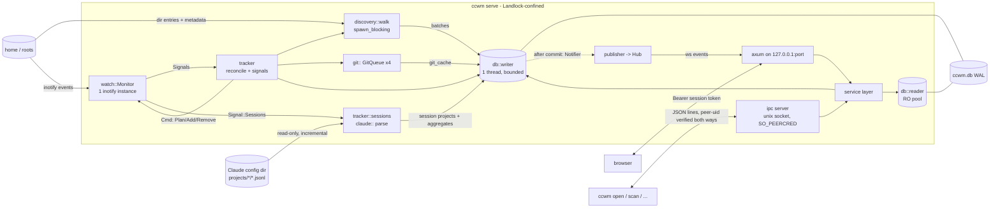

# ARCHITECTURE

Companion to `REQUIREMENTS.md` (the single source of truth, revision of 2026-11-23). Where this file and the
spec disagree, the spec wins. **Verified** = run on the development host; **Decision** = accepted by the
maintainer; **Open** = needs a decision. Nothing here is claimed to work until the milestone that builds it
has run it (see `ROADMAP.md`).

---

## 1. Verified environment (development host, 2026-11-23)

| Item | Observed |
|---|---|
| OS / kernel | Ubuntu 24.04.4 LTS, Linux 7.0.0-34-generic, x86_64 |
| Rust | rustc / cargo 1.94.0, clippy 0.1.94, rustfmt 1.8.0; targets include `x86_64-unknown-linux-musl` (installed by the maintainer) |
| git | 2.43.0 (Ubuntu `1:2.43.0-1ubuntu7.4`, which carries the CVE-2024-32465 backport and honors `GIT_NO_LAZY_FETCH`: verified by its "lazy fetching disabled" warning and no fetch child; upstream lists `--no-lazy-fetch` in the 2.45.0 release notes). `--attr-source` appears in the 2.41.0 release notes (and is in 2.43's man page) ⇒ **minimum 2.41.0**; hardened status verified only on 2.43.0 |
| claude | 2.1.331; `claude --help` lists `--resume <session-id>` |
| systemd | 255 (`systemctl --user` works); `Linger=no` |
| Landlock | `landlock` in `/sys/kernel/security/lsm`; ABI **8** (queried via `landlock_create_ruleset`) ⇒ filesystem + TCP rules available |
| `unshare -rn` | **fails** (`apparmor_restrict_unprivileged_userns=1`), as does `unshare --user --map-current-user --net` ⇒ test 5 is traced with **strace** (it has no namespace variant since the v0.1.0 fix pass, §13h) |
| strace / node | strace 6.8 (traces children; `kernel.yama.ptrace_scope=1` allows tracing our own children); node v22.22.0 (UI helper tests) |
| inotify | `max_user_watches=65536` ⇒ default budget 25 % = 16 384 (M2.1; was `min(8192, 25 %)`); `max_user_instances=128` with ≥109 already used by other processes ⇒ ccwm uses exactly one instance |
| Env | uid 1000; `XDG_RUNTIME_DIR=/run/user/1000`; other XDG vars unset; `CLAUDE_CONFIG_DIR` unset |
| Not installed | `musl-tools`; `cargo-deny` is not installed system-wide (M1.1 installs 0.21.0 into the ignored `target/tools/` to run it — 0.22 needs rustc 1.95) |

---

## 2. Module map

One package `cc-workspace-manager`, binary `ccwm`, plus `lib.rs` so integration tests can reach modules.
Modules appear in the milestone that needs them; none are pre-created empty.

```
src/
  main.rs         # parse args; refuse root; apply Landlock BEFORE any thread is spawned; build runtime; map errors -> exit codes
  lib.rs
  error.rs        # errors + exit codes (EXIT_OK 0, EXIT_ERROR 1; M4: EXIT_PORT_IN_USE 10, EXIT_ALREADY_RUNNING 11)
  cli.rs          # clap definitions (+ unofficial notice in --help)
  client.rs       # M1: `open` -> Unix-socket client (peer verification, JSON lines). No HTTP client.
  paths.rs        # M1: Dirs{config,data,state,runtime}; XDG + fallbacks; 0700 creation + owner/mode verification; home = owned `$HOME`, else passwd;
                  #     M1.1: session_dir (CLAUDE_CONFIG_DIR), Owner::verify_trusted (config file + every ancestor), runtime file-name constants
  config.rs       # M1: config.toml model (serde, deny_unknown_fields), defaults, validation
  clock.rs        # M1: Clock trait (System / Fake)
  sandbox.rs      # M1: Landlock policy, apply(), SandboxReport (what is actually active);
                  #     M1.1: scopes, single-thread check, thread probes, broad-read flags, child_command() (IPC env scrub)
  instance.rs     # M1: flock + instance.json
  db/             # M1: mod (open, pragmas, migrations), writer.rs (1 thread), reader.rs (RO pool), queries.rs
  discovery/      # M1: exclusions.rs, mounts.rs (/proc/self/mountinfo), walk.rs (own DFS), status.rs; M1.1: dirfd.rs (fd-based opens)
  auth/           # M1: tokens.rs (CSPRNG, SHA-256, ct-compare, Bootstrap store), sessions.rs
  service.rs      # M1: THE service layer: bootstrap, exchange, rotate, logout, revoke_all, list_projects, stats, discovery_status, service_status
  ipc/            # M1: server.rs (accept loop, SO_PEERCRED, JSON lines) + protocol.rs (Request/Response enums)
  http/           # M1: mod (router, state, serve loop), middleware.rs, extract.rs (ApiJson/ApiQuery/Bearer/SessionAuth), error.rs, routes.rs, assets.rs;
                  #     M1.1: peer.rs (TCP peer UID via /proc/net/tcp{,6})
  synth.rs        # M1: synthetic environment generator (feature `synth`; also used by tests)
  bin/ccwm-synth.rs   # M1: CLI for the generator (required-features = ["synth"])
  activity.rs     # M2: calendar-day buckets (jiff, system time zone), filter ranges, stats boundaries
  git/            # M2: mod.rs (Git: detect, allowlisted inspect), run.rs (timeout + process-group kill, bounded output), parse.rs
                  #     (porcelain v2 -z, config -z, log, version, remote-URL sanitizing). The ONLY module that spawns `git`.
  watch/          # M2: mod.rs (Monitor actor: one inotify instance, watch table, budget, polled mode, debounce, rename pairing,
                  #     meaningful-activity rules -> Signals), tree.rs (fd-based project-tree walk + in-process gitignore matcher)
  tracker/        # M2: mod.rs: reconciliation loop, missing/purge, enrollment (walk -> inferred activity -> Git -> move matching -> watches),
                  #     handling of the monitor's Signals, GitQueue (4 concurrent, one refresh per project, rerun-once);
                  #     M3: sessions.rs (session ingest: list -> incremental parse -> resolve cwd -> upsert projects -> store),
                  #     dev-root marker scans, stat-based missing/revive, live settings, `claude` CLI check
  events.rs       # M2: Notifier (bounded change queue), coalesced batches, Hub (broadcast of pre-serialized JSON), until_stopped
  view.rs         # M2: API/WS JSON shape of projects (display_path, activity status, git summary/detail, monitoring)
  http/ws.rs      # M2: GET /api/v1/ws
  claude/         # M3: the ONLY module that knows Claude Code's formats: locate.rs (top-level session files, fd-based),
                  #     record.rs (allowlisted serde structs, lenient fields), parse.rs (checkpoints + aggregates),
                  #     prompt.rs (genuine-prompt classifier, bounded on-demand reads), redact.rs, resume.rs (UUID, POSIX quoting),
                  #     cli.rs (`claude --version/--help`, cached by path+size+mtime)
  discovery/resolve.rs         # M3: session cwd -> project root, unassigned reasons
  systemd.rs      # M4: the user unit text, `systemctl --user` wrapper (found on PATH), unit write (trusted dir, atomic),
                  #     purge of ccwm's four directories, linger check; CLI-side only, never a daemon child
  doctor.rs       # M4: `ccwm doctor`: gathers (socket, /proc, git --version, bind test) + pure evaluations -> suggestions
  (privacy)                    # M3: no module of its own: `view::Privacy` omits fields on the server (view.rs, service.rs)
build.rs                       # M2-pre: CCWM_GIT_COMMIT = 12-hex HEAD (+ "-dirty"), or "unknown"; runs git on THIS repo at build time only
web/ index.html app.css app.js # embedded with include_str!
scripts/ inspect-session-schema.py   # §19: maintainer-run, structure-only
tests/ …                       # integration tests; tests/fixtures/** reviewed synthetic fixtures only
deny.toml                      # bans HTTP-client/DNS crates (§11.5); CI in M4, runnable locally once cargo-deny is installed
```

Hard rules: only `git/` spawns git; every daemon child is built with `sandbox::child_command`; only `claude/` knows session formats; only `db/writer.rs` writes SQLite;
no `rusqlite` call runs on a Tokio worker; every queue is bounded; HTTP handlers and Unix-socket ops call
`service.rs` — no business logic lives in a transport.

---

## 3. Data flow


The CLI never uses TCP and never reads a token file; the browser never reaches the socket.

### Start sequence (`ccwm serve`)
1. Refuse if `geteuid()==0`. `umask(0o077)`. Parse args/config path.
2. Resolve dirs (`paths.rs`); every **ancestor** must be trusted (`Owner::verify_trusted`: owned by the user or root, not writable by others except a root-owned sticky dir or the user's private group); create each `0700`; any existing dir must be owned by the euid and not group/world accessible, else fail (never silently `chmod` something we did not create).
3. Load `config.toml` (absent ⇒ defaults; present ⇒ the file and its ancestors must be trusted too); compute discovery roots (config or home) and the session dir (`CLAUDE_CONFIG_DIR` if absolute, else `~/.claude`). From here on the home directory is **canonical**, and the hard boundaries (ccwm's four directories, the session dir) are kept under their configured **and** canonical paths for discovery, the tracker and the watcher alike (v0.1.0 review L2).
4. **Apply Landlock now, on the main thread, before the Tokio runtime or any other thread exists** (`landlock_restrict_self` confines only the calling thread and its future children; threads created earlier would stay unconfined). `apply` counts `/proc/self/task` first: ≠ 1 ⇒ the report claims nothing. Flag broad read rules.
5. Build the Tokio runtime; probe a worker and a blocking-pool thread (read of `/` must fail with `EACCES`); log the `SandboxReport`. Take the `flock` (lock file in the runtime dir). Open SQLite (`temp_store=MEMORY` so no temp files are needed under the sandbox), migrate, spawn writer + reader pool.
6. Bind TCP `127.0.0.1:port` (failure ⇒ clear message naming the port, exit code 10; a held lock in step 5 ⇒ exit 11) and the Unix socket (remove a stale socket only if it is a socket we own; the lock proves no live daemon). **M4:** then, from the blocking pool, the write probe (`O_TMPFILE` in home) and the connect probe (`127.0.0.1:1`); then `sandbox::deny_new_sockets()` (seccomp, TSYNC: every existing thread, inherited by later ones and children); then socket probes on a worker and a blocking thread; then the report is logged (with a warning for anything `unverified`). **Everything that needs a socket or a socket pair exists before the filter:** before step 4 (still single-threaded, before Landlock limits binds), `http::peer::select_lookup()` opens the one `NETLINK_SOCK_DIAG` socket (`peer::SockDiag`, reused for every lookup, serialized, sequence-numbered) and self-tests it on an ephemeral loopback connection; the Tokio runtime creates its signal socket pair when it is built (step 5), and the SIGTERM/SIGINT handlers are registered right before the filter. After it, child processes are started only through `posix_spawn` (absolute program path, no `pre_exec`): the standard library's fork/exec fallback needs a `socketpair`.
7. Write `instance.json` (pid, port, version, started_at; atomic rename).
8. Detect `git` on `PATH` (version, hardened?); create the single inotify instance (failure ⇒ every project polled, reported); build Tracker, Monitor, Service; spawn the monitor, the reconciler (first scan immediately), the signal handler, the WebSocket publisher, the hourly session purge, and serve. Cached projects are readable immediately.
9. SIGTERM/SIGINT: stop accepting → cancel discovery → stop monitor/tracker/publisher → writer `Flush` + join → remove socket and `instance.json` → exit 0.

---

## 4. Dependencies (justification required by §3)

Spec-named: `axum` (`ws` from M2), `tokio`, `notify` (M2, `default-features = false`: inotify backend only), `rusqlite` (`bundled`), `serde`, `serde_json`, `clap`,
`tracing`, `tracing-subscriber`, `toml`, `ignore`, `landlock`. Approved by the maintainer: `nix`, `sha2`,
`subtle`, `getrandom`, `base64`, `jiff` (M2), `regex` (M3). **Rejected: `ureq`; all HTTP/DNS client crates are
banned (§11.5).**

| Crate | Why |
|---|---|
| `nix` (`dir`,`fs`,`user`,`process`,`signal`,`socket`) | `flock`, `geteuid`, passwd/group lookup, `umask`, `SO_PEERCRED` on the CLI side, `killpg` (M2); M1.1: `openat`/`openat2`/`fstatat`/`Dir` for the fd-based walk (`dir` feature: same crate) |
| `sha2`, `subtle`, `getrandom`, `base64` | token hashing, constant-time compare, OS CSPRNG, URL-safe token/cursor encoding |
| `landlock` | §11.5 sandbox |
| `hyper` (`server`,`http1`), `hyper-util` (`tokio`,`service`) — M1.1 | already in the tree through axum with exactly these features (no new crate): the serve loop needs hyper's http1 builder for the header-read timeout, which `axum::serve` does not expose |
| `ignore` (`gitignore` module only in M1) | user exclusion patterns with gitignore syntax; gitignore matching in M2 |
| `jiff` (M2, approved) | calendar days in the system time zone (DST-correct day boundaries) |
| `notify` 9 (M2) | the single inotify watcher; brings `inotify`, `inotify-sys` (ISC), `mio`, `walkdir`, `xxhash-rust` (BSL-1.0); `notify` itself is CC0-1.0 — licenses added to `deny.toml` (flagged for review) |
| `axum` `ws` (M2) | WebSocket upgrade; brings `tokio-tungstenite`/`tungstenite`, `sha1` 0.10, `base64` 0.22, `rand` 0.9 (`getrandom` 0.3). **axum enables `tokio-tungstenite`'s default `connect` feature** (a WebSocket client entry point): no extra crate, never called, TCP connect denied by Landlock; noted in SECURITY.md. Duplicate-version warnings (base64, digest/sha1 vs sha2, getrandom) are accepted (`multiple-versions = "warn"`) |
| `regex` 1.x (M3, approved; `default-features = false`, `std`, `perf`, `unicode-perl`, `unicode-case`) | secret redaction of titles and prompts (`claude/redact.rs`); `regex-automata`/`regex-syntax` were already in the tree through `ignore` |
| `seccompiler` 0.5 (M4; rust-vmm/Firecracker; Apache-2.0 OR BSD-3-Clause; `default-features = false`, only `libc`) | the §11.5 seccomp `socket()` filter. Builds a BPF program from a syscall → argument-condition map and installs it with `SECCOMP_FILTER_FLAG_TSYNC`; `unsafe_code = "forbid"` rules out doing the `prctl`/`seccomp` calls ourselves, and `libseccomp` would need the C library (no static musl build). Its arch check kills on a foreign architecture (i386 `int 0x80`); x32 numbers are denied explicitly |
| dev: `tempfile` | temp dirs/repos |

Not added: `ureq`/`reqwest`/any client; `rust-embed` (`include_str!` for three files); `tracing-journald`
(stderr under systemd reaches journald); `r2d2*`; `uuid` (strict validator hand-written, M3); `tower-http`
(few lines of middleware); `http-body-util` (axum re-exports what is needed). Integration tests speak
HTTP/1.1 over `std::net::TcpStream` with a ~60-line helper — no client crate, not even as a dev-dependency.

MSRV: `rust-version = "1.94"` — the only toolchain tested here; widen in M4 when CI can test older ones.

---

## 5. SQLite schema

Per connection: `foreign_keys=ON`, `busy_timeout=5000`; writer also `journal_mode=WAL`, `synchronous=NORMAL`,
`temp_store=MEMORY`, `secure_delete=ON` (M3.1: deleted content is overwritten, review L6). Readers open `SQLITE_OPEN_READ_ONLY`. Migrations are embedded `.sql` files applied in a
transaction each, bumping `PRAGMA user_version`; each milestone adds only the tables it uses. Timestamps are
Unix seconds (UTC). IDs are 128-bit CSPRNG hex (32 chars), opaque and validated.

### Migration 1 (M1)
```sql
CREATE TABLE meta (key TEXT PRIMARY KEY, value TEXT NOT NULL) WITHOUT ROWID;
CREATE TABLE projects (
  id TEXT PRIMARY KEY CHECK (length(id) = 32),
  canonical_path TEXT NOT NULL UNIQUE,
  name TEXT NOT NULL,
  first_seen_at INTEGER NOT NULL,
  last_seen_at INTEGER NOT NULL);
CREATE INDEX projects_name ON projects (name COLLATE NOCASE, id);
CREATE TABLE project_sources (
  project_id TEXT NOT NULL REFERENCES projects(id) ON DELETE CASCADE,
  source TEXT NOT NULL CHECK (source IN ('marker','session')),
  first_seen_at INTEGER NOT NULL,
  PRIMARY KEY (project_id, source)) WITHOUT ROWID;
CREATE TABLE auth_sessions (
  id TEXT PRIMARY KEY,                 -- stable across rotations; not the token
  token_hash BLOB NOT NULL UNIQUE,     -- SHA-256
  prev_token_hash BLOB UNIQUE, prev_valid_until INTEGER,   -- 60 s rotation grace
  created_at INTEGER NOT NULL, last_used_at INTEGER NOT NULL, rotated_at INTEGER NOT NULL,
  expires_at INTEGER NOT NULL);        -- sliding 30 days, bumped at most every 5 min
```
### Migration 2 (M1.1)
`projects.sort_key TEXT NOT NULL` (computed in Rust by `db::sort_key` = Unicode `to_lowercase`, backfilled
for existing rows by a Rust step inside the migration transaction); index `(sort_key, id)` replaces
`(lower(name), id)`; index `auth_sessions (last_used_at, created_at)` for the LRU cap. Keyset cursors
carry the stored `sort_key`, so SQL and Rust can never disagree (L8).

**Sessions (M1.1):** creating a session first purges expired ones, then keeps the 10 most recently used
(the new one always kept). `PurgeExpiredSessions` also clears previous-token hashes whose grace has ended.

### Migration 3 (M2)
`projects` + `marker_hash BLOB` (SHA-256 of ≤256 KiB of `CLAUDE.md`, move matching), `missing_since`,
`activity_at`, `activity_kind` (`inferred|observed`), `activity_path`; indexes `(activity_at, sort_key, id)`,
`(missing_since)`. `ignored_paths(canonical_path PK, ignored_at)`. `file_events(id, project_id → CASCADE, at,
kind ∈ create|modify|delete|rename, path)`, trimmed to `activity.events_per_project`. `git_cache(project_id PK →
CASCADE, fetched_at, state, branch, detached, upstream, ahead, behind, staged, modified, untracked, files JSON
(≤200 per list), head_commit/subject/author/time, remote_url sanitized)`; NULL counts = status not run.
Writer commands added: `RecordActivity` (never moves backwards; same second: observed may upgrade an inference
or name a newer file; `path = NULL` keeps the file), `StoreGit`, `MarkMissing`, `PurgeMissing`, `MoveProject`
(deletes a duplicate row already at the new path, keeps the id, moves the ignore entry), `SetIgnored`; `UpsertProjects`
now returns per-row `{id, inserted, revived}` and clears `missing_since`.

### Migration 4 (M3)
`sessions(id UUID PK, project_id → projects ON DELETE SET NULL, file_path UNIQUE, first_cwd, last_cwd, started_at
(min), last_activity_at (max), title (redacted ai-title), git_branch, version, entrypoint, continued_in, derived_from
JSON, is_sidechain (always 0), unassigned (reason), prompt_text, prompt_at)` — aggregates only; `prompt_text` is set
only while "Store prompt text" is on (redacted) and cleared whenever the session's aggregate changes.
`session_file_checkpoints(session_id PK → CASCADE, dev, ino, size, offset, mtime_ns, lines, malformed, oversized,
unknown, foreign_id)`. `projects` + `session_count`, `session_at` (maintained by the writer from `sessions` on every
change: sort `session`, filter `has_sessions`), index `(session_at, sort_key, id)`. No per-record table.
Writer commands added: `StoreSessions`, `AssignSessions`, `DeleteSessions`, `ClearSessionIndex`, `CachePrompt`
(best effort), `ClearPromptCache`, `Revive`.

### Migration 5 (M3.1)
`session_file_checkpoints.partial` (0/1): the file was read only up to its first cwd because that cwd can never
name a project (early stop, §7b). Writer changes: `Forget` (delete a **missing** project row; sessions → `SET
NULL`, resolved again at the next ingest); `CachePrompt` is a no-op unless `Writer::set_store_prompts(true)` — an
`AtomicBool` the writer thread reads **inside the transaction** (the service sets it from the config at start,
clears it before `ClearPromptCache`, sets it when the setting turns on); after a batch that contains
`ClearPromptCache` or `ClearSessionIndex` commits, the writer runs `PRAGMA wal_checkpoint(TRUNCATE)` before it
replies. v0.1.1: the pragma's result row is read (`busy = 1` means a reader blocked it; that is not an
SQL error); a truncation that did not happen is logged and stays owed, and the writer tries it again
after every later batch until it succeeds (`truncate_wal`). `session_counts` adds the top 10 `(reason, first_cwd, n)` of unassigned sessions.

### Parser version (M4)
`claude::parse::PARSER_VERSION` (2 = M3.1 rules; an M3 database has no entry) is compared with
`meta.session_parser_version` by `db::writer::reindex_if_parser_changed` when the writer opens the database:
a difference clears `sessions` + `session_file_checkpoints` (the `ClearSessionIndex` code, projects' session
counts recomputed) and records the version, in one transaction, then checkpoints the WAL. No schema change.

**Reader permits (M4):** `Reader::with` takes one of `POOL_SIZE` async permits **before** `spawn_blocking`, so
reads never park blocking-pool threads on the pool's condition variable (500 simultaneous Git refreshes did:
517 threads in the 500-project benchmark, 25 after the fix).

**Writer:** one `std::thread`, `sync_channel(1024)` of `WriteCmd` (`UpsertProjects`, `CreateSession`,
`RotateSession`, `DeleteSession`, `TouchSession`, `RevokeAll`, `SetMeta`, `Flush`, `Shutdown`); commands needing
an answer carry a `tokio::sync::oneshot::Sender`. Loop: block on one command, drain up to 256 more (or 50 ms),
apply in **one transaction**, answer. Events are published after commit. `TouchSession` is best-effort
(`try_send`, drop when full). **Reader pool:** 4 read-only connections behind `Mutex<Vec<_>>`+`Condvar`;
async facade is `spawn_blocking`.

---

## 6. Configuration (`config.toml`, read at startup only)

```toml
[server]
port = 8765                  # 1024..=65535; `--port 0` (ephemeral) is accepted for tests only
[discovery]
roots = []                   # empty ⇒ home (owned $HOME, else passwd)
exclude = []                 # extra gitignore-syntax patterns, relative to each root
max_depth = 10
same_file_system = true
```
`deny_unknown_fields`. Symlink-following is not configurable in v0.1 (never followed). M2 keys (all in
`config.example.toml`, which a unit test parses and compares with the defaults):
`discovery.scan_interval_secs` (600, 60–86400), `discovery.missing_retention_days` (30), `watch.budget` (0 = auto: 25 % of `max_user_watches`, 8192 if unreadable),
`watch.debounce_ms` (2000), `activity.inactive_after_days` (7), `activity.dormant_after_days` (30),
`activity.events_per_project` (200), `git.allow_unhardened_status` (false).
M3 keys: `discovery.full_scan` (false), `sessions.dir` (unset: `$CLAUDE_CONFIG_DIR`, else `~/.claude`; absolute),
`sessions.store_prompt_text` (false), `ui.default_view` (`cards`), `ui.theme` (`system`), `ui.privacy` (false).
`PUT /settings` accepts only the Settings page's keys (M3.1, review L7: `server.port`; `discovery.roots`, `exclude`,
`max_depth`, `same_file_system`, `scan_interval_secs`, `missing_retention_days`, `full_scan`; `watch.budget`;
`activity.inactive_after_days`, `dormant_after_days`; `sessions.dir`, `store_prompt_text`; `ui.*`), rejects port 0
and a `sessions.dir` that is `/`, contains `.`/`..` or is an ancestor of home, then — under one async lock held from
merge to apply (review M2) — merges the partial object into the saved file, validates the whole configuration, writes
`<config>.tmp` (0600, fsync) and renames it; the service keeps the config **as loaded from the file** (command-line
overrides such as `--port` are never written back). Live: scan interval, retention, `full_scan`, activity
thresholds, `store_prompt_text` (off ⇒ cached prompts deleted), `ui.*`; everything else is listed in
`restart_required` until the next start.

---

## 7. M1 discovery

Own iterative DFS (descriptor-based since M1.1, `discovery/dirfd.rs`) inside `spawn_blocking` (not `ignore::Walk`: it hides
`.git`, yields files interleaved with sub-directories — which makes "is my ancestor a project?" order-dependent —
and cannot compare exact entry names without extra work).

1. Roots: configured or home; each canonicalized; must be a readable directory; rejected if inside a hard boundary (`/proc /sys /dev /run`, ccwm config/data/state/**runtime**, and Claude Code's config directory — hidden or not, M1.1 L7). Bad roots are reported, never fatal.
2. Per directory: open it with `openat(parent_fd, name, O_DIRECTORY|O_NOFOLLOW)` and require `fstat` (dev, ino) to equal what the parent's listing showed (else `skipped.changed`); read entries from that descriptor; **marker** = an entry named exactly `CLAUDE.md` that is a regular file, or a symlink that `openat2(dir_fd, …, O_PATH, RESOLVE_BENEATH|RESOLVE_NO_MAGICLINKS)` resolves to a regular file (fallback without `openat2`: component-by-component `O_NOFOLLOW` walk, rejecting absolute targets, `..` and nested links); anything else is `rejected_markers`. No file contents are read in M1. Open descriptors are bounded by the depth (each directory's fd lives while its children are pending).
3. **Nested rule** (preorder, so ancestors are known): a marker directory B becomes a project unless a registered ancestor A exists and `symlink_metadata(B/.git)` is absent (then B's marker is "a nested instruction file of A"). The home directory itself is never registered.
4. Descend into subdirectories (real directories only; symlinks never followed) in name order **unless**: hidden (`.*`), default-excluded (`node_modules target build dist venv __pycache__ snap`[home only] `VirtualBox VMs`), user-excluded (gitignore patterns), a FUSE mount point (type `fuse*` from `/proc/self/mountinfo`), on another device (`same_file_system`), under a hard boundary, deeper than `max_depth`, or **not valid UTF-8** (counted). Pruning happens before descending.
5. Candidates stream to the writer in batches (≤64 or 250 ms), keyed by canonical path (existing rows keep their `id`). Counters (dirs visited, projects found, skipped: permission / vanished / excluded / non_utf8 / rejected_markers / changed / other) update `DiscoveryStatus`. Errors never abort the walk; user-visible samples show only `…/<last two components>`.
6. Phases `idle → scanning → idle`; `last_success_at` persisted in `meta`. M1 scans once at startup; vanished projects are **not** removed in M1 (missing state is M2).

---

## 7a. M2 activity tracking

**Actors.** `watch::Monitor` (one task) owns the notify watcher and the watch table; it never touches SQLite.
`tracker::Tracker` runs two tasks: the reconciler and the signal handler. `GitQueue` runs Git refreshes (≤4,
one per project, a request during a refresh schedules exactly one more). `Service::run_publisher` turns
`Notifier` changes (bounded queue, coalesced 200 ms) into WebSocket messages.

**Reconciliation** (startup, every `scan_interval_secs`, or on request; never overlapping; failures back off ×2 up
to 1 h): full discovery scan (batches upserted and published progressively) → projects not found are marked
missing, except under a root whose scan state is not `ok` → new/revived projects are enrolled → (startup) every
present project is walked and handed to the monitor as one **Plan**; (later) polled projects are walked for newer
mtimes and re-added, and *partly watched* projects are walked **only in their unwatched subtrees** (`walk_from` with
the project's ignore rules; `.git` is retried, never walked), their newest file recorded as inferred, then
`Cmd::Retry` tries those subtrees' watches again → purge of projects missing longer than the retention → `scans_finished += 1`.
`POST /refresh` returns `done_at_scans_finished` (current + 1, or + 2 while a scan runs).

**Enrollment** (new project, revived, un-ignored, `.gitignore` changed, renamed): fd-based tree walk
(`watch/tree.rs`: same exclusions as discovery, other projects' subtrees pruned, `.gitignore` +
`.git/info/exclude` layers when the project is in a Git work tree below home — since M2.1 also the
`info/exclude` and `.gitignore` files from a work-tree root *above* the project root, layers ranked by
depth — ≤100 000 entries, future mtimes
clamped to now; ignore files within the limits of REQUIREMENTS.md §5.2, see "Ignore rules" below) → newest file = *inferred* activity → Git inspection → for a newly inserted project while
missing projects exist: **move matching** (exactly one missing project with the same HEAD commit and the same
sanitized remote, or — without a commit — the same marker hash and no Git head; ambiguity ⇒ no match) ⇒ the old id
moves to the new path and the new row is deleted → Git cache stored → `Cmd::Add` to the monitor.

**Watch plan / budget (M2.1).** Budget = `max_user_watches/4` (no fixed ceiling; 8192 if the limit cannot be read)
or `watch.budget`. Allocation is **breadth first** over a plan (projects most-recent first): every project root,
then the parents of project roots (sibling detection, inside the configured roots only), then every project's
`.git` and depth-1 directories, then the deeper directories project by project (shallow first within a project).
The first limit hit (budget, kernel `ENOSPC`, no inotify instance) is remembered for the rest of the command, so
the kernel is not asked again; every directory refused is recorded as a **subtree root** (nothing below a
refused directory is tried). Monitoring per project: `watched` (nothing refused, tree complete), `partial` (root
watched, some subtrees refused, or the tree truncated: reason reported; reconciliation polls only the refused
subtrees, or the whole project when truncated), `polled` (root refused or no inotify instance: whole project).
`Cmd::Retry` re-watches refused subtrees when budget frees up; removing a refused subtree settles the project.
Directories created at runtime are walked with `walk_from` (project root, the project's ignore layers, depth
from the project root), so gitignored subdirectories of a new directory are never watched. Watches are
non-recursive and `IN_DONT_FOLLOW`; notify requests `IN_ONLYDIR` but retries without it on `ENOTDIR`, so the
backend checks that the path is still a directory after adding a watch and drops it otherwise (M2 review L2).

**Events → signals.** Paths are attributed to the innermost registered project (longest prefix). In a project:
`.git/…` (not `*.lock`) ⇒ Git refresh only; gitignored files and excluded directories ⇒ nothing; other changes ⇒
activity (debounced per project for `debounce_ms`; one `Activity` signal with the latest file, the events and a
Git-refresh flag); a new eligible directory is walked and watched and re-discovered (it may hold a nested project);
a new `CLAUDE.md` or `.git` in a subdirectory ⇒ re-discovery of that directory (subtree scan with the full-scan
rules and the caller-supplied nesting state); `.gitignore` changed ⇒ re-walk. On a project root (from its parent's
watch): removed ⇒ `Vanished` (missing at once), created ⇒ re-discovery. In a sibling-detection directory: a new
directory is watched one level deep and re-discovered; a new `CLAUDE.md` ⇒ re-discovery. Renames: notify reports
`From`, `To` and a paired `Both` with one cookie; halves wait 200 ms for their partner; `Both` touching project roots
⇒ `Moved` (ids kept if the new location still qualifies, else missing); unpaired halves ⇒ removal / creation.
`IN_Q_OVERFLOW` or our 8192-event queue full ⇒ `Rescan`: the next reconciliation walks every project and re-plans
all watches, then `OverflowRecovered`.

**Activity status and sorting.** `activity::Classifier` (system time zone via jiff; UTC fallback) computes the
status per row and the `[from, until)` ranges used by the `activity` filter and the stats, from the same day
boundaries. Sort keys: `k1` = negated time for "newest first", time for "oldest first", `i64::MAX` for unknown (last
in both orders), then `sort_key`, then `id`; the cursor carries `(k1, sort_key, id)`.

**Ignore rules (v0.1.1): `tree::RuleStore`**, one instance shared by the tracker's walks and the monitor.
`GitIgnore` is a list of `Arc<Layer>`, one per ignore file (its directory, its compiled rules, its size, its
rule lines, and the file's `FileId` = device, inode, size, modification time).

- *Limits per file and per project* are decided in `GitIgnore::load`, from the file's size and rule lines
  (counted before compiling). They count the files a walk left out for its allowance too
  (`Admission.denied_*`), so they decide the same way whatever the allowance is, and
  `Tree::ignore_rules_wanted` (what the project would keep under its own limits alone) does not depend on it.
- *Reuse (the rule cache).* The store keeps each project's rules of its last full walk. `begin(root, recency,
  at_most)` hands them to the next full walk (`TreeOptions::reuse`), and `load` takes over the layer of every
  file whose `FileId` is unchanged without reading the file; only changed and new files are compiled, and
  layers of files that are gone are not carried over. A subtree walk starts from the project's rules (a copy
  costs a pointer per file) and reuses them the same way. Location is part of the identity (the directory and
  whether it is `info/exclude`): compiled rules are relative to their directory, and hard links give several
  locations one inode. `retain` drops projects that are no longer monitored, rules included.
- *The limit across projects.* `begin` gives a full walk what the other projects leave of the limit (at most
  the project limit, at most `at_most`) and keeps that reserved until `settle`: all projects together never
  hold more than the limit, also when two are walked at once. A subtree walk asks for `room`.
- *By recency.* Who holds the rules when they do not fit is a function of the projects alone
  (`RuleStore::rebalance`): ordered by last activity (most recent first, unknown last, the path between
  equals), each project gets all it wants while it fits in what is left, the first that does not fit
  completely gets what is left, the ones after it nothing. `rebalance` returns the walks that get there:
  projects that hold more than their share first (least recent first), then projects that may hold more
  (most recent first), each with its allowance. `Tracker::rebalance_rules` runs them (`Cmd::Add` replaces the
  project in the monitor); it is called at the end of every reconciliation, after the signals that walk or
  remove projects, and after ignore/un-ignore, and returns at once unless some project lacks rules
  (`contended`). Walk batches go in the order of `tracked_projects` (recency first), so a start with known
  activity gets the shares right in the first pass.
- *No feedback from the allocation into the order.* A walk of a project that lacks rules cannot tell ignored
  files from meaningful ones; `Tracker::record_inferred` takes its newest file only for a project that has no
  activity yet. Without that rule a project that gave its rules up became "recent" through the files its
  rules used to hide and took the rules back from the next project (seen in `tests/tracker.rs`: the shares
  changed across a restart).

## 7b. M3 sessions and session-based discovery

**Ingest** (`tracker/sessions.rs`; serialized by a lock; at every reconciliation, before the marker scan, and on
`Signal::Sessions`): list `<config dir>/projects/*/` by descriptor (`claude::locate`; only `<uuid>.jsonl` regular
files are sessions, everything else is counted as skipped) → for each file, open with `O_NOFOLLOW`, compare
`(dev, ino, size, mtime)` with the checkpoint, parse from the stored offset (`claude::parse`: complete lines only,
8 MiB line cap, unknown/malformed/foreign counted; a new inode, a shrink or a same-size rewrite resets) → resolve
the first cwd of new and unassigned sessions (`discovery::resolve`) → upsert those roots as `session` projects →
store aggregates + checkpoints in batches of 256 (`StoreSessions`; assigned sessions keep their project) → re-assign
unparsed unassigned sessions whose resolution changed → delete sessions whose file is gone from a completely listed
directory (`DeleteSessions`; projects stay) → `Cmd::WatchSessions(projects/ + every listed dir)` → session status.

**M3.1 changes to the ingest.** One resolver `Context` per ingest (roots with exclusions, home, temp dirs, present
projects, `max_depth`, `same_file_system`). Listing → `locate::dedupe` (one file per id: the indexed file, else the
first by path; the rest counted as `duplicate_ids`; only lower-case UUID stems are sessions). Parsing an unassigned
session passes `Context::never_a_project` as the early-stop predicate (memoized per cwd): once the first cwd fails a
**static** check (`no_cwd`, `home`, `temporary`, `outside_roots`, `excluded`), reading stops and the checkpoint is
`partial`; appends then only update size/mtime; a partial checkpoint whose cwd no longer stops is parsed again from
byte 0, changed or not. Resolution is memoized per distinct cwd.
**Resolver** (`discovery/resolve.rs`): `locate` (the static checks, plus every component's `st_dev` against the root
with `same_file_system`, and `max_depth`) → nearest *anchored* directory (a `.git` entry or a `CLAUDE.md`) at or
above the cwd → nested rule repeated: a candidate without its own `.git` that is not registered moves to the nearest
ancestor that is a marker directory or a registered anchored project → no anchor: *session-only* candidate, which is
`container` if a registered project lies below it or `project_below` finds a `.git` or a marker below it (preorder by
descriptor, discovery's exclusions/depth/device rules, ≤ 2,000 directories, more = container). The tracker's marker
scans use only anchored present projects as `known`/`inside_project` (`Tracker::nesting_projects`), so a
session-only project never makes markers below it nested.

**Watches**: the monitor watches `projects/` and every `<encoded-dir>` non-recursively (`Owner::Sessions`, first in
the budget); a new `<encoded-dir>` gets a watch at once; changes are debounced (`watch.debounce_ms`) into
`Signal::Sessions(dirs)` (`projects/` in the list = everything). Without a watch, the next reconciliation ingests.

**Reconciliation order (M3)**: `claude` check (only if the binary changed) → session ingest → marker scan (full on
the first launch — meta `full_scan_done_at` absent — or with `discovery.full_scan`; otherwise the development roots,
`Scope::DevRoots`, each a `Subtree` with `max_rel_depth` 3, or 1 for a configured root / home) with the present
projects as `known` (nested rule) → missing = present project whose directory is gone (roots whose state is not
`ok` exempt) → revive missing projects whose directory is back → enroll new/revived → poll → purge.

**Privacy** is applied when building payloads (`view::Privacy`), never in the browser: list/detail/session views
omit their fields; status and settings JSON have path keys removed. Search in privacy mode ignores the path.

## 8. API and IPC contracts

### Connection handling (M1.1)
`http::serve` (hyper http1, not `axum::serve`): take one of 64 slots **before** `accept`; on accept,
look up the client socket's owner on the blocking pool — **M4:** one exact `sock_diag` request
(`SOCK_DIAG_BY_FAMILY`, `NLM_F_REQUEST` without `DUMP`, `inet_diag_req_v2` for the client's 4-tuple; the reply's
family, ports and addresses must equal the request, state not `LISTEN`/`TIME_WAIT`, `ENOENT` = not found), or,
when the startup self-test failed, `/proc/net/tcp{,6}` (row with local = client address, remote = our address;
v4-mapped v6 canonicalized; TIME_WAIT rows ignored; exactly one distinct owner required); serve only if it equals the daemon's euid, else close without reading (rejections
logged at most once a minute). Then hyper http1 with `header_read_timeout = 10 s` and upgrades.
Shutdown: stop accepting, `graceful_shutdown` every connection, wait at most 5 s.

### HTTP pipeline (every response, in this order)
1. **Security headers** (outermost, so error responses carry them): `X-Content-Type-Options: nosniff`, `Referrer-Policy: no-referrer`, `Cross-Origin-Opener-Policy: same-origin`, the §11.3 CSP; `Cache-Control: no-store` on `/api`.
2. **Host check**: exactly `127.0.0.1:<bound port>`, `localhost:<port>`, `[::1]:<port>` (case-insensitive) else `421 host_not_allowed`.
3. **Origin check** (`/api`): any `Origin` other than `http://127.0.0.1:<bound port>` ⇒ `403 origin_not_allowed`; POST/PUT/DELETE without `Origin` ⇒ 403 too. No CORS headers, ever; `OPTIONS` ⇒ 405.
4. **Auth** by route: `Public` (health, assets, `auth/exchange`) or `Session` (everything else). Tokens: SHA-256 → DB lookup → `subtle` compare of digests → expiry via `Clock`.
5. Bodies ≤ 16 KiB (`413 payload_too_large`) and complete within 10 s of the request head (`408 request_timeout`, then the connection is closed; v0.1.0 review L5); unknown query keys or bad values ⇒ `400 invalid_argument`.

Errors: `{"error":{"code":"…","message":"…"}}` — codes `invalid_argument 400`, `unauthorized 401`,
`origin_not_allowed 403`, `not_found 404`, `method_not_allowed 405`, `request_timeout 408`, `payload_too_large 413`,
`host_not_allowed 421`, `internal 500` (generic message; details only in logs, never content).

### Browser endpoints (M1)
| | | |
|---|---|---|
| `GET /health` | Public | `{"status":"ok","version":"0.1.1","commit":"<12 hex>[-dirty]"\|"unknown"}` — never proof of identity |
| `POST /auth/exchange` | Public + Origin | `{"bootstrap_token"}` → `{"session_token","expires_at","rotate_after"}`; bad/used/expired ⇒ identical 401 |
| `POST /auth/rotate` | Bearer (authenticated by the service; the only route an overdue token may use) | → new `session_token` (+ times); the old token stays valid 60 s |
| `POST /auth/logout` | Session | revokes the session → 204 |
| `GET /projects` | Session | `q` (name, path, branch), `sort` (`activity` default \| `name` \| `commit`), `order` (default `desc` for times, `asc` for names), `activity` (`all`\|`today`\|`week`\|`inactive`\|`dormant`\|`unknown`), `dirty`, `include_missing`, `include_ignored` (`1`\|`0`\|`true`\|`false`), `limit` 1–200 (default 50), `cursor` → `{"items":[project],"next_cursor","total"}`; `has_sessions`, `sort=session`, `privacy` are rejected until M3 |
| `GET /projects/{id}` | Session | project + `git_detail{head{hash,short,subject,author,time},remote_url,files{staged,modified,untracked}}`; malformed or unknown id ⇒ 404 |
| `PUT` / `DELETE /projects/{id}/ignore` | Session + Origin | ignore / un-ignore (by canonical path; idempotent) → the project |
| `POST /refresh` | Session + Origin | 202 `{"status":"accepted","done_at_scans_finished":n}` |
| `GET /ws` | Origin required; auth by first message | see below |
| `GET /stats` | Session | `{"total_projects","modified_today","modified_this_week","inactive","dormant","unknown_activity","uncommitted_changes","missing"}` over present, non-ignored projects (missing counted separately); `total_sessions` arrives in M3 |
| `GET /discovery/status` | Session | `{"phase","dirs_visited","projects_found","skipped":{…},"roots":[{"path","state"}],"last_success_at","next_scan_at"}` |
| `GET /service/status` | Session | M1 subset: `version`, `uptime_s`, `port`, `sandbox{abi,status,filesystem,network:"tcp_only"\|"none",abstract_unix_socket,signal,no_new_privs,threads_at_apply,thread_probes{worker,blocking},broad_read_rules[],unconfined[],unverified[],notes[]}` (`status`, `network` and `seccomp` can also be `"unverified"`; with `privacy=1`: `broad_read_rules: []`, `notes: []` and `notes_hidden: <count>`), `discovery{phase,last_success_at}` |

"Session" = a valid token whose rotation is not overdue (rotated within 24 h + 60 s).

**Project** (list items, events): `{"id","name","path","display_path" ("~/…" inside home),"sources",
"first_seen_at","activity":{"status","at","kind","path"},"git":null|{"state","branch","detached","upstream",
"ahead","behind","staged","modified","untracked","dirty","commit":{"subject","time"}|null,"checked_at"},
"missing_since","ignored","monitoring":"watched"|"partial"|"polled"|null,"monitoring_reason"}`; `activity` also
carries `days_ago` (M2.1: local calendar days from the same classifier as `status`, ≥ 0, `null` when unknown; the
UI's "N days ago" uses it). Git states: `ok`, `not_git`, `git_missing`, `unsafe_repository`,
`status_disabled_old_git`, `status_disabled_unsafe_config`, `partial_clone` (M2.1), `timeout`, `error`.
`/discovery/status` adds `scans_finished` and (M2.1) `unreadable[{path ("~/…"),reason}]` (first 50 folders counted
in `skipped.permission|vanished|changed|other`); `/service/status` adds `commit`, `discovery.next_scan_at`,
`monitoring{watcher,watches,budget,max_user_watches,watched_projects,partial_projects,polled_projects,overflows,
recovering_overflow,pending_projects,session_watches,ignore_files_skipped,degraded,advice[]}`, `git{program,version,hardened_status,
unhardened_status_allowed}`, `queues{git_in_flight,websocket_clients}`.

**WebSocket** (`/api/v1/ws`): exact Origin on upgrade (403 otherwise); client messages ≤ 4 KiB; first message
`{"type":"auth","token":…}` (unknown fields rejected) within 5 s else close 4401; then `{"type":"ready"}` and events
`project` (`{"project":…}`), `project_removed` (`{"id"}`), `stats`, `discovery`, `monitoring`, `resync` (a lagging
client, or lost changes: fetch a fresh snapshot). Revalidation on revocation (logout, revoke-all, hourly purge) and
every 10 s ⇒ 4401. The UI reconnects with back-off 1 s…30 s and refetches after every `ready`.
v0.1.1: the session's `select!` is `biased` — revocation, the periodic check, client messages, then events —
so nothing is forwarded once a revocation is signalled; every send (events, `ready`, the close frame) has
`ws::SEND_TIMEOUT` (5 s), after which the session ends.
M3: the auth message may carry `"privacy": true`; later `{"type":"privacy","on":bool}` switches the subscription.
The publisher builds each `project` and `discovery` event twice (full and privacy variant, `events::Msg`); each
client receives the variant of its subscription.

### M3 additions
- `GET /projects`: `sort=session` (latest session activity; unknown last in both orders), `has_sessions`, `privacy`;
  in privacy mode `q` matches name and branch only. Project objects add `sessions{count, latest{title (omitted in
  privacy mode), title_source ("ai_title"|null), last_activity_at}|null}`; `path`/`display_path` are omitted in
  privacy mode. `/stats` adds `total_sessions`.
- `GET /projects/{id}?privacy=1`: no `path`, `display_path`, `git_detail.head.author`, `git_detail.remote_url`.
- `GET /projects/{id}/sessions?limit=1..10&privacy=` → `{"items":[session],"total"}`; session = `{id, started_at,
  last_activity_at, duration_s, title, title_source, git_branch, version, first_cwd, last_cwd, cwd_changed,
  last_prompt{state: found|none|unreadable|hidden, text, truncated, at, whole_file}, first_prompt (only when
  untitled), resume{session_id, command, cwd, via_continuation, warnings[]}}`. Prompts are read from the session
  file at request time (4 MiB window, redacted, 2,000 characters) unless "Store prompt text" is on and a cached
  prompt exists. Warning codes: `claude_not_found`, `claude_unverified`, `resume_unsupported`, `cwd_missing`,
  `no_cwd`, `continuation_not_indexed`.
- `GET /settings?privacy=` → `{config, restart_required[], effective{roots, session_dir, config_path,
  default_exclusions, home_only_exclusions, hidden_excluded, max_depth, same_file_system}, ignored[{id, name,
  display_path}]}`; `PUT /settings` (Origin) with a partial config object → the same; 400 with the validation
  message otherwise. `POST /session-index/clear` (Origin) → `{"status":"cleared","projects_affected":n}`.
- `/discovery/status` adds `scope` (`full`|`dev_roots`), `dev_roots[]` and `sessions{state, files, indexed,
  skipped_entries, malformed_lines, oversized_lines, unknown_records, unassigned{reason: n}}`; with `privacy=1`
  without root/unreadable/dev-root paths. `/service/status` adds `claude{state (verified|not_found|failed|
  timed_out|no_resume), program, version, resume_supported}` and `monitoring.session_watches`; with `privacy=1`
  without program paths and broad read rules.

### M3.1 additions
- `GET /projects?missing_only=1` (missing projects only; `?2` of the filter SQL is 0 present / 1 both / 2 missing).
- `DELETE /projects/{id}` (Origin) → 204: forget a missing project; a present one → 400; unknown → 404.
- `PUT`/`DELETE /projects/{id}/ignore?privacy=` and `PUT /settings?privacy=` return the privacy variant.
- Session resume adds `continuation_cwd` (with `continuation_other_project` / `continuation_unassigned`) and the
  warning `cwd_unsafe_characters` (no `command`); `cwd`, `first_cwd`, `last_cwd` and `continuation_cwd` are shown
  through `resume::display` (escaped only when they hold control/bidi characters).
- `/discovery/status` `sessions` adds `duplicate_ids` and `unassigned_folders[{reason, folder ("~/…", escaped),
  sessions}]` (top 10; `folder` omitted with `privacy=1`); `unassigned` may hold `container`.

Keyset cursors: base64url JSON `{s,o,k,i}`; a cursor whose `s`/`o` differ from the request, or is malformed, ⇒ 400.

### Unix-socket protocol (CLI ↔ daemon)
Path `<runtime dir>/ccwm.sock` (runtime dir = `$XDG_RUNTIME_DIR/ccwm`, else `$XDG_STATE_HOME/ccwm/run`; `0700`,
owned by the user, verified; socket `0600`; path must be ≤ 107 bytes or startup fails). Per connection:
1. Daemon: `peer_cred().uid == geteuid()` else close silently (counted, logged without content).
2. Client, before sending anything: `getsockopt(SO_PEERCRED)` uid must equal its own `getuid()`.
3. One request line (≤ 4 KiB, 2 s read timeout) → one response line → close.

```
{"op":"ping"}                → {"ok":{"version":"0.1.1"}}
{"op":"auth.bootstrap"}      → {"ok":{"bootstrap_token":"…","expires_in":30,"port":8765}}
{"op":"auth.revoke_all"}     → {"ok":{"revoked":3}}
{"op":"service.status"}      → {"ok":{…same body as GET /service/status…}}
{"op":"scan.refresh"}        → {"ok":{"status":"accepted","done_at_scans_finished":n}}   (M2; `ccwm scan`)
{"op":"discovery.status"}    → {"ok":{…same body as GET /discovery/status…}}               (M2)
{"op":"ping"} also returns "commit"; `ccwm status` warns when it differs from the CLI's build.
errors                       → {"error":{"code":"…","message":"…"}}   (same codes as HTTP)
```
`ccwm open` uses `auth.bootstrap` only; the URL's port comes from the daemon, not from `instance.json` or a TCP
probe, so an impostor on the TCP port receives nothing. Bootstrap tokens live in memory only: 32 random bytes,
single-use, 30 s, ≤16 outstanding.

---

## 9. Sandbox (Landlock) policy

Built with the `landlock` crate in best-effort mode at the highest supported ABI; report what is **actually**
active (never what was requested).

| Access | Paths |
|---|---|
| read + execute | discovery roots; Claude session dir (`CLAUDE_CONFIG_DIR` or `~/.claude`); `/usr`, `/etc`, `/lib`, `/lib64`, `/bin`, `/sbin`, `/proc` (inotify limits, mountinfo, `net/tcp`). **Not** the `--config` file's directory (M1.1: the config is read before `apply`) |
| read + write (create/remove/truncate/make-sock) | ccwm config, data, state, runtime dirs |
| read + write file | `/dev/null` only |
| network (ABI ≥ 4) | all TCP `connect` denied; `bind` allowed only on the configured port — reported as `network: "tcp_only"` |
| scopes (ABI ≥ 6) | abstract Unix sockets and signals cannot reach processes outside the domain |
| **not confined by Landlock** | UDP and other non-TCP families; `connect()` on path-based Unix sockets (`ResolveUnix` exists only from ABI 9, not requested in v0.1); listed in `unconfined[]` **unless the seccomp filter is active**. `sandbox::child_command` drops `DBUS_*`, `XDG_RUNTIME_DIR`, `SSH_AUTH_SOCK`, display/agent/systemd IPC variables from every child's environment |
| seccomp (M4, after the listeners are bound, all threads) | `socket()` and `socketpair()` ⇒ `EPERM` for every family, no exception (the peer check's netlink socket is opened before the filter; v0.1.0 fix pass); `io_uring_setup/enter/register` and x32 `socket`/`socketpair`/`io_uring_setup` ⇒ `EPERM`; foreign architecture ⇒ kill. Reported as `seccomp: "socket_denied"` only if both socket probes (UDP, Unix, socket pair) saw `EPERM`; `"unverified"` if a probe failed otherwise without creating a socket |

`SandboxReport {abi, status, filesystem, network, abstract_unix_socket, signal, no_new_privs, threads_at_apply,
thread_probes{worker,blocking}, seccomp, daemon_probes{write,connect,socket_worker,socket_blocking},
broad_read_rules[], unconfined[], unverified[], notes[]}` goes to the startup log and `service.status` (which also carries
`peer_lookup`: `sock_diag` | `procfs`). Every protection is in exactly one of three places: claimed (its field),
`unconfined[]` (withdrawn or never applied) or `unverified[]` (applied, but its probe failed for an unexpected
reason: neither claimed nor withdrawn; the field then says `false` or `"unverified"`). `record_daemon_probes`:
write `allowed` ⇒ every claim withdrawn, connect `allowed` ⇒ `network: none`, any other outcome ⇒ `filesystem` /
`tcp` unverified. `record_seccomp`: claimed only with both socket probes `eperm`; a created socket ⇒
`not_applied`; otherwise unverified. If `/proc/self/task` ≠ 1 entry at `apply`, or a thread probe is `allowed`,
every claim is withdrawn (`not_enforced`); a thread probe that fails otherwise leaves every Landlock claim
unverified (`status: "unverified"`). A later disproof moves an unverified protection to `unconfined[]`. Child processes inherit the ruleset. Known consequences: roots added at
runtime (M3 settings) outside the startup read set cannot be read until restart — reported as "requires
restart" (**Open**, M3); `claude` located outside the allowed system paths cannot be executed (M3).
**Verified in tests (M1.1):** `tests/sandbox.rs` has its own `main` (`harness = false`, because libtest runs
tests on threads); its re-executed child applies the **real** `daemon_policy()` single-threaded and checks
errnos exactly: writes/reads outside ⇒ `EACCES`, TCP connect and binds to other ports ⇒ `EACCES`, abstract
Unix connect and signals to the parent ⇒ `EPERM`, a thread spawned later and grandchild processes are
confined, a path-based Unix connect outside **succeeds** (documented residual), a second thread at `apply`
time ⇒ `not_enforced`, and `child_command` children see no IPC variables. `tests/process.rs` checks the
real daemon's report (`fully_enforced`, `threads_at_apply = 1`, both thread probes `eacces`).
`CCWM_REQUIRE_LANDLOCK=1` turns "Landlock unavailable" into a failure. The Git-subprocess variant of test
11 (M2): the confined child runs plain Git with `protocol.allow=always` against a listener (`git ls-remote
git://127.0.0.1:…` ⇒ `EACCES`, the listener receives nothing) and `git init` outside (⇒ `EACCES`), and ccwm's hardened
`Git::inspect` of a repository in the read set succeeds (`ok`).

---

## 10. Test plan (M1) and the security acceptance tests

- **Unit:** exclusions & hard boundaries; mountinfo parsing (incl. `\040`); marker rules (case, dir named `CLAUDE.md`, symlink in/out/dangling/loop); nested resolution; non-UTF-8 skip; `max_depth`; symlinked dirs not followed; `same_file_system` (best effort: needs a second device; skipped with notice); paths (modes, ownership, 108-byte limit, fallback); config validation; migrations idempotent; writer batching/flush/back-pressure; token primitives; bootstrap (single-use, expiry via `FakeClock`); sessions (create, slide, rotate + grace, logout, revoke-all); cursor round-trip/forgery; peer-uid decision function.
- **HTTP via `tower::ServiceExt::oneshot`:** no/bad/expired/revoked token, wrong Host, wrong/`null`/`localhost` Origin, state-changing without Origin, header set on every response class (incl. 401/404/421), `OPTIONS` 405, oversized body, unknown query keys, traversal-looking paths and ids, error bodies free of secrets.
- **Process-level (real `ccwm` in a synthetic env, `--port 0`):** serve → `open --print` → exchange → list projects → rotate → logout; SIGTERM clean exit; restart serves cached projects before the new scan completes; second instance exits; **impostor**: with no daemon, a TCP listener on the would-be port receives **zero** connections from `ccwm open`; startup log and `service.status` show the sandbox report.
- **Security acceptance tests in M1 (strengthened in M1.1):** **1** (hash the whole synthetic tree incl. mtimes/modes before/after a full discovery; also with the XDG and Claude config dirs *inside* the walked home), **6** (no token, expired, revoked, wrong Origin, wrong Host, simulated Unix-socket peer-UID mismatch, simulated **TCP** peer-UID mismatch / unknown owner / failed lookup ⇒ connection closed unanswered, concurrent rotation, logout and revoke-all during the grace window, overdue rotation; cross-user check documented as manual), **7** (traversal and symlink escapes in project ids, static paths, markers; untrusted `--config` (world-writable, in a world-writable dir, symlinked there, FIFO), untrusted XDG dirs, non-hidden `CLAUDE_CONFIG_DIR`, and a concurrent directory↔symlink swap race during the walk), **9** (`tests/hygiene.rs`: every runtime file name from the `paths.rs` constants incl. `instance.json.tmp` and WAL/SHM, a real synthetic env generated inside the repo, sensitive patterns; skipped with notice if git is absent, **failure** if `CI` is set), **11** (above). Log check runs at `info` and at `CCWM_LOG=trace`. WAL/SHM modes `0600` asserted (unit and process level).
- `web/` grep test: no `innerHTML|outerHTML|insertAdjacentHTML|document.write|eval(|new Function`. `app.js` logic is exercised by `node --test` only if node exists (not a build requirement); otherwise documented manual steps.
- **M2 tests:** `tests/git.rs` (real repositories: states, upstream/remote, worktrees, unborn, home repo, timeouts via a stand-in, old-Git gate; acceptance **3** and **4** with control runs), `tests/watch.rs` (monitor with a recording fake backend: eligible-only non-recursive watches, budget/kernel/no-instance polled modes, debounce, ignore rules, nested attribution, rename pairing, overflow, live discovery), `tests/tracker.rs` (full stack with real inotify + Git: live activity, live registration, missing/revived, rename keeps the id, moves while stopped (marker hash, HEAD + remote), purge, Git refresh, ignore), `tests/db.rs` (activity, Git cache, filters, keyset with unknown-last, stats, moves), `tests/http.rs` (detail/ignore/refresh; WebSocket origin, 5 s auth timeout, bad first messages, nothing before auth, revocation/expiry/rotation-out/overdue ⇒ 4401; a valid token over a peer-UID-rejected connection), `tests/process.rs` (M2 acceptance over the real WebSocket; acceptance 1 + 3 with watching and `ccwm scan`; acceptance **5**), `tests/sandbox.rs` (test 11 Git variant), `tests/ui/app.test.js` (query building, view toggle keeps filters, prefs, relative time, Git summary, pagination, back-off). Tests that need an inotify instance hold a lock (this host has few left) and skip with a notice if none can be created, unless `CCWM_REQUIRE_INOTIFY=1`.
- All tests use temp dirs and synthetic data; none reads the real `$HOME` or `~/.claude`. Cargo itself runs with the normal environment, **never** under the synthetic `HOME` (`CARGO_HOME`/`RUSTUP_HOME` are not redirected; the synthetic env is applied only to spawned `ccwm` processes).
- **Synthetic environment generator** (`src/synth.rs`, `ccwm-synth <dir>`): creates `home/`, XDG dirs and `claude/` (`CLAUDE_CONFIG_DIR`) under the given dir (default a fresh `/tmp/ccwm-synth-XXXX`), populates projects (marker, symlinked marker, nested git/non-git, excluded dirs, symlink loop, non-UTF-8 name, deep tree, decoys like `claude.md`) and minimal synthetic session files, and prints the `env` line to use. Shared by tests and manual runs (DRY).
- **Schema inspection script** (`scripts/inspect-session-schema.py`): structure-only per §19; written and tested **only against synthetic data**; the maintainer runs it. Output: key paths + value types, values of an allowlisted set of low-cardinality discriminators (each value must match `^[A-Za-z0-9_.:-]{1,32}$` or is replaced by `<other>`), per-type record counts, file counts and directory-shape patterns (UUIDs → `<uuid>`); no other strings, no real paths.

---

## 11. Verified Claude Code session schema (structure only, via the §19 script; accepted by the maintainer)

First inspection 2026-11-23 (697 files); refreshed for M3 from the maintainer's run of
`scripts/inspect-session-schema.py` on 2026-11-24 (checked for leaks by the maintainer; the agent read only that
output, never a session file). Claude Code 2.1.217–2.1.331 (17 versions); **819** top-level session files (91,581
lines), 84 subagent files (28,340 lines); largest session file 76 MB; 0 malformed and 0 oversized lines; every
record's `sessionId` equals its file stem; 817/819 files have unordered timestamps (9 where the first is not the
minimum, 7 where the last is not the maximum); 8 files change cwd; 0 files without a cwd; one timestamp shape
(`YYYY-MM-DDTHH:MM:SS.mmmZ`). Claude Code prunes old sessions, so a project's latest session can disappear.

**Layout**
```
<config dir>/projects/<encoded-cwd>/<session-uuid>.jsonl                     # sessions
<config dir>/projects/<encoded-cwd>/<session-uuid>/subagents/agent-<id>.jsonl (+ <name>.json)   # ignored in v0.1
<config dir>/projects/<encoded-cwd>/<session-uuid>/tool-results/<name>.txt   # not sessions
<config dir>/projects/<encoded-cwd>/memory/<name>.md, .session-aliases      # not sessions
```
`<encoded-cwd>` is never decoded (a consistency check at most).

**Record types** (29): `agent-color`, `agent-name`, `ai-title`, `api-request`, `api-request-blob`,
`api-request-shape`, `artifact-autoreact-ledger`, `artifact-comment-monitor`, `assistant`, `atis-latch`,
`attachment`, `bridge-session`, `continued-in`, `cost-state`, `data-flow-records`, `derived-from`,
`file-history-delta`, `file-history-snapshot`, `fork-context-ref` (subagent files only), `frame-link`, `last-prompt`,
`mode`, `permission-mode`, `pr-link`, `queue-operation`, `session-owner`, `system`, `tools-used`, `user`. Unknown
types are skipped and counted. `cwd`, `uuid`, `parentUuid` exist only on `user|assistant|attachment|system`;
`timestamp` also on `api-request*`, `continued-in`, `file-history-delta`, `frame-link`, `pr-link`,
`queue-operation`; `ai-title` has **no** timestamp (title = latest in file order).
- `ai-title`: `aiTitle`. `continued-in`: `continuedInSessionId` (+ `timestamp`; 2 records). `derived-from`:
  `sessions[{id,type,via}]`, `v` (4 records; `type`/`via` values not inspected ⇒ stored, not used for resume).
- `user` discriminators: `promptSource` ∈ {`typed` 512, `queued` 20, `suggestion_accepted` 83, `sdk` 795, `system`
  278}; `turnOrigin` ∈ {`human`, `sdk`, `task_notification`}; `entrypoint` ∈ {`cli`, `sdk-ts`};
  `message.content[].type` ∈ {`text`, `image`, `tool_result`, `tool_use`, `thinking`, `tool_addition`}. 31 distinct
  user-record signatures (`isMeta`, `isSidechain`, `isCompactSummary`, `promptSource`, `turnOrigin`,
  `toolUseResult`, content kind); every one is a case in `claude::prompt` tests. Notably: `queued` +
  `<pasted_content>` (a paste ⇒ genuine), `promptSource` absent + `<command-name>` / `<local-command-*>` /
  `<bash-*>` (synthetic), `system` + `<task-notification>`, sidechain plain text (subagent prompts).
- Sensitive types and fields exist (`session-owner`/`bridge-session` account and organization UUIDs, `cost-state`,
  `api-request-blob` payloads, `toolUseResult`, `wireToolInputs`, `serverClassifierContext` with git state and
  cwds, `mcpMeta`): none is declared in ccwm's structs, so none is materialized.

**Decisions** (all in the spec): min/max timestamps over conversational records; first/last cwd in file order,
resume from the first; genuine prompts per §7.3; last prompt never from `last-prompt` (truncated ≈ 200 chars);
title = latest `ai-title`; resume follows `continued-in`; top-level files only.

**Fixtures:** `tests/fixtures/sessions/<version>/projects/…` (2.1.331 and 2.1.220), synthetic, generated once from
these shapes (see the README there); `synth::SESSION_FIXTURES` embeds them for `ccwm-synth` and the tests, with
`@HOME@` replaced by the synthetic home.

## 12. Git hardening — verified results (git 2.43.0)

Method: throw-away repos in the session scratchpad, `env -i` with only the §6 environment and flags, malicious
repo-local config whose command touches a sentinel file; a control run without mitigations proves the test can
detect execution.

| Vector | §6 base flags only | Control |
|---|---|---|
| `core.fsmonitor=<cmd>` | not executed | executed |
| `filter.<n>.clean` via `.gitattributes` | **executed** | executed |
| same via `.git/info/attributes` | **executed** | executed |
| `core.pager`, `diff.external` | not reached by `status`/`rev-parse`/`log -1` | — |
| promisor partial clone (`HEAD` object missing) + `ext::` / `file://`+`uploadpack` / `ssh://`+`core.sshCommand`, per-protocol `allow=always` in repo config (M2 review H1) | **executed** by `status` and `log -1` (lazy `git fetch` → transport) | executed |
| same, with `GIT_ALLOW_PROTOCOL=` only / `-c protocol.<name>.allow=never` only / `GIT_NO_LAZY_FETCH=1` only (M2.1) | not executed (each alone, all three vectors) | — |
| hooks | `status` runs none (maintainer decision: no hook test) | — |
| `filter.<n>.clean` under a driver name that is not valid UTF-8 (`ev\xFFil`, Latin-1 `caf\xE9`), selected by `.git/info/attributes` (v0.1.0 review H1) | with the §6 filter rules of M2–M4: **executed** (the lossy name got the override, the real driver ran) | executed |
| same, and 150 generated names of arbitrary bytes, with the fail-closed rule (v0.1.0 fix pass) | not executed: exact names are neutralized (`ok`), every other name disables status | executed where an attribute can select the name |

Verified mitigation (now §6 of the spec): `--attr-source=<empty tree>` stops worktree `.gitattributes` filters;
nulling every `filter.<name>.{clean,smudge,process}` (+ `required=false`) from **all scopes** stops
`info/attributes`-selected ones; neither alone suffices, together no sentinel appeared and status stayed correct.
**Minimum git: 2.41.0** (release notes); verified on 2.43.0 only; older ⇒ worktree status disabled
("status disabled: git too old to harden") unless `git.allow_unhardened_status = true`. Consequence to
document: git-lfs/`eol` repos can show different status than the user's own `git status`. Implementation is M2.

---

## 13. systemd user unit — verified (systemd 255)

**M4 (real daemon, synthetic env, transient user units via `systemd-run --user`):** with `Type=exec`,
`Restart=on-failure`, `RestartSec=5`, `RestartPreventExitStatus=10 11`, `TimeoutStopSec=10`, `UMask=0077`, `Nice=10`,
`IOSchedulingClass=idle`, `NoNewPrivileges`, `LockPersonality`, `RestrictRealtime`, `RestrictSUIDSGID`,
`RestrictNamespaces`, `SystemCallArchitectures=native` the daemon ran `fully_enforced` (Landlock ABI 8, seccomp
`socket_denied` on top of systemd's own filters, TSYNC fine), `ccwm status` worked, SIGTERM stopped it in 0.02 s.
With `ProtectSystem=strict` + `ProtectHome=read-only` (+ `ReadWritePaths`) and, separately, `PrivateTmp=yes`,
systemd 255 runs the user service in a user namespace: `/tmp` (and `/`, `/home`) appear owned by uid 65534, and
ccwm refuses to start ("/tmp is owned by uid 65534, not by you or root") — correct behaviour of the §11.3 trust
checks, so these directives are not used. `systemd-analyze --user verify` accepts the generated unit (its only
complaint: `%h/.local/bin/ccwm` absent in the real home). **v0.1.1, `MemoryMax=2G` + `MemorySwapMax=0`**
(transient user units, Ubuntu 24.04, systemd 255, the user manager has the `cpu memory pids` controllers):
(1) a plain process under `MemoryMax=64M` allocating 300 MiB **survived** (71 MiB resident, 246 MiB in swap;
`memory.swap.max = max`); with `MemorySwapMax=0` added it ended with result `oom-kill`. Hence both directives.
(2) The static release binary with every directive of the unit: `memory.max = 2147483648`,
`memory.swap.max = 0` in the unit's cgroup, `fully_enforced`, seccomp `socket_denied`, the (fake) `claude`
check verified, `ccwm status` works, `systemctl --user stop` ⇒ clean shutdown in 0.01 s. (3) The same binary
with `MemoryMax=200M` and four projects of 5,000 expensive ignore rules each (about 390 MiB): `oom-kill`
about 2 s after each start, `auto-restart`, restarted after 5 s, again and again (`NRestarts` 0, 1, 2 within
22 s) until stopped. (4) The same content under `MemoryMax=2G`: runs, `memory.current` 384 MiB, peak 389 MiB,
no swap, no restart. Earlier (M1) acceptance list:
Accepted in a transient user unit: `NoNewPrivileges`, `Nice`, `IOSchedulingClass=idle`, `UMask`, `PrivateTmp`,
`ProtectSystem=strict`, `ProtectHome=read-only`, `ProtectKernelTunables`, `RestrictNamespaces`,
`RestrictAddressFamilies`, `MemoryDenyWriteExecute`, `LockPersonality`, `SystemCallArchitectures`,
`ProtectProc=invisible`, `SystemCallFilter=@system-service`. **Rejected: `PrivateDevices=yes`.** Per the spec,
Landlock is the primary enforcement; the extras are optional defense in depth, added in M4 only after the real
daemon is tested under them (`ReadWritePaths=` for ccwm's dirs). `Type=exec`; port-in-use and lock-held exit
codes go in `RestartPreventExitStatus=`.

---

## 13a. M1 verification notes (what was actually run)

- Landlock on this host (Linux 7.0, ABI 8): `tests/sandbox.rs` re-executes the test binary, applies the policy, and verifies that writes outside the allowed directories, reads outside the allowed paths, outbound TCP connects and binds to other ports are denied — for the process **and** for `/bin/sh`/`/bin/bash` children — while writes in ccwm's directories, `/dev/null`, Unix-socket binding and the allowed TCP port work. A real daemon run reported `fully_enforced abi=8 filesystem=true network=true` and `NoNewPrivs: 1`. `--port 0` needs an explicit `NetPort(0)` rule (granted automatically because the configured port is 0).
- `hyper`/`hyper-util` are in the tree only with their `server` features (checked with `cargo tree -e features`); no client crates. M1.1: `cargo deny check` run (see §13b).
- The UI was exercised with a Node DOM stub against a live synthetic daemon (fragment removal, exchange, listing, session storage). It has **not** been viewed in a real browser (extension not connected).
- Sign-in links printed by `ccwm open --print` contain the single-use token by design; the log never does (asserted).

## 13b. M1.1 verification notes (what was actually run)

- Real daemon in a synthetic env (Linux 7.0, ABI 8): `landlock fully_enforced: abi=8 filesystem=true network=tcp_only abstract_unix_socket=true signal=true threads_at_apply=1 probes=eacces/eacces unconfined=udp,unix_socket_connect_by_path`.
- Race test (`tests/discovery.rs`): 8 directories swapped with symlinks by `renameat2(RENAME_EXCHANGE)` during 3,000 scans — ~100 k swaps, ~9 k swaps caught inside the list→open window (`skipped.changed`), the outside target never entered. Mutation check: with `O_NOFOLLOW` and the identity check removed, the test failed in 5/5 runs.
- `cargo deny check` (cargo-deny 0.21.0, installed into `target/tools/`): see the M1.1 report in `ROADMAP.md`.

## 13c. M2 verification notes (what was actually run, 2026-11-24)

- Pre-M2 test 5: **strace variant** (strace 6.8): daemon + Git children traced through discovery, live edits, Git
  refreshes, a new project and a socket-triggered reconciliation; every `connect()` was a Unix socket or loopback,
  Git execs present in the trace. The network-namespace variant has **not run anywhere** (AppArmor blocks it here).
- Real daemon in a synthetic environment (30 bulk projects, real Git repos from `ccwm-synth`): `landlock
  fully_enforced abi=8`, `git 2.43.0 hardened_status=true`, 48 watches for 38 projects, `ccwm status`/`ccwm scan`.
- **Real browser** (Chrome via the extension, against the synthetic daemon): sign-in, cards with uniform heights and
  left-ellipsized `~/…` paths, table view, an edited project moved to the top and a new `CLAUDE.md` project appeared
  without reload, daemon stop ⇒ "disconnected" banner, restart ⇒ reconnect and fresh snapshot. No console errors.
- Process tests: M2 acceptance over the real WebSocket; acceptance 1 + 3 with watching, Git and two `ccwm scan`s:
  the monitored tree (incl. every `.git`) and the Claude directory unchanged with mtimes/modes.
- Found and fixed while testing: rename of a project root built `…/name/` (trailing slash) and marked it missing;
  `ccwm scan` compared one-second timestamps and could wait 10 min (now `scans_finished`); same-second inferred
  updates could downgrade an observation; `log.showSignature` + `gpg.program` executed during `log -1` (control
  run) ⇒ `--no-show-signature`; filter names with `=` could not be nulled ⇒ fail closed.

## 13d. M2.1 verification notes (what was actually run, 2026-11-24)

- H1 reproduced in a scratch directory with ccwm's exact flags and environment: all three promisor vectors
  executed their helper; each of the three transport blocks alone stopped all three (`tests/git.rs`
  `each_transport_block_alone_stops_the_promisor_vectors`). Mutation checks: removing the blocks makes acceptance
  test 4 fail; removing only `GIT_NO_LAZY_FETCH` makes test 5 fail (two `fetch` execs outside the allowlist).
- Test 5 (strace variant): 52 execs traced, all allowlisted; 3 promisor projects, zero fetch children, state
  `partial_clone` over the API. `strace -s 256` so long Git argument lists are not abbreviated.
- L2: with the directory check removed, `notify` watched a regular file (`watch(file) == Ok`); test in
  `tests/tracker.rs` (real inotify).
- Real daemon in a synthetic environment with `watch.budget = 40`: `ccwm status` printed "34 watched, 4 partly
  watched, 0 polled" and the unreadable folder; a `ccwm status` started before the daemon waited and succeeded.
  Real browser (Chrome extension, synthetic daemon): one-line degraded banner with a details toggle, "1 folder
  could not be read" with the path in the tooltip, one-line non-Git cards, "partly watched" badges, a long path
  shown as `…/internal-services/backend-api-gateway`; no console errors.

## 13e. M3 verification notes (what was actually run, 2026-11-24)

- `cargo test` with `CCWM_REQUIRE_LANDLOCK=1 CCWM_REQUIRE_INOTIFY=1`; real daemon in a synthetic environment
  (30 bulk projects, real Git repositories, the fixture corpus, a fake `claude` on `PATH` in `~/.local/bin`):
  `claude: verified`, `sessions: ok (7 files, 7 indexed; not in a project: 1 home, 1 nonexistent)`, first launch
  `marker scan: every root`, second launch `development roots ~/dev, ~/dev/beta/packages`.
- Real browser (Chrome extension, synthetic daemon): table with the session column, detail panel (AI title label,
  start/last activity/duration, last prompt read on demand, resume command, Copy → "Copied"), Esc closes it;
  privacy toggle: paths, title, prompt and command hidden, and the page's HTML holds no home path, title or
  prompt; Settings page with the plain-language scope, a rejected scan interval shows the server's message;
  cards with "Has sessions": the session-only project with only the `session` badge. No console errors.
- Found while testing: the daemon passed its `--port`-overridden config to Settings, so saving would have written
  the override into `config.toml` (fixed: the service keeps the file's config; process test asserts it).
- Test 5 (strace variant) now includes the session cycle and the `claude` check: 2 `claude` execs
  (`--version`, `--help`), all other execs allowlisted Git, no non-loopback connect.

## 13f. M3.1 verification notes (what was actually run, 2026-11-24)

- `cargo test` with `CCWM_REQUIRE_LANDLOCK=1 CCWM_REQUIRE_INOTIFY=1`, fmt, clippy `-D warnings`, `cargo deny check`;
  `git status --ignored` identical before and after the full test run (no files in the working tree).
- Mutation checks: with the writer's prompt guard disabled the in-flight test fails (a prompt is cached after the
  setting turned off); without `secure_delete` the clear-index byte scan fails; without the WAL checkpoint both byte
  scans fail. The pty test's control runs (the pre-M3.1 command with Ctrl-U + newline, and with an embedded
  `ESC[201~` under bracketed paste) execute their sentinel in `bash` 5.2.21, so the harness is not blind.
- Real daemon in a synthetic environment (12 bulk projects, a fake `claude`, a session started in `~/dev`, one whose
  cwd holds `\x15`, a deleted project): `ccwm status` printed `3 not in a project` broken down as `1 container
  (~/dev)`, `1 home (~)`, `1 nonexistent (~/dev/deleted-project)`. Real browser (Chrome extension): "sessions in
  projects", the `≈` inferred marker with its tooltip, table "—" for a missing commit, "Missing only" listing the
  deleted project, a two-click Forget removing it, the actions column on one line in all 21 rows (no clipping, no
  horizontal scroll at 1230 px, also with "Confirm forget"), the detail panel's escaped cwd with the
  `cwd_unsafe_characters` text and no command, a Settings save sending `{"server":{"port":8777}}` only and saying
  "Saved; takes effect after ccwm restart: port.", a resave saying "Nothing changed."; no console errors; no prompt
  text in the daemon log.
- **Landlock and `/proc` (the deferred "Claude running" indicator):** a process that applied ccwm's daemon policy
  (ABI 8, `/proc` in the read set) reading an unrelated process started before it: `readlink /proc/<pid>/cwd` and
  `/exe` → `EACCES`; `/proc/<pid>/cmdline` and `status` readable; `stat` shortened. See §14.

## 13g. M4 verification notes (what was actually run, 2026-11-24)

- `cargo test` with `CCWM_REQUIRE_LANDLOCK=1 CCWM_REQUIRE_INOTIFY=1`, fmt, clippy `-D warnings`, `cargo deny check`.
- Seccomp (`tests/sandbox.rs`, harness-less child applying the real policy, then the filter): a thread created
  **before** the filter, threads after it, the main thread and grandchildren get `EPERM` for UDP and Unix sockets;
  path-based Unix connect (Landlock's residual) ⇒ `EPERM`; `NETLINK_ROUTE` ⇒ `EPERM`; a `sock_diag` lookup of a
  pre-existing connection still works; `socketpair` and exec still work. Daemon-level probes: `O_TMPFILE` outside
  ⇒ `EACCES` (Landlock covers `O_TMPFILE`), inside ⇒ allowed; connect ⇒ `EACCES`.
- Real daemon (`tests/process.rs`, every test under the filter, incl. test 5 under strace): report
  `daemon_probes=write:eacces,connect:eacces,socket:eperm/eperm seccomp=socket_denied unconfined=` and
  `peer_lookup: sock_diag`.
- `sock_diag`: unit tests on hand-built replies (foreign tuple, our own end, `TIME_WAIT`, `LISTEN`, another
  sequence, `ENOENT`, `ENOMEM`, truncated, ambiguous) and a real loopback connection whose lookup equals procfs's.
- Service management end to end (`tests/service.rs`) with a stand-in `systemctl` that really starts and stops
  `~/.local/bin/ccwm`: install.sh (twice: idempotent, restarts an active service), start/stop/restart, status,
  doctor, revoke-all, uninstall.sh (data kept), `--purge` answered "no" (nothing deleted) and "yes"; tests 2 and
  10 snapshots unchanged after the purge.
- Benchmarks: [docs/benchmarks.md](docs/benchmarks.md) (`scripts/bench.py`, release build, synthetic data); they
  found the reader's blocking-thread growth (§5).
- Release engineering (CI not run — nothing pushed): workflows linted with actionlint 1.7.12; musl static build,
  strip, `--version`, a synthetic smoke test, cargo-about 0.9.3 (`--frozen --fail`) and `package-release.sh`
  (`sha256sum -c`, reproducible) run locally; gitleaks 8.30.1 over the history: no leaks after reviewing 14
  synthetic findings.

## 13h. v0.1.0 fix pass verification notes (what was actually run, 2026-11-25)

Fixes for the v0.1.0 pre-release security review (docs/reviews/v0.1.0-security-review.md) and the items carried
over from M4. Host as in §1 (Linux 7.0, Landlock ABI 8, git 2.43.0, rustc 1.94.0).

- **H1:** `tests/git.rs` runs 165 driver names (the review's two, hand-picked edge cases, 150 generated from
  arbitrary bytes) through `Git::inspect`, each with a plain-`git status` control: no sentinel; exact names ⇒ `ok`,
  all others ⇒ `status_disabled_unsafe_config`. With the old lossy decode the test fails on `ev\xFFil` ("the
  malicious command was executed"): checked by putting the old code back once.
- **Seccomp (M1 + carried over):** `tests/sandbox.rs` child under Landlock, then the filter: a datagram socket
  pair sends to a path-based datagram socket outside the sandbox **before** the filter (control; the datagram
  arrives), and `socketpair` (stream and datagram, also from a grandchild), a new `NETLINK_SOCK_DIAG` socket,
  `io_uring_setup` and the x32 `socket`/`socketpair`/`io_uring_setup` entry points all get `EPERM` after it
  (raw system calls through a `python3`/ctypes child, with controls before the filter); the netlink socket
  opened before the filter still answers; `Git::inspect` still returns `ok` (posix_spawn). The whole
  `tests/process.rs` suite runs under the filter: SIGTERM ⇒ exit 0 in every test that stops a daemon.
  The static musl binary was smoke-tested in a synthetic environment: `fully_enforced`, `seccomp=socket_denied`,
  Git states `ok`, the (fake) `claude` check `verified`, SIGTERM ⇒ clean shutdown.
- **Unverified probes:** unit tests of every transition (`sandbox.rs`), and of the `ccwm status` / `ccwm doctor`
  rendering. No real host here produces an unexpected probe failure, so the daemon-level path was not observed.
- **M2:** measured with a release build (`ignore` 0.4): a rule that needs a regular expression (`*1?b[c-d]*.x`)
  costs about 15 KiB of resident memory and 0.25 ms to compile, linearly (1,000 rules: 15 MiB, 0.2 s; 5,000:
  73 MiB, 1.2 s; 20,000: 315 MiB, 5 s; 1 MiB of such rules: 920 MiB, 15.5 s); literal rules cost almost
  nothing. Hence the rule limit next to the byte limits. `tests/process.rs` starts the real daemon on the
  review's repository shape (12 hard-linked 1 MiB `.gitignore` files, the same file as `info/exclude`, and a
  root `.gitignore` of 5,001 rules): 14 files skipped and reported, resident memory under 200 MiB (debug build),
  SIGTERM ⇒ exit 0.
- **L2:** process test with `XDG_DATA_HOME` reached through a symlink into project `alpha`: the latest file stays
  a fixture file and the activity `inferred`; without the canonical boundaries the same test shows
  `observed`, `store/ccwm/ccwm.db-wal` (checked once).
- **L5:** socket test: a complete head with `Content-Length: 100` and no body ⇒ `408` and a closed connection
  after the timeout, for `/auth/exchange` and an authenticated `PUT /settings`.
- **EPIPE:** `ccwm status|doctor|scan|open --print|auth revoke-all` with stdout's read end already closed: exit
  0, nothing on stderr; before the fix: `thread 'main' panicked` from `println!`.
- **UI:** table view and Activity column checked in Chrome against a synthetic daemon: `main` spans the window
  (`max-width: none`), the Activity column stays 6.5rem and "Inactive" is not truncated at table widths from
  1350 px down to 430 px. Not checked in Firefox.
- **Test 5:** strace only (its namespace variant was removed, see REQUIREMENTS.md §16). CI workflows linted with
  actionlint 1.7.12; **CI itself has still not run** (nothing pushed).
- **Not done:** `Clear-Site-Data` (evaluated from MDN's compatibility data only, no browser test; SECURITY.md);
  POSIX ACLs in the trust check (documented; needs an xattr read, i.e. a new dependency); review items I3
  (WebSocket send timeout and `biased` select), I7 (check the `wal_checkpoint` result), I8 (session-file cap marks
  a directory complete), the stricter `PUT /settings` checks of I6, and the review's other test-coverage gaps.
- A flaky test was fixed on the way: a stand-in `git` script written and executed while another test thread
  forked failed with `ETXTBSY` (seen as `GitMissing`, about one run in ten once the fuzz test added a thousand
  process spawns to that binary); scripts in `tests/git.rs` are now written by a child shell
  (`common::write_executable`): 80 consecutive runs of the binary passed.

## 13i. v0.1.1 verification notes (what was actually run, 2026-11-26)

A maintenance release: the items of ROADMAP.md "v0.1.1". Host as in §1 (Linux 7.0, Landlock ABI 8, git 2.43.0,
rustc 1.94.0, systemd 255).

- **Session titles (UI):** `tests/ui/app.test.js` (`sessionParts`, `sessionSummary`). In Chrome against a
  synthetic daemon with a session titled "Resuming the previous session": cards and table rows show the title
  in quotation marks and italics (`font-style: italic` computed), the line's tooltip starts with
  "Session title:", the same words are there for screen readers (`.sr-only`), and privacy mode shows no
  quotation. Not checked in Firefox.
- **Limit on ignore rules across projects, by recency:** unit tests of `RuleStore`: the hard limit (also with
  eight walks beginning at once), the shares as a function of recency, path and wanted rules (the same result
  for four different walk orders; unknown recency last; a project being walked is left alone), and
  `rebalance` giving up before taking with the total within the limit at every step. `tests/tracker.rs` with
  the real tracker and monitor, room for eight rules and three projects of four whose names sort opposite to
  their recency: the two most recent hold the rules after the first start (when no activity is known before
  the walks), a file their rules name is activity only in the project without rules, that project then gets
  the rules at the next scan and the least recent one gives them up without its activity moving, and a
  restart finds the same shares. `tests/process.rs` with the real daemon and the real limits: six projects
  of 5,000 rules, two files skipped and reported, every project listed.
- **Rule cache:** unit tests: a later walk shares the layer (`Arc::ptr_eq`) of every unchanged file and
  compiles only a changed, new or replaced one; size, time and inode each count as a change, a rewrite that
  changes none of them is not seen (pinned as the documented limit); hard links have rules per directory;
  reused rules meet the same limits as fresh ones for six allowances. `tests/process.rs`
  (`repeated_scans_…`): four polled projects of 400 rules that need a regular expression, twelve scans,
  resident memory may grow by 4 MiB at most; **passes for the glibc target and for
  `x86_64-unknown-linux-musl`** (`cargo test --target x86_64-unknown-linux-musl --test process
  repeated_scans`); with reuse switched off it fails (99 MiB → 244 MiB, glibc; checked once).
- **Memory, measured** (`scripts/bench.py --only ignore`, release builds, docs/benchmarks.md): 20,000 rules
  that need a regular expression: 343.7 MiB kept in the glibc build, 391.4 MiB (peak 394.8) with the static
  musl release binary. With every project polled (a watch budget of 1), ten more scans: glibc 343.8 →
  344.7 MiB, musl 380.6 → 380.7 MiB, 0.1 s per scan. Before the cache (the first v0.1.1
  commit): each such scan took 5–6 s; musl peaked at 775 MiB and returned to 395 MiB; glibc held 672, 1,002,
  1,332, 1,661 MiB after scans 1 to 4, and with 3,000 rules reached 633 MiB after 30 scans.
- **`MemoryMax=`:** see §13.
- **I3:** `tests/http.rs`: a sign-out and an event made ready at the same instant (one runtime thread, no
  await between them), 16 rounds: the close frame 4401 comes first every time; a client that stops reading
  while 24 MiB are published and is then signed out: its session ends within the send timeout. With the old
  loop (unordered `select!`, no timeout) both fail: an event arrives first in round 1, and the stalled
  session never ends (checked by putting the old code back once).
- **I7:** unit test in `db/writer.rs`: a second connection holds a read transaction, the checkpoint returns
  `busy = 1`, `truncate_wal` reports failure, the truncation stays owed across batches and happens (WAL 0
  bytes) once the reader commits.
- **I8:** unit tests: a listing cut off at a (lowered) limit is marked; `gone_files` returns nothing for it,
  and the same listing without the mark would drop a session (control).
- **I6:** `tests/sessions_api.rs`: `/`, `/home`, a list containing `/`, a symlink to `/` and `..` paths are
  refused as roots, home and `/home` as the session directory; home as a root and roots elsewhere are saved.
- **Test-coverage gaps 4–8:** purge with ccwm's directories inside home next to other applications' data;
  purge refused while a daemon outside systemd holds the lock (and done once it stopped); canaries for the
  discovery roots, unreadable folders, development roots, the configuration path and `git.program`, with a
  control without privacy mode, also for live updates; every directive of the unit pinned as a literal;
  skips that fail in CI; `same_file_system` in both walks across the `/dev` → `/dev/shm` boundary (each
  device check removed once: the test fails); the swap race asserts that a swap raced; the child-environment
  test sets `XDG_RUNTIME_DIR` itself; a secret across the truncation point; `package-release.sh`,
  `sha256sum -c`, reproducibility, the archive's file list and modes, and `install.sh` run from the extracted
  archive without an argument (with a stand-in binary; the real musl build is not part of the test).
- **Script writes:** `synth::write_executable` (a child shell writes the file) is now the only way a test
  writes a script it runs at once; `tests/common` re-exports it.
- **Checks:** `cargo fmt --check`, `cargo clippy --all-targets --all-features -- -D warnings`,
  `CCWM_REQUIRE_LANDLOCK=1 CCWM_REQUIRE_LANDLOCK_ABI=8 CCWM_REQUIRE_INOTIFY=1 cargo test`, `cargo deny check`,
  gitleaks, actionlint on the workflows, shellcheck on the scripts. **CI has not run on this commit** (nothing
  pushed).

## 14. Decisions log and remaining open items

Decided (2026-11-23): Git fix accepted (min 2.41.0, disabled-by-default fallback + opt-in); all schema findings
accepted; `~/.cargo` cache allowed, synthetic HOME for every `ccwm` run, cargo never under the synthetic HOME;
musl target/`musl-tools`/`cargo-deny` installed by the maintainer; `POST /auth/rotate` with 60 s grace; polling
in M1, WebSocket in M2; top-level session files only, aggregates not per-record dedup; prompts: `typed`/`queued`;
non-UTF-8 paths skipped and counted; dependency set in §4; one inotify instance; runtime-dir fallback must be
owned/0700 and respect 108 bytes; only allowed Origin `http://127.0.0.1:<port>`; no HTTP client crates.

Decided for M1.1 (2026-11-23): the review's spec changes H1/H2 (TCP peer-UID check, bootstrap 30 s, `hidepid`
optional, impostor fake UI as residual risk) and M1 (scopes, child IPC env scrub, TCP-only reporting, UDP and
path-based Unix connect as residual risks, seccomp deferred to M4). **L4 rule:** group write is acceptable
only for the user's private group (primary group, named like the user, no listed members); root-owned sticky
ancestors are acceptable. **L3:** the 11th session revokes the **least recently used** one. **L1:** overdue
means more than 24 h + 60 s since the last rotation (the slack covers a client that checks just before
sending). **L6:** a nested object with more than 12 distinct keys over the whole corpus (record top level:
64) is data-keyed and fully masked; tag labels come only from the script's own table.

Decided 2026-11-24: M1.1 spec additions L1, L3, L4, L5 (§11) approved; pre-M2 requests (test 5 strace fallback,
home-relative left-ellipsized paths, licensing, forwarder residual risk + test, build commit in `/health` and
`ccwm status`).

Decided 2026-11-24 (M2.1): the M2 security review's H1 fix (per-protocol denies, `GIT_ALLOW_PROTOCOL=`,
`GIT_NO_LAZY_FETCH=1`, partial clones degraded not refused), test 4/5 additions, L1/L2/L4 as SECURITY.md notes (L2
plus the directory check), and the real-home defect fixes (breadth-first watches, 25 % budget, calendar-day
relative time, `/`-boundary paths, unreadable list, one-line banner, CLI start-up wait).

Decided 2026-11-24 (before M3): O5 (the M2/pre-M2 spec changes) approved; O6 approved with the license exceptions
scoped per crate in `deny.toml`; the M3 parser, discovery and wording decisions recorded in REQUIREMENTS.md §4, §5.1,
§7, §8, §13 and Appendix A ("M3, approved").

Decided 2026-11-24 (M3.1): every M3 security review finding accepted (M1, M3, M4 with the spec changes in
REQUIREMENTS.md §4.4/§7.3/§8; M2, L1–L8 as written; the informational `claude --version` note in SECURITY.md); the
real-home defects (test isolation, Forget, Missing only, `ccwm status` folders, early stop, UI details, restart
wording); the `monorepo/services/api` expectation (the nested rule now also applies against marker directories on
disk, so it holds on the first launch).

**"Claude running" indicator — deferred to v0.2 (maintainer decision 2026-11-24).** Approved for M3.1 as a `/proc`
scan reading `/proc/<pid>/cwd`; found infeasible: Landlock confines ptrace-class access to processes inside the
caller's domain (a base Landlock rule, no right relaxes it), and `/proc/<pid>/cwd` and `/exe` need that access, so
inside ccwm's sandbox both fail with `EACCES` for a `claude` started from the user's shell (verified, §13f; `cmdline`
and `status` stay readable). Rejected alternatives: **(1)** an unsandboxed helper spawned before Landlock — breaks
the §11.5 claim that the whole daemon is confined; **(2)** presence only (match `cmdline` argv[0] and the UID, one
global "Claude running (N)") — too little value without the project. **Preferred future design:** opt-in Claude Code
`SessionStart`/`SessionEnd` hooks that call a `ccwm` subcommand, which forwards `session_id`, `cwd` and `pid` to the
daemon over the Unix socket (`SO_PEERCRED`-verified like every CLI call); the daemon resolves the cwd with the
session-discovery rules, checks liveness through `/proc/<pid>/status` (UID) and `cmdline` (both readable under
Landlock), drops entries whose process is gone, and never infers running state from file or session activity. ccwm
documents the hook configuration for the user to add; it never edits `~/.claude`. The hook input fields must be
verified against the installed Claude Code version (per §19: from documentation or the maintainer, not by reading
real session data) before building it.

**Session activity indicator — planned as the v0.2 headline (maintainer, 2026-11-25; nothing built).** It extends
the design above from "running" to what the session is doing. Hooks, all opt-in and added by the user:
`SessionStart`/`SessionEnd` (a session is open) and `UserPromptSubmit`/`Stop` (a turn starts and ends), each
calling the `ccwm` subcommand with `session_id`, `cwd` and `pid` over the Unix socket. States shown on cards and
table rows:

| State | Shown as | From |
|---|---|---|
| a session is open and waiting for input | a dim, steady dot | `SessionStart`, or `Stop` after a turn |
| Claude is working on a turn | a bright, gently pulsing dot | `UserPromptSubmit` until `Stop` |
| no open session | no dot | `SessionEnd`, or the process is gone |

Rules: liveness comes from `/proc/<pid>/status` (an entry whose process is gone is dropped); the state is never
inferred from file or session activity (REQUIREMENTS.md §5.3); the dot always comes with a text label, so the
state does not depend on colour or motion; the pulse is off under `prefers-reduced-motion`; two filters, "Waiting
for me" and "Working". **Before building:** verify the four event names and the fields of their input against the
installed Claude Code version (documentation or the maintainer, §19), in particular where the `pid` comes from.
**Proposed answers to three open questions (maintainer, 2026-11-25; still to be confirmed in v0.2):**

- *Several open sessions in one project:* the project shows "working" if any of them is working, otherwise
  "waiting"; the tooltip gives the number of open sessions.
- *After a restart of the daemon:* the sessions it had recorded as open are restored as open if their `pid` is
  still alive. Whether such a session is waiting or working is unknown until its next hook fires, and it is
  never guessed (how an open session of unknown state is shown is part of the v0.2 design).
- *Privacy mode:* the indicator stays visible; it carries no paths and no text from sessions.

Decided 2026-11-24 (before M4): **O1** approved and permanent (roots, exclusions, depth, same-file-system, budget,
port and session directory need a restart; Landlock cannot widen a running process's rules, so no in-process
restart is planned); **O7** approved (`<pasted_content>` is user text; privacy also hides the status/settings paths;
the cwd walk-up also stops at a `CLAUDE.md`); the M3.1 narrowed Basic-auth redaction rule approved.

Decided for the v0.1.0 fix pass (2026-11-25, maintainer): H1 fails closed on any name that is not exact; `socketpair`
is denied and the netlink socket pre-opened; ignore files are capped per file and per project; inconclusive probes
report `unverified`; test 5 keeps strace only (one of the two options the maintainer offered). Chosen during the
pass, for review: the per-project limits (1 MiB, 5,000 rules), `notes_hidden` in privacy mode, `408` for a late
body, exit status 0 on a closed output pipe, `Clear-Site-Data` not sent, ACLs documented rather than checked.

Decided 2026-11-26 (maintainer): **O8 approved** — every REQUIREMENTS.md Appendix A row that was marked "M4, needs
approval", the seccomp row as amended by the fix pass (the `sock_diag` socket is opened before the filter, no netlink
exception) and the probe row as amended (an inconclusive probe reports `unverified`). Approved from the choices made
during the fix pass: the 5,000-rule ignore limit, `notes_hidden` in privacy mode, `408` for a late request body, and
exit status 0 on a closed output pipe. The two other choices listed above (`Clear-Site-Data` not sent, POSIX ACLs
documented rather than checked) were not part of this approval. **Verified by the maintainer on the real home:** with
the `socket`/`socketpair` denial active, `ccwm doctor` reports the `claude` check ok (Claude Code 2.1.332, `--resume`
supported, checked by the daemon in its sandbox): the real binary's `--version` and `--help` succeed under the filter.
**v0.1.0 is released** (tag `v0.1.0` at `975bf10`).

**v0.1.1 (2026-11-26).** Built on the maintainer's go-ahead; choices made on the way: the limit across
projects at 20,000 rules; `MemoryMax=2G` with `MemorySwapMax=0` (the latter not asked for: without it the limit
does not limit on a host with swap, §13); the WebSocket send timeout of 5 s; refusing home as the session
directory and `..` in root paths as well as broad roots; a WAL truncation that failed is retried after every
later batch; `CCWM_REQUIRE_LANDLOCK_ABI` in CI. Reported with them: in polled mode every scan compiled every
project's ignore rules again, and a glibc build kept the freed memory (1.66 GiB at the limit).

**Decided by the maintainer (2026-11-26):** every "v0.1.1, needs approval" row of Appendix A approved;
`MemorySwapMax=0` approved; `MemoryMax=2G` approved **for now**, to be tightened after the rule-cache fix
(ROADMAP.md "After v0.1.1"); the 20,000-rule limit approved, but **allocated by recency** (most recently active
projects first, the priority of the watch budget), deterministic and tested, not first come, first served; the
memory finding **fixed in v0.1.1** by caching compiled ignore rules per file, keyed by its device, inode, size
and modification time, recompiling only on change and evicting with removed projects, tested by repeated scans
of the worst-case fixture in both builds; no README changes.

**Built for those decisions, with choices for review:** the cache entry is also bound to the file's location
(directory, and whether it is `info/exclude`): compiled rules are relative to their directory, and hard links
give several locations one inode. The shares by recency: each project all it wants while it fits, the first
that does not fit completely gets the rest, the ones after it nothing (file granularity inside that one
project only). Rules follow a change of activity at the next scan, not at once. **One rule needs approval**
(REQUIREMENTS.md §5.2, Appendix A): a walk of a project that lacks rules because of the limit across projects
does not move a known activity time. Without it the allocation fed back into its own order — a project that
gave its rules up looked active through the files its rules used to hide and took the rules back from the
next one; the tracker test showed different shares after a restart. Consequence to know: a tree of projects
with huge ignore files and recent file times outranks older projects for the limit across projects (as it does
for deeper watches). Not done: keying the cache by content; a file rewritten with the same size, time and inode
keeps its old rules until it changes again or the daemon restarts (session files are followed the same way).

Open:
- **O2:** a `claude` binary outside the sandbox read set cannot be executed: reported as `failed` (the usual
  `~/.local/bin/claude` → `~/.local/share/claude/…` install is inside home, a root).
- **O3 (M4):** crate/GitHub/distro naming-conflict check needs outbound requests — needs the maintainer's OK.
- **O4:** `app.js` DOM tests only if Node is present.
