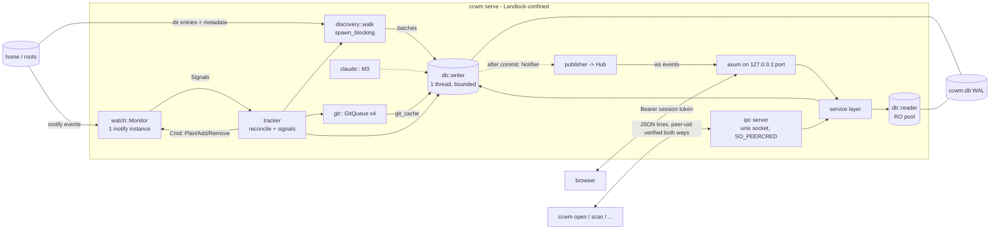

# ARCHITECTURE

Companion to `REQUIREMENTS.md` (the single source of truth, revision of 2026-11-23). Where this file and the
spec disagree, the spec wins. **Verified** = run on the development host; **Decision** = accepted by the
maintainer; **Open** = needs a decision. Nothing here is claimed to work until the milestone that builds it
has run it (see `ROADMAP.md`).

---

## 1. Verified environment (development host, 2026-11-23)

| Item | Observed |
|---|---|
| OS / kernel | Ubuntu 24.04.4 LTS, Linux 7.0.0-34-generic, x86_64 |
| Rust | rustc / cargo 1.94.0, clippy 0.1.94, rustfmt 1.8.0; targets include `x86_64-unknown-linux-musl` (installed by the maintainer) |
| git | 2.43.0 (Ubuntu `1:2.43.0-1ubuntu7.4`, which carries the CVE-2024-32465 backport and honors `GIT_NO_LAZY_FETCH`: verified by its "lazy fetching disabled" warning and no fetch child; upstream lists `--no-lazy-fetch` in the 2.45.0 release notes). `--attr-source` appears in the 2.41.0 release notes (and is in 2.43's man page) ⇒ **minimum 2.41.0**; hardened status verified only on 2.43.0 |
| claude | 2.1.331; `claude --help` lists `--resume <session-id>` |
| systemd | 255 (`systemctl --user` works); `Linger=no` |
| Landlock | `landlock` in `/sys/kernel/security/lsm`; ABI **8** (queried via `landlock_create_ruleset`) ⇒ filesystem + TCP rules available |
| `unshare -rn` | **fails** (`apparmor_restrict_unprivileged_userns=1`), as does `unshare --user --map-current-user --net` ⇒ test 5 runs its **strace** variant here |
| strace / node | strace 6.8 (traces children; `kernel.yama.ptrace_scope=1` allows tracing our own children); node v22.22.0 (UI helper tests) |
| inotify | `max_user_watches=65536` ⇒ default budget 25 % = 16 384 (M2.1; was `min(8192, 25 %)`); `max_user_instances=128` with ≥109 already used by other processes ⇒ ccwm uses exactly one instance |
| Env | uid 1000; `XDG_RUNTIME_DIR=/run/user/1000`; other XDG vars unset; `CLAUDE_CONFIG_DIR` unset |
| Not installed | `musl-tools`; `cargo-deny` is not installed system-wide (M1.1 installs 0.21.0 into the ignored `target/tools/` to run it — 0.22 needs rustc 1.95) |

---

## 2. Module map

One package `cc-workspace-manager`, binary `ccwm`, plus `lib.rs` so integration tests can reach modules.
Modules appear in the milestone that needs them; none are pre-created empty.

```
src/
  main.rs         # parse args; refuse root; apply Landlock BEFORE any thread is spawned; build runtime; map errors -> exit codes
  lib.rs
  exit.rs         # exit-code constants (M1: OK, ERROR, USAGE; M4 adds PORT_IN_USE, ALREADY_RUNNING)
  cli.rs          # clap definitions (+ unofficial notice in --help)
  client.rs       # M1: `open` -> Unix-socket client (peer verification, JSON lines). No HTTP client.
  paths.rs        # M1: Dirs{config,data,state,runtime}; XDG + fallbacks; 0700 creation + owner/mode verification; home = owned `$HOME`, else passwd;
                  #     M1.1: session_dir (CLAUDE_CONFIG_DIR), Owner::verify_trusted (config file + every ancestor), runtime file-name constants
  config.rs       # M1: config.toml model (serde, deny_unknown_fields), defaults, validation
  clock.rs        # M1: Clock trait (System / Fake)
  sandbox.rs      # M1: Landlock policy, apply(), SandboxReport (what is actually active);
                  #     M1.1: scopes, single-thread check, thread probes, broad-read flags, child_command() (IPC env scrub)
  instance.rs     # M1: flock + instance.json
  db/             # M1: mod (open, pragmas, migrations), writer.rs (1 thread), reader.rs (RO pool), queries.rs
  discovery/      # M1: exclusions.rs, mounts.rs (/proc/self/mountinfo), walk.rs (own DFS), status.rs; M1.1: dirfd.rs (fd-based opens)
  auth/           # M1: tokens.rs (CSPRNG, SHA-256, ct-compare, Bootstrap store), sessions.rs
  service.rs      # M1: THE service layer: bootstrap, exchange, rotate, logout, revoke_all, list_projects, stats, discovery_status, service_status
  ipc/            # M1: server.rs (accept loop, SO_PEERCRED, JSON lines) + protocol.rs (Request/Response enums)
  http/           # M1: mod (router, state, serve loop), middleware.rs, extract.rs (ApiJson/ApiQuery/Bearer/SessionAuth), error.rs, routes.rs, assets.rs;
                  #     M1.1: peer.rs (TCP peer UID via /proc/net/tcp{,6})
  synth.rs        # M1: synthetic environment generator (feature `synth`; also used by tests)
  bin/ccwm-synth.rs   # M1: CLI for the generator (required-features = ["synth"])
  activity.rs     # M2: calendar-day buckets (jiff, system time zone), filter ranges, stats boundaries
  git/            # M2: mod.rs (Git: detect, allowlisted inspect), run.rs (timeout + process-group kill, bounded output), parse.rs
                  #     (porcelain v2 -z, config -z, log, version, remote-URL sanitizing). The ONLY module that spawns `git`.
  watch/          # M2: mod.rs (Monitor actor: one inotify instance, watch table, budget, polled mode, debounce, rename pairing,
                  #     meaningful-activity rules -> Signals), tree.rs (fd-based project-tree walk + in-process gitignore matcher)
  tracker.rs      # M2: reconciliation loop, missing/purge, enrollment (walk -> inferred activity -> Git -> move matching -> watches),
                  #     handling of the monitor's Signals, GitQueue (4 concurrent, one refresh per project, rerun-once)
  events.rs       # M2: Notifier (bounded change queue), coalesced batches, Hub (broadcast of pre-serialized JSON), until_stopped
  view.rs         # M2: API/WS JSON shape of projects (display_path, activity status, git summary/detail, monitoring)
  http/ws.rs      # M2: GET /api/v1/ws
  claude/ privacy.rs           # M3   (claude/ is the only module that knows Claude's file formats)
build.rs                       # M2-pre: CCWM_GIT_COMMIT = 12-hex HEAD (+ "-dirty"), or "unknown"; runs git on THIS repo at build time only
web/ index.html app.css app.js # embedded with include_str!
scripts/ inspect-session-schema.py   # §19: maintainer-run, structure-only
tests/ …                       # integration tests; tests/fixtures/** reviewed synthetic fixtures only
deny.toml                      # bans HTTP-client/DNS crates (§11.5); CI in M4, runnable locally once cargo-deny is installed
```

Hard rules: only `git/` spawns git; every daemon child is built with `sandbox::child_command`; only `claude/` knows session formats; only `db/writer.rs` writes SQLite;
no `rusqlite` call runs on a Tokio worker; every queue is bounded; HTTP handlers and Unix-socket ops call
`service.rs` — no business logic lives in a transport.

---

## 3. Data flow


Dashed = M3. The CLI never uses TCP and never reads a token file; the browser never reaches the socket.

### Start sequence (`ccwm serve`)
1. Refuse if `geteuid()==0`. `umask(0o077)`. Parse args/config path.
2. Resolve dirs (`paths.rs`); every **ancestor** must be trusted (`Owner::verify_trusted`: owned by the user or root, not writable by others except a root-owned sticky dir or the user's private group); create each `0700`; any existing dir must be owned by the euid and not group/world accessible, else fail (never silently `chmod` something we did not create).
3. Load `config.toml` (absent ⇒ defaults; present ⇒ the file and its ancestors must be trusted too); compute discovery roots (config or home) and the session dir (`CLAUDE_CONFIG_DIR` if absolute, else `~/.claude`).
4. **Apply Landlock now, on the main thread, before the Tokio runtime or any other thread exists** (`landlock_restrict_self` confines only the calling thread and its future children; threads created earlier would stay unconfined). `apply` counts `/proc/self/task` first: ≠ 1 ⇒ the report claims nothing. Flag broad read rules.
5. Build the Tokio runtime; probe a worker and a blocking-pool thread (read of `/` must fail with `EACCES`); log the `SandboxReport`. Take the `flock` (lock file in the runtime dir). Open SQLite (`temp_store=MEMORY` so no temp files are needed under the sandbox), migrate, spawn writer + reader pool.
6. Bind TCP `127.0.0.1:port` (failure ⇒ clear message naming the port; exit 1 in M1, dedicated code in M4) and the Unix socket (remove a stale socket only if it is a socket we own; the lock proves no live daemon).
7. Write `instance.json` (pid, port, version, started_at; atomic rename).
8. Detect `git` on `PATH` (version, hardened?); create the single inotify instance (failure ⇒ every project polled, reported); build Tracker, Monitor, Service; spawn the monitor, the reconciler (first scan immediately), the signal handler, the WebSocket publisher, the hourly session purge, and serve. Cached projects are readable immediately.
9. SIGTERM/SIGINT: stop accepting → cancel discovery → stop monitor/tracker/publisher → writer `Flush` + join → remove socket and `instance.json` → exit 0.

---

## 4. Dependencies (justification required by §3)

Spec-named: `axum` (`ws` from M2), `tokio`, `notify` (M2, `default-features = false`: inotify backend only), `rusqlite` (`bundled`), `serde`, `serde_json`, `clap`,
`tracing`, `tracing-subscriber`, `toml`, `ignore`, `landlock`. Approved by the maintainer: `nix`, `sha2`,
`subtle`, `getrandom`, `base64`, `jiff` (M2), `regex` (M3). **Rejected: `ureq`; all HTTP/DNS client crates are
banned (§11.5).**

| Crate | Why |
|---|---|
| `nix` (`dir`,`fs`,`user`,`process`,`signal`,`socket`) | `flock`, `geteuid`, passwd/group lookup, `umask`, `SO_PEERCRED` on the CLI side, `killpg` (M2); M1.1: `openat`/`openat2`/`fstatat`/`Dir` for the fd-based walk (`dir` feature: same crate) |
| `sha2`, `subtle`, `getrandom`, `base64` | token hashing, constant-time compare, OS CSPRNG, URL-safe token/cursor encoding |
| `landlock` | §11.5 sandbox |
| `hyper` (`server`,`http1`), `hyper-util` (`tokio`,`service`) — M1.1 | already in the tree through axum with exactly these features (no new crate): the serve loop needs hyper's http1 builder for the header-read timeout, which `axum::serve` does not expose |
| `ignore` (`gitignore` module only in M1) | user exclusion patterns with gitignore syntax; gitignore matching in M2 |
| `jiff` (M2, approved) | calendar days in the system time zone (DST-correct day boundaries) |
| `notify` 9 (M2) | the single inotify watcher; brings `inotify`, `inotify-sys` (ISC), `mio`, `walkdir`, `xxhash-rust` (BSL-1.0); `notify` itself is CC0-1.0 — licenses added to `deny.toml` (flagged for review) |
| `axum` `ws` (M2) | WebSocket upgrade; brings `tokio-tungstenite`/`tungstenite`, `sha1` 0.10, `base64` 0.22, `rand` 0.9 (`getrandom` 0.3). **axum enables `tokio-tungstenite`'s default `connect` feature** (a WebSocket client entry point): no extra crate, never called, TCP connect denied by Landlock; noted in SECURITY.md. Duplicate-version warnings (base64, digest/sha1 vs sha2, getrandom) are accepted (`multiple-versions = "warn"`) |
| dev: `tempfile` | temp dirs/repos |

Not added: `ureq`/`reqwest`/any client; `rust-embed` (`include_str!` for three files); `tracing-journald`
(stderr under systemd reaches journald); `r2d2*`; `uuid` (strict validator hand-written, M3); `tower-http`
(few lines of middleware); `http-body-util` (axum re-exports what is needed). Integration tests speak
HTTP/1.1 over `std::net::TcpStream` with a ~60-line helper — no client crate, not even as a dev-dependency.

MSRV: `rust-version = "1.94"` — the only toolchain tested here; widen in M4 when CI can test older ones.

---

## 5. SQLite schema

Per connection: `foreign_keys=ON`, `busy_timeout=5000`; writer also `journal_mode=WAL`, `synchronous=NORMAL`,
`temp_store=MEMORY`. Readers open `SQLITE_OPEN_READ_ONLY`. Migrations are embedded `.sql` files applied in a
transaction each, bumping `PRAGMA user_version`; each milestone adds only the tables it uses. Timestamps are
Unix seconds (UTC). IDs are 128-bit CSPRNG hex (32 chars), opaque and validated.

### Migration 1 (M1)
```sql
CREATE TABLE meta (key TEXT PRIMARY KEY, value TEXT NOT NULL) WITHOUT ROWID;
CREATE TABLE projects (
  id TEXT PRIMARY KEY CHECK (length(id) = 32),
  canonical_path TEXT NOT NULL UNIQUE,
  name TEXT NOT NULL,
  first_seen_at INTEGER NOT NULL,
  last_seen_at INTEGER NOT NULL);
CREATE INDEX projects_name ON projects (name COLLATE NOCASE, id);
CREATE TABLE project_sources (
  project_id TEXT NOT NULL REFERENCES projects(id) ON DELETE CASCADE,
  source TEXT NOT NULL CHECK (source IN ('marker','session')),
  first_seen_at INTEGER NOT NULL,
  PRIMARY KEY (project_id, source)) WITHOUT ROWID;
CREATE TABLE auth_sessions (
  id TEXT PRIMARY KEY,                 -- stable across rotations; not the token
  token_hash BLOB NOT NULL UNIQUE,     -- SHA-256
  prev_token_hash BLOB UNIQUE, prev_valid_until INTEGER,   -- 60 s rotation grace
  created_at INTEGER NOT NULL, last_used_at INTEGER NOT NULL, rotated_at INTEGER NOT NULL,
  expires_at INTEGER NOT NULL);        -- sliding 30 days, bumped at most every 5 min
```
### Migration 2 (M1.1)
`projects.sort_key TEXT NOT NULL` (computed in Rust by `db::sort_key` = Unicode `to_lowercase`, backfilled
for existing rows by a Rust step inside the migration transaction); index `(sort_key, id)` replaces
`(lower(name), id)`; index `auth_sessions (last_used_at, created_at)` for the LRU cap. Keyset cursors
carry the stored `sort_key`, so SQL and Rust can never disagree (L8).

**Sessions (M1.1):** creating a session first purges expired ones, then keeps the 10 most recently used
(the new one always kept). `PurgeExpiredSessions` also clears previous-token hashes whose grace has ended.

### Migration 3 (M2)
`projects` + `marker_hash BLOB` (SHA-256 of ≤256 KiB of `CLAUDE.md`, move matching), `missing_since`,
`activity_at`, `activity_kind` (`inferred|observed`), `activity_path`; indexes `(activity_at, sort_key, id)`,
`(missing_since)`. `ignored_paths(canonical_path PK, ignored_at)`. `file_events(id, project_id → CASCADE, at,
kind ∈ create|modify|delete|rename, path)`, trimmed to `activity.events_per_project`. `git_cache(project_id PK →
CASCADE, fetched_at, state, branch, detached, upstream, ahead, behind, staged, modified, untracked, files JSON
(≤200 per list), head_commit/subject/author/time, remote_url sanitized)`; NULL counts = status not run.
Writer commands added: `RecordActivity` (never moves backwards; same second: observed may upgrade an inference
or name a newer file; `path = NULL` keeps the file), `StoreGit`, `MarkMissing`, `PurgeMissing`, `MoveProject`
(deletes a duplicate row already at the new path, keeps the id, moves the ignore entry), `SetIgnored`; `UpsertProjects`
now returns per-row `{id, inserted, revived}` and clears `missing_since`.

Later: **M3** `sessions` (aggregates only: min/max timestamps, first/last cwd, title, `is_sidechain`) and
`session_file_checkpoints`; prompt text only if the opt-in "Store prompt text" is on. No per-record table.

**Writer:** one `std::thread`, `sync_channel(1024)` of `WriteCmd` (`UpsertProjects`, `CreateSession`,
`RotateSession`, `DeleteSession`, `TouchSession`, `RevokeAll`, `SetMeta`, `Flush`, `Shutdown`); commands needing
an answer carry a `tokio::sync::oneshot::Sender`. Loop: block on one command, drain up to 256 more (or 50 ms),
apply in **one transaction**, answer. Events are published after commit. `TouchSession` is best-effort
(`try_send`, drop when full). **Reader pool:** 4 read-only connections behind `Mutex<Vec<_>>`+`Condvar`;
async facade is `spawn_blocking`.

---

## 6. Configuration (`config.toml`, read at startup only)

```toml
[server]
port = 8765                  # 1024..=65535; `--port 0` (ephemeral) is accepted for tests only
[discovery]
roots = []                   # empty ⇒ home (owned $HOME, else passwd)
exclude = []                 # extra gitignore-syntax patterns, relative to each root
max_depth = 10
same_file_system = true
```
`deny_unknown_fields`. Symlink-following is not configurable in v0.1 (never followed). M2 keys (all in
`config.example.toml`, which a unit test parses and compares with the defaults):
`discovery.scan_interval_secs` (600, 60–86400), `discovery.missing_retention_days` (30), `watch.budget` (0 = auto: 25 % of `max_user_watches`, 8192 if unreadable),
`watch.debounce_ms` (2000), `activity.inactive_after_days` (7), `activity.dormant_after_days` (30),
`activity.events_per_project` (200), `git.allow_unhardened_status` (false).

---

## 7. M1 discovery

Own iterative DFS (descriptor-based since M1.1, `discovery/dirfd.rs`) inside `spawn_blocking` (not `ignore::Walk`: it hides
`.git`, yields files interleaved with sub-directories — which makes "is my ancestor a project?" order-dependent —
and cannot compare exact entry names without extra work).

1. Roots: configured or home; each canonicalized; must be a readable directory; rejected if inside a hard boundary (`/proc /sys /dev /run`, ccwm config/data/state/**runtime**, and Claude Code's config directory — hidden or not, M1.1 L7). Bad roots are reported, never fatal.
2. Per directory: open it with `openat(parent_fd, name, O_DIRECTORY|O_NOFOLLOW)` and require `fstat` (dev, ino) to equal what the parent's listing showed (else `skipped.changed`); read entries from that descriptor; **marker** = an entry named exactly `CLAUDE.md` that is a regular file, or a symlink that `openat2(dir_fd, …, O_PATH, RESOLVE_BENEATH|RESOLVE_NO_MAGICLINKS)` resolves to a regular file (fallback without `openat2`: component-by-component `O_NOFOLLOW` walk, rejecting absolute targets, `..` and nested links); anything else is `rejected_markers`. No file contents are read in M1. Open descriptors are bounded by the depth (each directory's fd lives while its children are pending).
3. **Nested rule** (preorder, so ancestors are known): a marker directory B becomes a project unless a registered ancestor A exists and `symlink_metadata(B/.git)` is absent (then B's marker is "a nested instruction file of A"). The home directory itself is never registered.
4. Descend into subdirectories (real directories only; symlinks never followed) in name order **unless**: hidden (`.*`), default-excluded (`node_modules target build dist venv __pycache__ snap`[home only] `VirtualBox VMs`), user-excluded (gitignore patterns), a FUSE mount point (type `fuse*` from `/proc/self/mountinfo`), on another device (`same_file_system`), under a hard boundary, deeper than `max_depth`, or **not valid UTF-8** (counted). Pruning happens before descending.
5. Candidates stream to the writer in batches (≤64 or 250 ms), keyed by canonical path (existing rows keep their `id`). Counters (dirs visited, projects found, skipped: permission / vanished / excluded / non_utf8 / rejected_markers / changed / other) update `DiscoveryStatus`. Errors never abort the walk; user-visible samples show only `…/<last two components>`.
6. Phases `idle → scanning → idle`; `last_success_at` persisted in `meta`. M1 scans once at startup; vanished projects are **not** removed in M1 (missing state is M2).

---

## 7a. M2 activity tracking

**Actors.** `watch::Monitor` (one task) owns the notify watcher and the watch table; it never touches SQLite.
`tracker::Tracker` runs two tasks: the reconciler and the signal handler. `GitQueue` runs Git refreshes (≤4,
one per project, a request during a refresh schedules exactly one more). `Service::run_publisher` turns
`Notifier` changes (bounded queue, coalesced 200 ms) into WebSocket messages.

**Reconciliation** (startup, every `scan_interval_secs`, or on request; never overlapping; failures back off ×2 up
to 1 h): full discovery scan (batches upserted and published progressively) → projects not found are marked
missing, except under a root whose scan state is not `ok` → new/revived projects are enrolled → (startup) every
present project is walked and handed to the monitor as one **Plan**; (later) polled projects are walked for newer
mtimes and re-added, and *partly watched* projects are walked **only in their unwatched subtrees** (`walk_from` with
the project's ignore rules; `.git` is retried, never walked), their newest file recorded as inferred, then
`Cmd::Retry` tries those subtrees' watches again → purge of projects missing longer than the retention → `scans_finished += 1`.
`POST /refresh` returns `done_at_scans_finished` (current + 1, or + 2 while a scan runs).

**Enrollment** (new project, revived, un-ignored, `.gitignore` changed, renamed): fd-based tree walk
(`watch/tree.rs`: same exclusions as discovery, other projects' subtrees pruned, `.gitignore` +
`.git/info/exclude` layers when the project is in a Git work tree below home — since M2.1 also the
`info/exclude` and `.gitignore` files from a work-tree root *above* the project root, layers ranked by
depth — ≤100 000 entries, future mtimes
clamped to now) → newest file = *inferred* activity → Git inspection → for a newly inserted project while
missing projects exist: **move matching** (exactly one missing project with the same HEAD commit and the same
sanitized remote, or — without a commit — the same marker hash and no Git head; ambiguity ⇒ no match) ⇒ the old id
moves to the new path and the new row is deleted → Git cache stored → `Cmd::Add` to the monitor.

**Watch plan / budget (M2.1).** Budget = `max_user_watches/4` (no fixed ceiling; 8192 if the limit cannot be read)
or `watch.budget`. Allocation is **breadth first** over a plan (projects most-recent first): every project root,
then the parents of project roots (sibling detection, inside the configured roots only), then every project's
`.git` and depth-1 directories, then the deeper directories project by project (shallow first within a project).
The first limit hit (budget, kernel `ENOSPC`, no inotify instance) is remembered for the rest of the command, so
the kernel is not asked again; every directory refused is recorded as a **subtree root** (nothing below a
refused directory is tried). Monitoring per project: `watched` (nothing refused, tree complete), `partial` (root
watched, some subtrees refused, or the tree truncated: reason reported; reconciliation polls only the refused
subtrees, or the whole project when truncated), `polled` (root refused or no inotify instance: whole project).
`Cmd::Retry` re-watches refused subtrees when budget frees up; removing a refused subtree settles the project.
Directories created at runtime are walked with `walk_from` (project root, the project's ignore layers, depth
from the project root), so gitignored subdirectories of a new directory are never watched. Watches are
non-recursive and `IN_DONT_FOLLOW`; notify requests `IN_ONLYDIR` but retries without it on `ENOTDIR`, so the
backend checks that the path is still a directory after adding a watch and drops it otherwise (M2 review L2).

**Events → signals.** Paths are attributed to the innermost registered project (longest prefix). In a project:
`.git/…` (not `*.lock`) ⇒ Git refresh only; gitignored files and excluded directories ⇒ nothing; other changes ⇒
activity (debounced per project for `debounce_ms`; one `Activity` signal with the latest file, the events and a
Git-refresh flag); a new eligible directory is walked and watched and re-discovered (it may hold a nested project);
a new `CLAUDE.md` or `.git` in a subdirectory ⇒ re-discovery of that directory (subtree scan with the full-scan
rules and the caller-supplied nesting state); `.gitignore` changed ⇒ re-walk. On a project root (from its parent's
watch): removed ⇒ `Vanished` (missing at once), created ⇒ re-discovery. In a sibling-detection directory: a new
directory is watched one level deep and re-discovered; a new `CLAUDE.md` ⇒ re-discovery. Renames: notify reports
`From`, `To` and a paired `Both` with one cookie; halves wait 200 ms for their partner; `Both` touching project roots
⇒ `Moved` (ids kept if the new location still qualifies, else missing); unpaired halves ⇒ removal / creation.
`IN_Q_OVERFLOW` or our 8192-event queue full ⇒ `Rescan`: the next reconciliation walks every project and re-plans
all watches, then `OverflowRecovered`.

**Activity status and sorting.** `activity::Classifier` (system time zone via jiff; UTC fallback) computes the
status per row and the `[from, until)` ranges used by the `activity` filter and the stats, from the same day
boundaries. Sort keys: `k1` = negated time for "newest first", time for "oldest first", `i64::MAX` for unknown (last
in both orders), then `sort_key`, then `id`; the cursor carries `(k1, sort_key, id)`.

## 8. API and IPC contracts

### Connection handling (M1.1)
`http::serve` (hyper http1, not `axum::serve`): take one of 64 slots **before** `accept`; on accept,
look up the client socket's owner in `/proc/net/tcp{,6}` (row with local = client address, remote =
our address; v4-mapped v6 canonicalized; TIME_WAIT rows ignored; exactly one distinct owner required)
on the blocking pool; serve only if it equals the daemon's euid, else close without reading (rejections
logged at most once a minute). Then hyper http1 with `header_read_timeout = 10 s` and upgrades.
Shutdown: stop accepting, `graceful_shutdown` every connection, wait at most 5 s.

### HTTP pipeline (every response, in this order)
1. **Security headers** (outermost, so error responses carry them): `X-Content-Type-Options: nosniff`, `Referrer-Policy: no-referrer`, `Cross-Origin-Opener-Policy: same-origin`, the §11.3 CSP; `Cache-Control: no-store` on `/api`.
2. **Host check**: exactly `127.0.0.1:<bound port>`, `localhost:<port>`, `[::1]:<port>` (case-insensitive) else `421 host_not_allowed`.
3. **Origin check** (`/api`): any `Origin` other than `http://127.0.0.1:<bound port>` ⇒ `403 origin_not_allowed`; POST/PUT/DELETE without `Origin` ⇒ 403 too. No CORS headers, ever; `OPTIONS` ⇒ 405.
4. **Auth** by route: `Public` (health, assets, `auth/exchange`) or `Session` (everything else). Tokens: SHA-256 → DB lookup → `subtle` compare of digests → expiry via `Clock`.
5. Bodies ≤ 16 KiB (`413 payload_too_large`); unknown query keys or bad values ⇒ `400 invalid_argument`.

Errors: `{"error":{"code":"…","message":"…"}}` — codes `invalid_argument 400`, `unauthorized 401`,
`origin_not_allowed 403`, `not_found 404`, `method_not_allowed 405`, `payload_too_large 413`,
`host_not_allowed 421`, `internal 500` (generic message; details only in logs, never content).

### Browser endpoints (M1)
| | | |
|---|---|---|
| `GET /health` | Public | `{"status":"ok","version":"0.1.0","commit":"<12 hex>[-dirty]"\|"unknown"}` — never proof of identity |
| `POST /auth/exchange` | Public + Origin | `{"bootstrap_token"}` → `{"session_token","expires_at","rotate_after"}`; bad/used/expired ⇒ identical 401 |
| `POST /auth/rotate` | Bearer (authenticated by the service; the only route an overdue token may use) | → new `session_token` (+ times); the old token stays valid 60 s |
| `POST /auth/logout` | Session | revokes the session → 204 |
| `GET /projects` | Session | `q` (name, path, branch), `sort` (`activity` default \| `name` \| `commit`), `order` (default `desc` for times, `asc` for names), `activity` (`all`\|`today`\|`week`\|`inactive`\|`dormant`\|`unknown`), `dirty`, `include_missing`, `include_ignored` (`1`\|`0`\|`true`\|`false`), `limit` 1–200 (default 50), `cursor` → `{"items":[project],"next_cursor","total"}`; `has_sessions`, `sort=session`, `privacy` are rejected until M3 |
| `GET /projects/{id}` | Session | project + `git_detail{head{hash,short,subject,author,time},remote_url,files{staged,modified,untracked}}`; malformed or unknown id ⇒ 404 |
| `PUT` / `DELETE /projects/{id}/ignore` | Session + Origin | ignore / un-ignore (by canonical path; idempotent) → the project |
| `POST /refresh` | Session + Origin | 202 `{"status":"accepted","done_at_scans_finished":n}` |
| `GET /ws` | Origin required; auth by first message | see below |
| `GET /stats` | Session | `{"total_projects","modified_today","modified_this_week","inactive","dormant","unknown_activity","uncommitted_changes","missing"}` over present, non-ignored projects (missing counted separately); `total_sessions` arrives in M3 |
| `GET /discovery/status` | Session | `{"phase","dirs_visited","projects_found","skipped":{…},"roots":[{"path","state"}],"last_success_at","next_scan_at"}` |
| `GET /service/status` | Session | M1 subset: `version`, `uptime_s`, `port`, `sandbox{abi,status,filesystem,network:"tcp_only"\|"none",abstract_unix_socket,signal,no_new_privs,threads_at_apply,thread_probes{worker,blocking},broad_read_rules[],unconfined[],notes[]}`, `discovery{phase,last_success_at}` |

"Session" = a valid token whose rotation is not overdue (rotated within 24 h + 60 s).

**Project** (list items, events): `{"id","name","path","display_path" ("~/…" inside home),"sources",
"first_seen_at","activity":{"status","at","kind","path"},"git":null|{"state","branch","detached","upstream",
"ahead","behind","staged","modified","untracked","dirty","commit":{"subject","time"}|null,"checked_at"},
"missing_since","ignored","monitoring":"watched"|"partial"|"polled"|null,"monitoring_reason"}`; `activity` also
carries `days_ago` (M2.1: local calendar days from the same classifier as `status`, ≥ 0, `null` when unknown; the
UI's "N days ago" uses it). Git states: `ok`, `not_git`, `git_missing`, `unsafe_repository`,
`status_disabled_old_git`, `status_disabled_unsafe_config`, `partial_clone` (M2.1), `timeout`, `error`.
`/discovery/status` adds `scans_finished` and (M2.1) `unreadable[{path ("~/…"),reason}]` (first 50 folders counted
in `skipped.permission|vanished|changed|other`); `/service/status` adds `commit`, `discovery.next_scan_at`,
`monitoring{watcher,watches,budget,max_user_watches,watched_projects,partial_projects,polled_projects,overflows,
recovering_overflow,pending_projects,degraded,advice[]}`, `git{program,version,hardened_status,
unhardened_status_allowed}`, `queues{git_in_flight,websocket_clients}`.

**WebSocket** (`/api/v1/ws`): exact Origin on upgrade (403 otherwise); client messages ≤ 4 KiB; first message
`{"type":"auth","token":…}` (unknown fields rejected) within 5 s else close 4401; then `{"type":"ready"}` and events
`project` (`{"project":…}`), `project_removed` (`{"id"}`), `stats`, `discovery`, `monitoring`, `resync` (a lagging
client, or lost changes: fetch a fresh snapshot). Revalidation on revocation (logout, revoke-all, hourly purge) and
every 10 s ⇒ 4401. The UI reconnects with back-off 1 s…30 s and refetches after every `ready`.

Keyset cursors: base64url JSON `{s,o,k,i}`; a cursor whose `s`/`o` differ from the request, or is malformed, ⇒ 400.

### Unix-socket protocol (CLI ↔ daemon)
Path `<runtime dir>/ccwm.sock` (runtime dir = `$XDG_RUNTIME_DIR/ccwm`, else `$XDG_STATE_HOME/ccwm/run`; `0700`,
owned by the user, verified; socket `0600`; path must be ≤ 107 bytes or startup fails). Per connection:
1. Daemon: `peer_cred().uid == geteuid()` else close silently (counted, logged without content).
2. Client, before sending anything: `getsockopt(SO_PEERCRED)` uid must equal its own `getuid()`.
3. One request line (≤ 4 KiB, 2 s read timeout) → one response line → close.

```
{"op":"ping"}                → {"ok":{"version":"0.1.0"}}
{"op":"auth.bootstrap"}      → {"ok":{"bootstrap_token":"…","expires_in":30,"port":8765}}
{"op":"auth.revoke_all"}     → {"ok":{"revoked":3}}
{"op":"service.status"}      → {"ok":{…same body as GET /service/status…}}
{"op":"scan.refresh"}        → {"ok":{"status":"accepted","done_at_scans_finished":n}}   (M2; `ccwm scan`)
{"op":"discovery.status"}    → {"ok":{…same body as GET /discovery/status…}}               (M2)
{"op":"ping"} also returns "commit"; `ccwm status` warns when it differs from the CLI's build.
errors                       → {"error":{"code":"…","message":"…"}}   (same codes as HTTP)
```
`ccwm open` uses `auth.bootstrap` only; the URL's port comes from the daemon, not from `instance.json` or a TCP
probe, so an impostor on the TCP port receives nothing. Bootstrap tokens live in memory only: 32 random bytes,
single-use, 30 s, ≤16 outstanding.

---

## 9. Sandbox (Landlock) policy

Built with the `landlock` crate in best-effort mode at the highest supported ABI; report what is **actually**
active (never what was requested).

| Access | Paths |
|---|---|
| read + execute | discovery roots; Claude session dir (`CLAUDE_CONFIG_DIR` or `~/.claude`); `/usr`, `/etc`, `/lib`, `/lib64`, `/bin`, `/sbin`, `/proc` (inotify limits, mountinfo, `net/tcp`). **Not** the `--config` file's directory (M1.1: the config is read before `apply`) |
| read + write (create/remove/truncate/make-sock) | ccwm config, data, state, runtime dirs |
| read + write file | `/dev/null` only |
| network (ABI ≥ 4) | all TCP `connect` denied; `bind` allowed only on the configured port — reported as `network: "tcp_only"` |
| scopes (ABI ≥ 6) | abstract Unix sockets and signals cannot reach processes outside the domain |
| **not confined** | UDP and other non-TCP families; `connect()` on path-based Unix sockets (`ResolveUnix` exists only from ABI 9, not requested in v0.1); listed in `unconfined[]`. Mitigation: `sandbox::child_command` drops `DBUS_*`, `XDG_RUNTIME_DIR`, `SSH_AUTH_SOCK`, display/agent/systemd IPC variables from every child's environment. Seccomp `socket()` deny: M4 |

`SandboxReport {abi, status, filesystem, network, abstract_unix_socket, signal, no_new_privs, threads_at_apply,
thread_probes{worker,blocking}, broad_read_rules[], unconfined[], notes[]}` goes to the startup log and
`service.status`. If `/proc/self/task` ≠ 1 entry at `apply`, or a thread probe is not `eacces`, every claim
is withdrawn (`not_enforced`). Child processes inherit the ruleset. Known consequences: roots added at
runtime (M3 settings) outside the startup read set cannot be read until restart — reported as "requires
restart" (**Open**, M3); `claude` located outside the allowed system paths cannot be executed (M3).
**Verified in tests (M1.1):** `tests/sandbox.rs` has its own `main` (`harness = false`, because libtest runs
tests on threads); its re-executed child applies the **real** `daemon_policy()` single-threaded and checks
errnos exactly: writes/reads outside ⇒ `EACCES`, TCP connect and binds to other ports ⇒ `EACCES`, abstract
Unix connect and signals to the parent ⇒ `EPERM`, a thread spawned later and grandchild processes are
confined, a path-based Unix connect outside **succeeds** (documented residual), a second thread at `apply`
time ⇒ `not_enforced`, and `child_command` children see no IPC variables. `tests/process.rs` checks the
real daemon's report (`fully_enforced`, `threads_at_apply = 1`, both thread probes `eacces`).
`CCWM_REQUIRE_LANDLOCK=1` turns "Landlock unavailable" into a failure. The Git-subprocess variant of test
11 (M2): the confined child runs plain Git with `protocol.allow=always` against a listener (`git ls-remote
git://127.0.0.1:…` ⇒ `EACCES`, the listener receives nothing) and `git init` outside (⇒ `EACCES`), and ccwm's hardened
`Git::inspect` of a repository in the read set succeeds (`ok`).

---

## 10. Test plan (M1) and the security acceptance tests

- **Unit:** exclusions & hard boundaries; mountinfo parsing (incl. `\040`); marker rules (case, dir named `CLAUDE.md`, symlink in/out/dangling/loop); nested resolution; non-UTF-8 skip; `max_depth`; symlinked dirs not followed; `same_file_system` (best effort: needs a second device; skipped with notice); paths (modes, ownership, 108-byte limit, fallback); config validation; migrations idempotent; writer batching/flush/back-pressure; token primitives; bootstrap (single-use, expiry via `FakeClock`); sessions (create, slide, rotate + grace, logout, revoke-all); cursor round-trip/forgery; peer-uid decision function.
- **HTTP via `tower::ServiceExt::oneshot`:** no/bad/expired/revoked token, wrong Host, wrong/`null`/`localhost` Origin, state-changing without Origin, header set on every response class (incl. 401/404/421), `OPTIONS` 405, oversized body, unknown query keys, traversal-looking paths and ids, error bodies free of secrets.
- **Process-level (real `ccwm` in a synthetic env, `--port 0`):** serve → `open --print` → exchange → list projects → rotate → logout; SIGTERM clean exit; restart serves cached projects before the new scan completes; second instance exits; **impostor**: with no daemon, a TCP listener on the would-be port receives **zero** connections from `ccwm open`; startup log and `service.status` show the sandbox report.
- **Security acceptance tests in M1 (strengthened in M1.1):** **1** (hash the whole synthetic tree incl. mtimes/modes before/after a full discovery; also with the XDG and Claude config dirs *inside* the walked home), **6** (no token, expired, revoked, wrong Origin, wrong Host, simulated Unix-socket peer-UID mismatch, simulated **TCP** peer-UID mismatch / unknown owner / failed lookup ⇒ connection closed unanswered, concurrent rotation, logout and revoke-all during the grace window, overdue rotation; cross-user check documented as manual), **7** (traversal and symlink escapes in project ids, static paths, markers; untrusted `--config` (world-writable, in a world-writable dir, symlinked there, FIFO), untrusted XDG dirs, non-hidden `CLAUDE_CONFIG_DIR`, and a concurrent directory↔symlink swap race during the walk), **9** (`tests/hygiene.rs`: every runtime file name from the `paths.rs` constants incl. `instance.json.tmp` and WAL/SHM, a real synthetic env generated inside the repo, sensitive patterns; skipped with notice if git is absent, **failure** if `CI` is set), **11** (above). Log check runs at `info` and at `CCWM_LOG=trace`. WAL/SHM modes `0600` asserted (unit and process level).
- `web/` grep test: no `innerHTML|outerHTML|insertAdjacentHTML|document.write|eval(|new Function`. `app.js` logic is exercised by `node --test` only if node exists (not a build requirement); otherwise documented manual steps.
- **M2 tests:** `tests/git.rs` (real repositories: states, upstream/remote, worktrees, unborn, home repo, timeouts via a stand-in, old-Git gate; acceptance **3** and **4** with control runs), `tests/watch.rs` (monitor with a recording fake backend: eligible-only non-recursive watches, budget/kernel/no-instance polled modes, debounce, ignore rules, nested attribution, rename pairing, overflow, live discovery), `tests/tracker.rs` (full stack with real inotify + Git: live activity, live registration, missing/revived, rename keeps the id, moves while stopped (marker hash, HEAD + remote), purge, Git refresh, ignore), `tests/db.rs` (activity, Git cache, filters, keyset with unknown-last, stats, moves), `tests/http.rs` (detail/ignore/refresh; WebSocket origin, 5 s auth timeout, bad first messages, nothing before auth, revocation/expiry/rotation-out/overdue ⇒ 4401; a valid token over a peer-UID-rejected connection), `tests/process.rs` (M2 acceptance over the real WebSocket; acceptance 1 + 3 with watching and `ccwm scan`; acceptance **5**), `tests/sandbox.rs` (test 11 Git variant), `tests/ui/app.test.js` (query building, view toggle keeps filters, prefs, relative time, Git summary, pagination, back-off). Tests that need an inotify instance hold a lock (this host has few left) and skip with a notice if none can be created, unless `CCWM_REQUIRE_INOTIFY=1`.
- All tests use temp dirs and synthetic data; none reads the real `$HOME` or `~/.claude`. Cargo itself runs with the normal environment, **never** under the synthetic `HOME` (`CARGO_HOME`/`RUSTUP_HOME` are not redirected; the synthetic env is applied only to spawned `ccwm` processes).
- **Synthetic environment generator** (`src/synth.rs`, `ccwm-synth <dir>`): creates `home/`, XDG dirs and `claude/` (`CLAUDE_CONFIG_DIR`) under the given dir (default a fresh `/tmp/ccwm-synth-XXXX`), populates projects (marker, symlinked marker, nested git/non-git, excluded dirs, symlink loop, non-UTF-8 name, deep tree, decoys like `claude.md`) and minimal synthetic session files, and prints the `env` line to use. Shared by tests and manual runs (DRY).
- **Schema inspection script** (`scripts/inspect-session-schema.py`): structure-only per §19; written and tested **only against synthetic data**; the maintainer runs it. Output: key paths + value types, values of an allowlisted set of low-cardinality discriminators (each value must match `^[A-Za-z0-9_.:-]{1,32}$` or is replaced by `<other>`), per-type record counts, file counts and directory-shape patterns (UUIDs → `<uuid>`); no other strings, no real paths.

---

## 11. Verified Claude Code session schema (structural inspection by the agent, accepted by the maintainer; further inspection only via §19)

Data written by Claude Code 2.1.217–2.1.331 (17 versions on one machine). 697 top-level session files, 83
subagent files, 498 MB; largest file 76 MB; longest line 1.9 MB (≥17 lines > 1 MiB) ⇒ the 8 MiB cap is safe;
0 malformed lines. Claude Code prunes old sessions, so a project's latest session can disappear.

**Layout**
```
<config dir>/projects/<encoded-cwd>/<session-uuid>.jsonl                     # sessions
<config dir>/projects/<encoded-cwd>/<session-uuid>/subagents/agent-<hex>.jsonl (+ .json)   # ignored in v0.1
<config dir>/projects/<encoded-cwd>/<session-uuid>/tool-results/…, memory/…, .session-aliases   # not sessions
```
Filename stem = `sessionId` in 697/697 files and always a UUID; `<encoded-cwd>` = first cwd with non-alphanumerics → `-`
(697/697) — a consistency check only, never used to derive paths. Subagent records carry `isSidechain:true`,
`agentId` and the parent's `sessionId`.

**Records:** ~26 types (`attachment`, `assistant`, `user`, `api-request*`, `last-prompt`, `ai-title`, `system`,
`queue-operation`, `session-owner`, `cost-state`, `file-history-*`, …); the set drifts between versions ⇒
unknown types are skipped and counted. `cwd` exists only on `user|assistant|attachment|system` ("conversational");
`timestamp` is ISO-8601 UTC (`YYYY-MM-DDTHH:MM:SS.mmmZ`) on those plus several others.

**Decisions derived from the findings (all in the spec now)**
1. Timestamps are unordered within files (695/697) ⇒ `started_at = min`, `last_activity_at = max` over conversational records; idempotent aggregates make restarts safe without a per-record dedup key (most types have no `uuid`).
2. 8 files change cwd mid-session ⇒ store first and last; **resume uses the first** (its encoding names the containing directory). Running `claude --resume` from another directory is untested.
3. `user` records (7,745): 5,939 tool results (`toolUseResult`, `tool_result` blocks); `promptSource` values seen: `typed`, `queued`, `sdk`, `system`, `suggestion_accepted`; `turnOrigin`: `human`, `sdk`, `task_notification`; `isMeta` (129), `isCompactSummary` (33); ~90 records lack `promptSource`. **Genuine = `promptSource` ∈ {`typed`,`queued`}; `sdk`/`system` never; records without `promptSource` use the classifier** (not `isMeta`/`isSidechain`/`isCompactSummary`, no `toolUseResult`/`tool_result`, `turnOrigin ≠ task_notification`, text not starting with a synthetic tag such as `<task-notification>`, `<local-command-caveat>`, `<command-name>`, `<local-command-stdout>`, `<bash-input>`, `<bash-stdout>`, `<system-reminder>`, `<command-message>`). **Open (M3):** `suggestion_accepted` (human-origin) is not listed by the maintainer; treated as *not genuine* until the §19 output says otherwise.
4. `last-prompt` records are truncated (≤ ~201 chars) ⇒ never used for the last prompt.
5. Title: `ai-title` records, last wins, labeled *recorded*, redacted.
6. Sensitive record types exist (`session-owner` account/org ids, `cost-state` amounts, `api-request-blob` full payloads) ⇒ deserialize into a minimal struct with `#[serde(default)]`; ignore everything else (also keeps 1.9 MB lines cheap).
7. Cold-parse cost of ~500 MB is unmeasured; M3 measures it (maintainer-run, §19) and may skip `api-request-blob` lines cheaply.

---

## 12. Git hardening — verified results (git 2.43.0)

Method: throw-away repos in the session scratchpad, `env -i` with only the §6 environment and flags, malicious
repo-local config whose command touches a sentinel file; a control run without mitigations proves the test can
detect execution.

| Vector | §6 base flags only | Control |
|---|---|---|
| `core.fsmonitor=<cmd>` | not executed | executed |
| `filter.<n>.clean` via `.gitattributes` | **executed** | executed |
| same via `.git/info/attributes` | **executed** | executed |
| `core.pager`, `diff.external` | not reached by `status`/`rev-parse`/`log -1` | — |
| promisor partial clone (`HEAD` object missing) + `ext::` / `file://`+`uploadpack` / `ssh://`+`core.sshCommand`, per-protocol `allow=always` in repo config (M2 review H1) | **executed** by `status` and `log -1` (lazy `git fetch` → transport) | executed |
| same, with `GIT_ALLOW_PROTOCOL=` only / `-c protocol.<name>.allow=never` only / `GIT_NO_LAZY_FETCH=1` only (M2.1) | not executed (each alone, all three vectors) | — |
| hooks | `status` runs none (maintainer decision: no hook test) | — |

Verified mitigation (now §6 of the spec): `--attr-source=<empty tree>` stops worktree `.gitattributes` filters;
nulling every `filter.<name>.{clean,smudge,process}` (+ `required=false`) from **all scopes** stops
`info/attributes`-selected ones; neither alone suffices, together no sentinel appeared and status stayed correct.
**Minimum git: 2.41.0** (release notes); verified on 2.43.0 only; older ⇒ worktree status disabled
("status disabled: git too old to harden") unless `git.allow_unhardened_status = true`. Consequence to
document: git-lfs/`eol` repos can show different status than the user's own `git status`. Implementation is M2.

---

## 13. systemd user unit — verified (systemd 255)

Accepted in a transient user unit: `NoNewPrivileges`, `Nice`, `IOSchedulingClass=idle`, `UMask`, `PrivateTmp`,
`ProtectSystem=strict`, `ProtectHome=read-only`, `ProtectKernelTunables`, `RestrictNamespaces`,
`RestrictAddressFamilies`, `MemoryDenyWriteExecute`, `LockPersonality`, `SystemCallArchitectures`,
`ProtectProc=invisible`, `SystemCallFilter=@system-service`. **Rejected: `PrivateDevices=yes`.** Per the spec,
Landlock is the primary enforcement; the extras are optional defense in depth, added in M4 only after the real
daemon is tested under them (`ReadWritePaths=` for ccwm's dirs). `Type=exec`; port-in-use and lock-held exit
codes go in `RestartPreventExitStatus=`.

---

## 13a. M1 verification notes (what was actually run)

- Landlock on this host (Linux 7.0, ABI 8): `tests/sandbox.rs` re-executes the test binary, applies the policy, and verifies that writes outside the allowed directories, reads outside the allowed paths, outbound TCP connects and binds to other ports are denied — for the process **and** for `/bin/sh`/`/bin/bash` children — while writes in ccwm's directories, `/dev/null`, Unix-socket binding and the allowed TCP port work. A real daemon run reported `fully_enforced abi=8 filesystem=true network=true` and `NoNewPrivs: 1`. `--port 0` needs an explicit `NetPort(0)` rule (granted automatically because the configured port is 0).
- `hyper`/`hyper-util` are in the tree only with their `server` features (checked with `cargo tree -e features`); no client crates. M1.1: `cargo deny check` run (see §13b).
- The UI was exercised with a Node DOM stub against a live synthetic daemon (fragment removal, exchange, listing, session storage). It has **not** been viewed in a real browser (extension not connected).
- Sign-in links printed by `ccwm open --print` contain the single-use token by design; the log never does (asserted).

## 13b. M1.1 verification notes (what was actually run)

- Real daemon in a synthetic env (Linux 7.0, ABI 8): `landlock fully_enforced: abi=8 filesystem=true network=tcp_only abstract_unix_socket=true signal=true threads_at_apply=1 probes=eacces/eacces unconfined=udp,unix_socket_connect_by_path`.
- Race test (`tests/discovery.rs`): 8 directories swapped with symlinks by `renameat2(RENAME_EXCHANGE)` during 3,000 scans — ~100 k swaps, ~9 k swaps caught inside the list→open window (`skipped.changed`), the outside target never entered. Mutation check: with `O_NOFOLLOW` and the identity check removed, the test failed in 5/5 runs.
- `cargo deny check` (cargo-deny 0.21.0, installed into `target/tools/`): see the M1.1 report in `ROADMAP.md`.

## 13c. M2 verification notes (what was actually run, 2026-11-24)

- Pre-M2 test 5: **strace variant** (strace 6.8): daemon + Git children traced through discovery, live edits, Git
  refreshes, a new project and a socket-triggered reconciliation; every `connect()` was a Unix socket or loopback,
  Git execs present in the trace. The network-namespace variant has **not run anywhere** (AppArmor blocks it here).
- Real daemon in a synthetic environment (30 bulk projects, real Git repos from `ccwm-synth`): `landlock
  fully_enforced abi=8`, `git 2.43.0 hardened_status=true`, 48 watches for 38 projects, `ccwm status`/`ccwm scan`.
- **Real browser** (Chrome via the extension, against the synthetic daemon): sign-in, cards with uniform heights and
  left-ellipsized `~/…` paths, table view, an edited project moved to the top and a new `CLAUDE.md` project appeared
  without reload, daemon stop ⇒ "disconnected" banner, restart ⇒ reconnect and fresh snapshot. No console errors.
- Process tests: M2 acceptance over the real WebSocket; acceptance 1 + 3 with watching, Git and two `ccwm scan`s:
  the monitored tree (incl. every `.git`) and the Claude directory unchanged with mtimes/modes.
- Found and fixed while testing: rename of a project root built `…/name/` (trailing slash) and marked it missing;
  `ccwm scan` compared one-second timestamps and could wait 10 min (now `scans_finished`); same-second inferred
  updates could downgrade an observation; `log.showSignature` + `gpg.program` executed during `log -1` (control
  run) ⇒ `--no-show-signature`; filter names with `=` could not be nulled ⇒ fail closed.

## 13d. M2.1 verification notes (what was actually run, 2026-11-24)

- H1 reproduced in a scratch directory with ccwm's exact flags and environment: all three promisor vectors
  executed their helper; each of the three transport blocks alone stopped all three (`tests/git.rs`
  `each_transport_block_alone_stops_the_promisor_vectors`). Mutation checks: removing the blocks makes acceptance
  test 4 fail; removing only `GIT_NO_LAZY_FETCH` makes test 5 fail (two `fetch` execs outside the allowlist).
- Test 5 (strace variant): 52 execs traced, all allowlisted; 3 promisor projects, zero fetch children, state
  `partial_clone` over the API. `strace -s 256` so long Git argument lists are not abbreviated.
- L2: with the directory check removed, `notify` watched a regular file (`watch(file) == Ok`); test in
  `tests/tracker.rs` (real inotify).
- Real daemon in a synthetic environment with `watch.budget = 40`: `ccwm status` printed "34 watched, 4 partly
  watched, 0 polled" and the unreadable folder; a `ccwm status` started before the daemon waited and succeeded.
  Real browser (Chrome extension, synthetic daemon): one-line degraded banner with a details toggle, "1 folder
  could not be read" with the path in the tooltip, one-line non-Git cards, "partly watched" badges, a long path
  shown as `…/internal-services/backend-api-gateway`; no console errors.

## 14. Decisions log and remaining open items

Decided (2026-11-23): Git fix accepted (min 2.41.0, disabled-by-default fallback + opt-in); all schema findings
accepted; `~/.cargo` cache allowed, synthetic HOME for every `ccwm` run, cargo never under the synthetic HOME;
musl target/`musl-tools`/`cargo-deny` installed by the maintainer; `POST /auth/rotate` with 60 s grace; polling
in M1, WebSocket in M2; top-level session files only, aggregates not per-record dedup; prompts: `typed`/`queued`;
non-UTF-8 paths skipped and counted; dependency set in §4; one inotify instance; runtime-dir fallback must be
owned/0700 and respect 108 bytes; only allowed Origin `http://127.0.0.1:<port>`; no HTTP client crates.

Decided for M1.1 (2026-11-23): the review's spec changes H1/H2 (TCP peer-UID check, bootstrap 30 s, `hidepid`
optional, impostor fake UI as residual risk) and M1 (scopes, child IPC env scrub, TCP-only reporting, UDP and
path-based Unix connect as residual risks, seccomp deferred to M4). **L4 rule:** group write is acceptable
only for the user's private group (primary group, named like the user, no listed members); root-owned sticky
ancestors are acceptable. **L3:** the 11th session revokes the **least recently used** one. **L1:** overdue
means more than 24 h + 60 s since the last rotation (the slack covers a client that checks just before
sending). **L6:** a nested object with more than 12 distinct keys over the whole corpus (record top level:
64) is data-keyed and fully masked; tag labels come only from the script's own table.

Decided 2026-11-24: M1.1 spec additions L1, L3, L4, L5 (§11) approved; pre-M2 requests (test 5 strace fallback,
home-relative left-ellipsized paths, licensing, forwarder residual risk + test, build commit in `/health` and
`ccwm status`).

Decided 2026-11-24 (M2.1): the M2 security review's H1 fix (per-protocol denies, `GIT_ALLOW_PROTOCOL=`,
`GIT_NO_LAZY_FETCH=1`, partial clones degraded not refused), test 4/5 additions, L1/L2/L4 as SECURITY.md notes (L2
plus the directory check), and the real-home defect fixes (breadth-first watches, 25 % budget, calendar-day
relative time, `/`-boundary paths, unreadable list, one-line banner, CLI start-up wait).

Open:
- **O5 (M2, needs approval):** the REQUIREMENTS.md changes listed in the M2 report (Appendix A rows marked "M2"/"pre-M2").
- **O6:** new dependency licenses ISC, CC0-1.0, BSL-1.0 (via `notify`) allowed in `deny.toml`; review.
- **O1 (M3):** Landlock vs. "roots change without restart" (§4.1): roots added later outside the startup read set need a restart; Settings must say so. Not a blocker for M1.
- **O2 (M3):** `suggestion_accepted` prompts; `claude` binary outside allowed system paths.
- **O3 (M4):** crate/GitHub/distro naming-conflict check needs outbound requests — needs the maintainer's OK.
- **O4:** `app.js` DOM tests only if Node is present.
