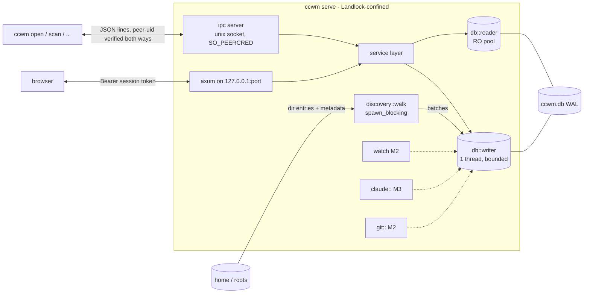

# ARCHITECTURE

Companion to `REQUIREMENTS.md` (the single source of truth, revision of 2026-11-23). Where this file and the
spec disagree, the spec wins. **Verified** = run on the development host; **Decision** = accepted by the
maintainer; **Open** = needs a decision. Nothing here is claimed to work until the milestone that builds it
has run it (see `ROADMAP.md`).

---

## 1. Verified environment (development host, 2026-11-23)

| Item | Observed |
|---|---|
| OS / kernel | Ubuntu 24.04.4 LTS, Linux 7.0.0-34-generic, x86_64 |
| Rust | rustc / cargo 1.94.0, clippy 0.1.94, rustfmt 1.8.0; targets include `x86_64-unknown-linux-musl` (installed by the maintainer) |
| git | 2.43.0. `--attr-source` appears in the 2.41.0 release notes (and is in 2.43's man page) ⇒ **minimum 2.41.0**; hardened status verified only on 2.43.0 |
| claude | 2.1.331; `claude --help` lists `--resume <session-id>` |
| systemd | 255 (`systemctl --user` works); `Linger=no` |
| Landlock | `landlock` in `/sys/kernel/security/lsm`; ABI **8** (queried via `landlock_create_ruleset`) ⇒ filesystem + TCP rules available |
| `unshare -rn` | **fails** (`apparmor_restrict_unprivileged_userns=1`) ⇒ security acceptance test 5 is skipped on this host |
| inotify | `max_user_watches=65536` ⇒ default budget `min(8192, 25 %)` = 8192; `max_user_instances=128` with ≥109 already used by other processes ⇒ ccwm uses exactly one instance |
| Env | uid 1000; `XDG_RUNTIME_DIR=/run/user/1000`; other XDG vars unset; `CLAUDE_CONFIG_DIR` unset |
| Not installed (maintainer installing) | `cargo-deny`, `musl-tools` |

---

## 2. Module map

One package `cc-workspace-manager`, binary `ccwm`, plus `lib.rs` so integration tests can reach modules.
Modules appear in the milestone that needs them; none are pre-created empty.

```
src/
  main.rs         # parse args; refuse root; apply Landlock BEFORE any thread is spawned; build runtime; map errors -> exit codes
  lib.rs
  exit.rs         # exit-code constants (M1: OK, ERROR, USAGE; M4 adds PORT_IN_USE, ALREADY_RUNNING)
  cli.rs          # clap definitions (+ unofficial notice in --help)
  client.rs       # M1: `open` -> Unix-socket client (peer verification, JSON lines). No HTTP client.
  paths.rs        # M1: Dirs{config,data,state,runtime}; XDG + fallbacks; 0700 creation + owner/mode verification; home = owned `$HOME`, else passwd
  config.rs       # M1: config.toml model (serde, deny_unknown_fields), defaults, validation
  clock.rs        # M1: Clock trait (System / Fake)
  sandbox.rs      # M1: Landlock policy, apply(), SandboxReport (what is actually active)
  instance.rs     # M1: flock + instance.json
  db/             # M1: mod (open, pragmas, migrations), writer.rs (1 thread), reader.rs (RO pool), queries.rs
  discovery/      # M1: exclusions.rs, mounts.rs (/proc/self/mountinfo), walk.rs (own DFS), status.rs
  auth/           # M1: tokens.rs (CSPRNG, SHA-256, ct-compare, Bootstrap store), sessions.rs
  service.rs      # M1: THE service layer: bootstrap, exchange, rotate, logout, revoke_all, list_projects, stats, discovery_status, service_status
  ipc/            # M1: server.rs (accept loop, SO_PEERCRED, JSON lines) + protocol.rs (Request/Response enums)
  http/           # M1: mod (router, state), middleware.rs, extract.rs (ApiJson/ApiQuery/SessionAuth), error.rs, routes.rs, assets.rs
  synth.rs        # M1: synthetic environment generator (feature `synth`; also used by tests)
  bin/ccwm-synth.rs   # M1: CLI for the generator (required-features = ["synth"])
  watch/ activity/ git/        # M2   (git/ is the only module that spawns `git`)
  claude/ privacy.rs           # M3   (claude/ is the only module that knows Claude's file formats)
web/ index.html app.css app.js # embedded with include_str!
scripts/ inspect-session-schema.py   # §19: maintainer-run, structure-only
tests/ …                       # integration tests; tests/fixtures/** reviewed synthetic fixtures only
deny.toml                      # bans HTTP-client/DNS crates (§11.5); CI in M4, runnable locally once cargo-deny is installed
```

Hard rules: only `git/` spawns git; only `claude/` knows session formats; only `db/writer.rs` writes SQLite;
no `rusqlite` call runs on a Tokio worker; every queue is bounded; HTTP handlers and Unix-socket ops call
`service.rs` — no business logic lives in a transport.

---

## 3. Data flow


Solid = M1. The CLI never uses TCP and never reads a token file; the browser never reaches the socket.

### Start sequence (`ccwm serve`)
1. Refuse if `geteuid()==0`. `umask(0o077)`. Parse args/config path.
2. Resolve dirs (`paths.rs`); create each `0700`; any existing dir must be owned by the euid and not group/world accessible, else fail (never silently `chmod` something we did not create).
3. Load `config.toml` (absent ⇒ defaults); compute discovery roots (config or passwd home) and the session dir.
4. **Apply Landlock now, on the main thread, before the Tokio runtime or any other thread exists** (`landlock_restrict_self` confines only the calling thread and its future children; threads created earlier would stay unconfined). Log the `SandboxReport`.
5. Build the Tokio runtime. Take the `flock` (lock file in the runtime dir). Open SQLite (`temp_store=MEMORY` so no temp files are needed under the sandbox), migrate, spawn writer + reader pool.
6. Bind TCP `127.0.0.1:port` (failure ⇒ clear message naming the port; exit 1 in M1, dedicated code in M4) and the Unix socket (remove a stale socket only if it is a socket we own; the lock proves no live daemon).
7. Write `instance.json` (pid, port, version, started_at; atomic rename).
8. Spawn discovery (background) and serve. Cached projects are readable immediately.
9. SIGTERM/SIGINT: stop accepting → cancel discovery → writer `Flush` + join → remove socket and `instance.json` → exit 0.

---

## 4. Dependencies (justification required by §3)

Spec-named: `axum` (`ws` from M2), `tokio`, `notify` (M2), `rusqlite` (`bundled`), `serde`, `serde_json`, `clap`,
`tracing`, `tracing-subscriber`, `toml`, `ignore`, `landlock`. Approved by the maintainer: `nix`, `sha2`,
`subtle`, `getrandom`, `base64`, `jiff` (M2), `regex` (M3). **Rejected: `ureq`; all HTTP/DNS client crates are
banned (§11.5).**

| Crate | Why |
|---|---|
| `nix` (`fs`,`user`,`process`,`signal`,`socket`) | `flock`, `geteuid`, passwd lookup (`getpwuid_r`), `umask`, `SO_PEERCRED` on the CLI side, `killpg` (M2) |
| `sha2`, `subtle`, `getrandom`, `base64` | token hashing, constant-time compare, OS CSPRNG, URL-safe token/cursor encoding |
| `landlock` | §11.5 sandbox |
| `ignore` (`gitignore` module only in M1) | user exclusion patterns with gitignore syntax; gitignore matching in M2 |
| dev: `tempfile` | temp dirs/repos |

Not added: `ureq`/`reqwest`/any client; `rust-embed` (`include_str!` for three files); `tracing-journald`
(stderr under systemd reaches journald); `r2d2*`; `uuid` (strict validator hand-written, M3); `tower-http`
(few lines of middleware); `http-body-util` (axum re-exports what is needed). Integration tests speak
HTTP/1.1 over `std::net::TcpStream` with a ~60-line helper — no client crate, not even as a dev-dependency.

MSRV: `rust-version = "1.94"` — the only toolchain tested here; widen in M4 when CI can test older ones.

---

## 5. SQLite schema

Per connection: `foreign_keys=ON`, `busy_timeout=5000`; writer also `journal_mode=WAL`, `synchronous=NORMAL`,
`temp_store=MEMORY`. Readers open `SQLITE_OPEN_READ_ONLY`. Migrations are embedded `.sql` files applied in a
transaction each, bumping `PRAGMA user_version`; each milestone adds only the tables it uses. Timestamps are
Unix seconds (UTC). IDs are 128-bit CSPRNG hex (32 chars), opaque and validated.

### Migration 1 (M1)
```sql
CREATE TABLE meta (key TEXT PRIMARY KEY, value TEXT NOT NULL) WITHOUT ROWID;
CREATE TABLE projects (
  id TEXT PRIMARY KEY CHECK (length(id) = 32),
  canonical_path TEXT NOT NULL UNIQUE,
  name TEXT NOT NULL,
  first_seen_at INTEGER NOT NULL,
  last_seen_at INTEGER NOT NULL);
CREATE INDEX projects_name ON projects (name COLLATE NOCASE, id);
CREATE TABLE project_sources (
  project_id TEXT NOT NULL REFERENCES projects(id) ON DELETE CASCADE,
  source TEXT NOT NULL CHECK (source IN ('marker','session')),
  first_seen_at INTEGER NOT NULL,
  PRIMARY KEY (project_id, source)) WITHOUT ROWID;
CREATE TABLE auth_sessions (
  id TEXT PRIMARY KEY,                 -- stable across rotations; not the token
  token_hash BLOB NOT NULL UNIQUE,     -- SHA-256
  prev_token_hash BLOB UNIQUE, prev_valid_until INTEGER,   -- 60 s rotation grace
  created_at INTEGER NOT NULL, last_used_at INTEGER NOT NULL, rotated_at INTEGER NOT NULL,
  expires_at INTEGER NOT NULL);        -- sliding 30 days, bumped at most every 5 min
```
Later: **M2** `ignored_paths`, `file_events`, `git_cache`, activity/missing/monitoring columns, sort indexes;
**M3** `sessions` (aggregates only: min/max timestamps, first/last cwd, title, `is_sidechain`) and
`session_file_checkpoints`; prompt text only if the opt-in "Store prompt text" is on. No per-record table.

**Writer:** one `std::thread`, `sync_channel(1024)` of `WriteCmd` (`UpsertProjects`, `CreateSession`,
`RotateSession`, `DeleteSession`, `TouchSession`, `RevokeAll`, `SetMeta`, `Flush`, `Shutdown`); commands needing
an answer carry a `tokio::sync::oneshot::Sender`. Loop: block on one command, drain up to 256 more (or 50 ms),
apply in **one transaction**, answer. Events are published after commit. `TouchSession` is best-effort
(`try_send`, drop when full). **Reader pool:** 4 read-only connections behind `Mutex<Vec<_>>`+`Condvar`;
async facade is `spawn_blocking`.

---

## 6. Configuration (`config.toml`, read at startup only)

```toml
[server]
port = 8765                  # 1024..=65535; `--port 0` (ephemeral) is accepted for tests only
[discovery]
roots = []                   # empty ⇒ home (owned $HOME, else passwd)
exclude = []                 # extra gitignore-syntax patterns, relative to each root
max_depth = 10
same_file_system = true
```
`deny_unknown_fields`. Symlink-following is not configurable in v0.1 (never followed). M2+ adds keys as used
(`git.allow_unhardened_status`, scan interval, watch budget, thresholds, retention, …).

---

## 7. M1 discovery

Own iterative DFS over `std::fs::read_dir` inside `spawn_blocking` (not `ignore::Walk`: it hides
`.git`, yields files interleaved with sub-directories — which makes "is my ancestor a project?" order-dependent —
and cannot compare exact entry names without extra work).

1. Roots: configured or home; each canonicalized; must be a readable directory; rejected if inside a hard boundary (`/proc /sys /dev /run`, ccwm config/data/state/**runtime**). Bad roots are reported, never fatal.
2. Per directory: `read_dir`; **marker** = an entry named exactly `CLAUDE.md` that is a file, or a symlink whose canonical target is a regular file under the canonical directory (anything else is counted as `rejected_markers`). No file contents are read in M1.
3. **Nested rule** (preorder, so ancestors are known): a marker directory B becomes a project unless a registered ancestor A exists and `symlink_metadata(B/.git)` is absent (then B's marker is "a nested instruction file of A"). The home directory itself is never registered.
4. Descend into subdirectories (real directories only; symlinks never followed) in name order **unless**: hidden (`.*`), default-excluded (`node_modules target build dist venv __pycache__ snap`[home only] `VirtualBox VMs`), user-excluded (gitignore patterns), a FUSE mount point (type `fuse*` from `/proc/self/mountinfo`), on another device (`same_file_system`), under a hard boundary, deeper than `max_depth`, or **not valid UTF-8** (counted). Pruning happens before descending.
5. Candidates stream to the writer in batches (≤64 or 250 ms), keyed by canonical path (existing rows keep their `id`). Counters (dirs visited, projects found, skipped: permission / vanished / excluded / non_utf8 / rejected_markers / other) update `DiscoveryStatus`. Errors never abort the walk; user-visible samples show only `…/<last two components>`.
6. Phases `idle → scanning → idle`; `last_success_at` persisted in `meta`. M1 scans once at startup; vanished projects are **not** removed in M1 (missing state is M2).

---

## 8. API and IPC contracts

### HTTP pipeline (every response, in this order)
1. **Security headers** (outermost, so error responses carry them): `X-Content-Type-Options: nosniff`, `Referrer-Policy: no-referrer`, `Cross-Origin-Opener-Policy: same-origin`, the §11.3 CSP; `Cache-Control: no-store` on `/api`.
2. **Host check**: exactly `127.0.0.1:<bound port>`, `localhost:<port>`, `[::1]:<port>` (case-insensitive) else `421 host_not_allowed`.
3. **Origin check** (`/api`): any `Origin` other than `http://127.0.0.1:<bound port>` ⇒ `403 origin_not_allowed`; POST/PUT/DELETE without `Origin` ⇒ 403 too. No CORS headers, ever; `OPTIONS` ⇒ 405.
4. **Auth** by route: `Public` (health, assets, `auth/exchange`) or `Session` (everything else). Tokens: SHA-256 → DB lookup → `subtle` compare of digests → expiry via `Clock`.
5. Bodies ≤ 16 KiB (`413 payload_too_large`); unknown query keys or bad values ⇒ `400 invalid_argument`.

Errors: `{"error":{"code":"…","message":"…"}}` — codes `invalid_argument 400`, `unauthorized 401`,
`origin_not_allowed 403`, `not_found 404`, `method_not_allowed 405`, `payload_too_large 413`,
`host_not_allowed 421`, `internal 500` (generic message; details only in logs, never content).

### Browser endpoints (M1)
| | | |
|---|---|---|
| `GET /health` | Public | `{"status":"ok","version":"0.1.0"}` — never proof of identity |
| `POST /auth/exchange` | Public + Origin | `{"bootstrap_token"}` → `{"session_token","expires_at","rotate_after"}`; bad/used/expired ⇒ identical 401 |
| `POST /auth/rotate` | Session | → new `session_token` (+ times); the old token stays valid 60 s |
| `POST /auth/logout` | Session | revokes the session → 204 |
| `GET /projects` | Session | `q`, `sort` (`activity`\|`name`), `order`, `limit` 1–200 (default 50), `cursor` → `{"items":[{"id","name","path","sources","first_seen_at"}],"next_cursor","total"}`. In M1 `activity` has no timestamps, so (unknown sorts last, ties by name) it equals name order. Other §12 filters arrive with their milestone and are rejected as unknown until then. |
| `GET /stats` | Session | `{"total_projects":n}`; later milestones add fields — unknown values are never emitted as `0` |
| `GET /discovery/status` | Session | `{"phase","dirs_visited","projects_found","skipped":{…},"roots":[{"path","state"}],"last_success_at","next_scan_at"}` |
| `GET /service/status` | Session | M1 subset: `version`, `uptime_s`, `port`, `sandbox{abi,status,filesystem,network,notes}`, `discovery{phase,last_success_at}` |

Keyset cursors: base64url JSON `{s,o,k,i}`; a cursor whose `s`/`o` differ from the request, or is malformed, ⇒ 400.

### Unix-socket protocol (CLI ↔ daemon)
Path `<runtime dir>/ccwm.sock` (runtime dir = `$XDG_RUNTIME_DIR/ccwm`, else `$XDG_STATE_HOME/ccwm/run`; `0700`,
owned by the user, verified; socket `0600`; path must be ≤ 107 bytes or startup fails). Per connection:
1. Daemon: `peer_cred().uid == geteuid()` else close silently (counted, logged without content).
2. Client, before sending anything: `getsockopt(SO_PEERCRED)` uid must equal its own `getuid()`.
3. One request line (≤ 4 KiB, 2 s read timeout) → one response line → close.

```
{"op":"ping"}                → {"ok":{"version":"0.1.0"}}
{"op":"auth.bootstrap"}      → {"ok":{"bootstrap_token":"…","expires_in":60,"port":8765}}
{"op":"auth.revoke_all"}     → {"ok":{"revoked":3}}
{"op":"service.status"}      → {"ok":{…same body as GET /service/status…}}
errors                       → {"error":{"code":"…","message":"…"}}   (same codes as HTTP)
```
`ccwm open` uses `auth.bootstrap` only; the URL's port comes from the daemon, not from `instance.json` or a TCP
probe, so an impostor on the TCP port receives nothing. Bootstrap tokens live in memory only: 32 random bytes,
single-use, 60 s, ≤16 outstanding.

---

## 9. Sandbox (Landlock) policy

Built with the `landlock` crate in best-effort mode at the highest supported ABI; report what is **actually**
active (never what was requested).

| Access | Paths |
|---|---|
| read + execute | discovery roots; Claude session dir (`CLAUDE_CONFIG_DIR` or `~/.claude`); `/usr`, `/etc`, `/lib`, `/lib64`, `/bin`, `/sbin`, `/proc` (inotify limits, mountinfo); the `--config` file's directory |
| read + write (create/remove/truncate/make-sock) | ccwm config, data, state, runtime dirs |
| read + write file | `/dev/null` only |
| network (ABI ≥ 4) | all TCP `connect` denied; `bind` allowed only on the configured port |

`SandboxReport {abi, status: Full|Partial|NotEnforced, filesystem: bool, network: bool, notes[]}` goes to the
startup log and `service.status`. Child processes inherit the ruleset. Known consequences: roots added at
runtime (M3 settings) outside the startup read set cannot be read until restart — reported as "requires
restart" (**Open**, M3); `claude` located outside the allowed system paths cannot be executed (M3).
**Verified in M1 tests:** self-re-exec child applies the policy and asserts a write outside the ccwm dirs, an
outbound TCP connect, and the same from a spawned `/bin/sh` child are all denied, while writes inside, bind on
the allowed port and Unix-socket serving still work. The Git-subprocess variant of test 11 lands with the Git
module (M2).

---

## 10. Test plan (M1) and the security acceptance tests

- **Unit:** exclusions & hard boundaries; mountinfo parsing (incl. `\040`); marker rules (case, dir named `CLAUDE.md`, symlink in/out/dangling/loop); nested resolution; non-UTF-8 skip; `max_depth`; symlinked dirs not followed; `same_file_system` (best effort: needs a second device; skipped with notice); paths (modes, ownership, 108-byte limit, fallback); config validation; migrations idempotent; writer batching/flush/back-pressure; token primitives; bootstrap (single-use, expiry via `FakeClock`); sessions (create, slide, rotate + grace, logout, revoke-all); cursor round-trip/forgery; peer-uid decision function.
- **HTTP via `tower::ServiceExt::oneshot`:** no/bad/expired/revoked token, wrong Host, wrong/`null`/`localhost` Origin, state-changing without Origin, header set on every response class (incl. 401/404/421), `OPTIONS` 405, oversized body, unknown query keys, traversal-looking paths and ids, error bodies free of secrets.
- **Process-level (real `ccwm` in a synthetic env, `--port 0`):** serve → `open --print` → exchange → list projects → rotate → logout; SIGTERM clean exit; restart serves cached projects before the new scan completes; second instance exits; **impostor**: with no daemon, a TCP listener on the would-be port receives **zero** connections from `ccwm open`; startup log and `service.status` show the sandbox report.
- **Security acceptance tests in M1:** **1** (hash the whole synthetic tree incl. mtimes/modes before/after a full discovery), **6** (no token, expired, revoked, wrong Origin, wrong Host, simulated peer-UID mismatch; cross-user check documented as manual), **7** (traversal and symlink escapes in project ids, static paths, `--config`, markers), **9** (a `tests/hygiene.rs` runs `git check-ignore` over db/WAL/SHM/socket/config/state/`*.jsonl`-outside-fixtures and asserts the fixtures are *not* ignored; skipped with notice if git is absent), **11** (above).
- `web/` grep test: no `innerHTML|outerHTML|insertAdjacentHTML|document.write|eval(|new Function`. `app.js` logic is exercised by `node --test` only if node exists (not a build requirement); otherwise documented manual steps.
- All tests use temp dirs and synthetic data; none reads the real `$HOME` or `~/.claude`. Cargo itself runs with the normal environment, **never** under the synthetic `HOME` (`CARGO_HOME`/`RUSTUP_HOME` are not redirected; the synthetic env is applied only to spawned `ccwm` processes).
- **Synthetic environment generator** (`src/synth.rs`, `ccwm-synth <dir>`): creates `home/`, XDG dirs and `claude/` (`CLAUDE_CONFIG_DIR`) under the given dir (default a fresh `/tmp/ccwm-synth-XXXX`), populates projects (marker, symlinked marker, nested git/non-git, excluded dirs, symlink loop, non-UTF-8 name, deep tree, decoys like `claude.md`) and minimal synthetic session files, and prints the `env` line to use. Shared by tests and manual runs (DRY).
- **Schema inspection script** (`scripts/inspect-session-schema.py`): structure-only per §19; written and tested **only against synthetic data**; the maintainer runs it. Output: key paths + value types, values of an allowlisted set of low-cardinality discriminators (each value must match `^[A-Za-z0-9_.:-]{1,32}$` or is replaced by `<other>`), per-type record counts, file counts and directory-shape patterns (UUIDs → `<uuid>`); no other strings, no real paths.

---

## 11. Verified Claude Code session schema (structural inspection by the agent, accepted by the maintainer; further inspection only via §19)

Data written by Claude Code 2.1.217–2.1.331 (17 versions on one machine). 697 top-level session files, 83
subagent files, 498 MB; largest file 76 MB; longest line 1.9 MB (≥17 lines > 1 MiB) ⇒ the 8 MiB cap is safe;
0 malformed lines. Claude Code prunes old sessions, so a project's latest session can disappear.

**Layout**
```
<config dir>/projects/<encoded-cwd>/<session-uuid>.jsonl                     # sessions
<config dir>/projects/<encoded-cwd>/<session-uuid>/subagents/agent-<hex>.jsonl (+ .json)   # ignored in v0.1
<config dir>/projects/<encoded-cwd>/<session-uuid>/tool-results/…, memory/…, .session-aliases   # not sessions
```
Filename stem = `sessionId` in 697/697 files and always a UUID; `<encoded-cwd>` = first cwd with non-alphanumerics → `-`
(697/697) — a consistency check only, never used to derive paths. Subagent records carry `isSidechain:true`,
`agentId` and the parent's `sessionId`.

**Records:** ~26 types (`attachment`, `assistant`, `user`, `api-request*`, `last-prompt`, `ai-title`, `system`,
`queue-operation`, `session-owner`, `cost-state`, `file-history-*`, …); the set drifts between versions ⇒
unknown types are skipped and counted. `cwd` exists only on `user|assistant|attachment|system` ("conversational");
`timestamp` is ISO-8601 UTC (`YYYY-MM-DDTHH:MM:SS.mmmZ`) on those plus several others.

**Decisions derived from the findings (all in the spec now)**
1. Timestamps are unordered within files (695/697) ⇒ `started_at = min`, `last_activity_at = max` over conversational records; idempotent aggregates make restarts safe without a per-record dedup key (most types have no `uuid`).
2. 8 files change cwd mid-session ⇒ store first and last; **resume uses the first** (its encoding names the containing directory). Running `claude --resume` from another directory is untested.
3. `user` records (7,745): 5,939 tool results (`toolUseResult`, `tool_result` blocks); `promptSource` values seen: `typed`, `queued`, `sdk`, `system`, `suggestion_accepted`; `turnOrigin`: `human`, `sdk`, `task_notification`; `isMeta` (129), `isCompactSummary` (33); ~90 records lack `promptSource`. **Genuine = `promptSource` ∈ {`typed`,`queued`}; `sdk`/`system` never; records without `promptSource` use the classifier** (not `isMeta`/`isSidechain`/`isCompactSummary`, no `toolUseResult`/`tool_result`, `turnOrigin ≠ task_notification`, text not starting with a synthetic tag such as `<task-notification>`, `<local-command-caveat>`, `<command-name>`, `<local-command-stdout>`, `<bash-input>`, `<bash-stdout>`, `<system-reminder>`, `<command-message>`). **Open (M3):** `suggestion_accepted` (human-origin) is not listed by the maintainer; treated as *not genuine* until the §19 output says otherwise.
4. `last-prompt` records are truncated (≤ ~201 chars) ⇒ never used for the last prompt.
5. Title: `ai-title` records, last wins, labeled *recorded*, redacted.
6. Sensitive record types exist (`session-owner` account/org ids, `cost-state` amounts, `api-request-blob` full payloads) ⇒ deserialize into a minimal struct with `#[serde(default)]`; ignore everything else (also keeps 1.9 MB lines cheap).
7. Cold-parse cost of ~500 MB is unmeasured; M3 measures it (maintainer-run, §19) and may skip `api-request-blob` lines cheaply.

---

## 12. Git hardening — verified results (git 2.43.0)

Method: throw-away repos in the session scratchpad, `env -i` with only the §6 environment and flags, malicious
repo-local config whose command touches a sentinel file; a control run without mitigations proves the test can
detect execution.

| Vector | §6 base flags only | Control |
|---|---|---|
| `core.fsmonitor=<cmd>` | not executed | executed |
| `filter.<n>.clean` via `.gitattributes` | **executed** | executed |
| same via `.git/info/attributes` | **executed** | executed |
| `core.pager`, `diff.external`, `core.sshCommand` | not reached by `status`/`rev-parse`/`log -1` | — |
| hooks | `status` runs none (maintainer decision: no hook test) | — |

Verified mitigation (now §6 of the spec): `--attr-source=<empty tree>` stops worktree `.gitattributes` filters;
nulling every `filter.<name>.{clean,smudge,process}` (+ `required=false`) from **all scopes** stops
`info/attributes`-selected ones; neither alone suffices, together no sentinel appeared and status stayed correct.
**Minimum git: 2.41.0** (release notes); verified on 2.43.0 only; older ⇒ worktree status disabled
("status disabled: git too old to harden") unless `git.allow_unhardened_status = true`. Consequence to
document: git-lfs/`eol` repos can show different status than the user's own `git status`. Implementation is M2.

---

## 13. systemd user unit — verified (systemd 255)

Accepted in a transient user unit: `NoNewPrivileges`, `Nice`, `IOSchedulingClass=idle`, `UMask`, `PrivateTmp`,
`ProtectSystem=strict`, `ProtectHome=read-only`, `ProtectKernelTunables`, `RestrictNamespaces`,
`RestrictAddressFamilies`, `MemoryDenyWriteExecute`, `LockPersonality`, `SystemCallArchitectures`,
`ProtectProc=invisible`, `SystemCallFilter=@system-service`. **Rejected: `PrivateDevices=yes`.** Per the spec,
Landlock is the primary enforcement; the extras are optional defense in depth, added in M4 only after the real
daemon is tested under them (`ReadWritePaths=` for ccwm's dirs). `Type=exec`; port-in-use and lock-held exit
codes go in `RestartPreventExitStatus=`.

---

## 13a. M1 verification notes (what was actually run)

- Landlock on this host (Linux 7.0, ABI 8): `tests/sandbox.rs` re-executes the test binary, applies the policy, and verifies that writes outside the allowed directories, reads outside the allowed paths, outbound TCP connects and binds to other ports are denied — for the process **and** for `/bin/sh`/`/bin/bash` children — while writes in ccwm's directories, `/dev/null`, Unix-socket binding and the allowed TCP port work. A real daemon run reported `fully_enforced abi=8 filesystem=true network=true` and `NoNewPrivs: 1`. `--port 0` needs an explicit `NetPort(0)` rule (granted automatically because the configured port is 0).
- `hyper`/`hyper-util` are in the tree only with their `server` features (checked with `cargo tree -e features`); no client crates. `deny.toml` encodes the bans but `cargo-deny` has **not** been run (not installed here).
- The UI was exercised with a Node DOM stub against a live synthetic daemon (fragment removal, exchange, listing, session storage). It has **not** been viewed in a real browser (extension not connected).
- Sign-in links printed by `ccwm open --print` contain the single-use token by design; the log never does (asserted).

## 14. Decisions log and remaining open items

Decided (2026-11-23): Git fix accepted (min 2.41.0, disabled-by-default fallback + opt-in); all schema findings
accepted; `~/.cargo` cache allowed, synthetic HOME for every `ccwm` run, cargo never under the synthetic HOME;
musl target/`musl-tools`/`cargo-deny` installed by the maintainer; `POST /auth/rotate` with 60 s grace; polling
in M1, WebSocket in M2; top-level session files only, aggregates not per-record dedup; prompts: `typed`/`queued`;
non-UTF-8 paths skipped and counted; dependency set in §4; one inotify instance; runtime-dir fallback must be
owned/0700 and respect 108 bytes; only allowed Origin `http://127.0.0.1:<port>`; no HTTP client crates.

Open:
- **O1 (M3):** Landlock vs. "roots change without restart" (§4.1): roots added later outside the startup read set need a restart; Settings must say so. Not a blocker for M1.
- **O2 (M3):** `suggestion_accepted` prompts; `claude` binary outside allowed system paths.
- **O3 (M4):** crate/GitHub/distro naming-conflict check needs outbound requests — needs the maintainer's OK.
- **O4:** `app.js` DOM tests only if Node is present.
