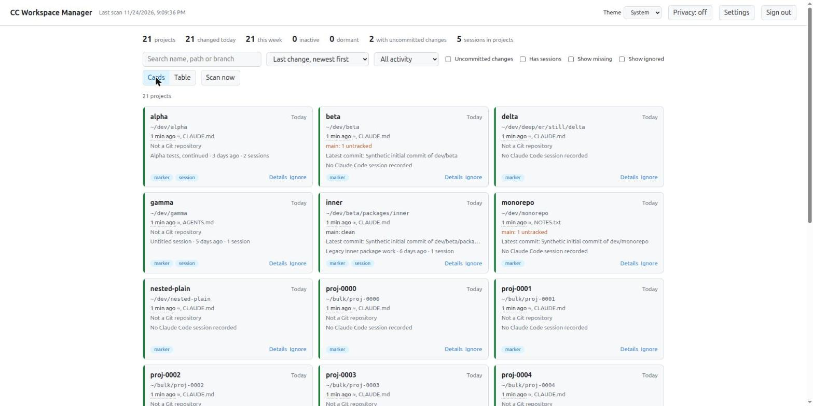
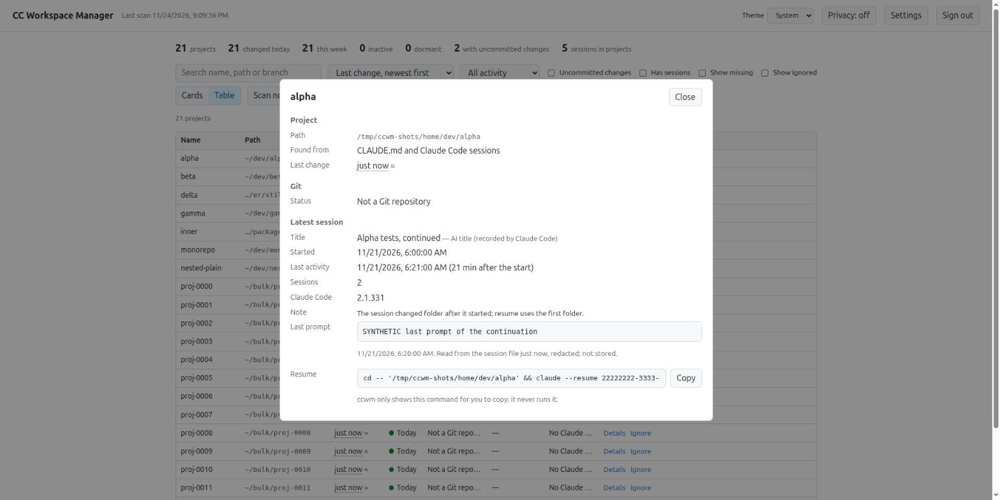
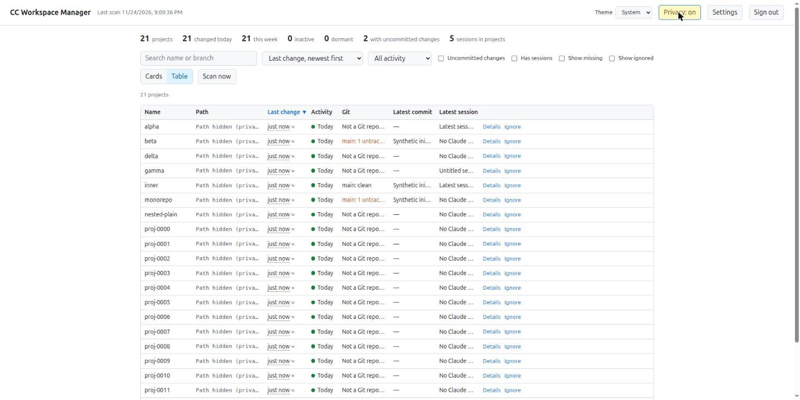

# CC Workspace Manager (`ccwm`)

Discover, track, and resume your Claude Code projects.

CC Workspace Manager is an **independent, unofficial** open-source project. Claude and Claude Code are trademarks of Anthropic, PBC. This project is independent and not affiliated with or endorsed by Anthropic.

`ccwm` is a small local daemon with a browser dashboard. It finds the folders on your machine that are Claude Code projects: those your Claude Code sessions started in, and those containing a `CLAUDE.md`. It shows which ones you worked on recently, their Git state, and where you left off. It also gives you the command to resume the last session. It is a project-centric workspace manager, not a token or cost dashboard.

> **Status: v0.2.0 (unreleased).** v0.1 plus the session activity indicator. Tested only on Linux x86_64 (Ubuntu 24.04, kernel 7.0, systemd 255, Git 2.43). See [CHANGELOG.md](CHANGELOG.md) for what has not been run yet.



## What it does

- **Finds projects** from your Claude Code sessions (the folder each session started in, resolved to its Git repository) and from `CLAUDE.md` files. It skips hidden, generated and dependency folders, and never descends into excluded trees. [How discovery works](docs/discovery.md).
- **Tracks activity live**: the latest meaningful file change per project, through one inotify instance with non-recursive watches and a budget. Gitignored files and `.git/` do not count. Folders without a watch are checked periodically.
- **Shows Git state**: branch, ahead/behind, staged/modified/untracked counts, the latest commit. It reads them with hardened, allowlisted Git commands that never run repository-defined helpers or contact a remote.
- **Picks up where you left off**: the latest session's AI title, the last prompt (read from the session file when you open the details, redacted, not stored), and a resume command to copy (`cd -- '<folder>' && claude --resume <id>`). ccwm never runs it.
- **Shows which sessions are open and what Claude is doing** (v0.2, opt-in): "Needs approval", "Working", "Waiting for input" per project, live, from Claude Code hooks you add (`ccwm hooks print`) and the session files. [The session activity indicator](docs/session-hooks.md).
- **Card and table views**, search, sort, filters, live updates, light/dark themes, a Settings page, and a **privacy mode** that the server enforces.

| Detail panel | Privacy mode |
|---|---|
|  |  |

*Screenshots from the synthetic test environment (`ccwm-synth`), not from real projects.*

## Privacy and security in one paragraph

ccwm reads your projects. It never modifies them, pushes them, or sends anything anywhere: there is no telemetry and no update check, and the only network traffic is loopback HTTP/WebSocket to your own browser. The daemon confines itself with **Landlock** (read-only on your projects, writes only to its own directories, no outbound TCP) and a **seccomp** filter (no new sockets once it is listening). It runs Git with repository-defined helpers neutralised, and it serves only connections that belong to your own Linux user. Sign-in uses single-use links over a peer-verified Unix socket. Prompts are never stored unless you opt in, and secrets are redacted on a best-effort basis. [SECURITY.md](SECURITY.md) has the threat model and the residual risks, and [docs/data-retention.md](docs/data-retention.md) lists what is stored and how to delete it.

## Install (from a release)

Releases ship one static binary for **Linux x86_64** (`x86_64-unknown-linux-musl`). It needs no runtime libraries. `git` (2.41+) is optional, and so is `claude`.

```bash
sha256sum -c SHA256SUMS                                   # the archive and SHA256SUMS from the release page
tar -xzf ccwm-0.1.1-x86_64-unknown-linux-musl.tar.gz
cd ccwm-0.1.1-x86_64-unknown-linux-musl
scripts/install.sh      # ~/.local/bin/ccwm + a systemd user service that starts at login; no root
ccwm open               # opens the dashboard, signed in
```

Uninstall with `scripts/uninstall.sh`, which keeps your data, or `scripts/uninstall.sh --purge`, which asks first, then deletes ccwm's data. Your projects and Claude Code sessions are never touched either way. [Service management](docs/service.md) covers start/stop/logs, foreground mode, and starting at boot (lingering).

## Quick start (from source)

Requires Rust 1.94 on Linux.

```bash
cargo build --release
target/release/ccwm serve            # the daemon, in the foreground (port 8765)
target/release/ccwm open             # in another terminal: opens the dashboard, signed in
```

To try it without touching your real home directory, use a synthetic environment:

```bash
cargo build
target/debug/ccwm-synth /tmp/ccwm-demo --projects 30
env $(cat /tmp/ccwm-demo/env) target/debug/ccwm serve --port 8766 &
env $(cat /tmp/ccwm-demo/env) target/debug/ccwm open --print
```

## Commands

| | |
|---|---|
| `ccwm serve [--port N] [--config PATH]` | run the daemon in the foreground (what the service runs) |
| `ccwm open [--print]` | single-use sign-in link for the dashboard |
| `ccwm status` | service state, daemon state, monitoring, sandbox, sessions |
| `ccwm scan` | rescan now and wait for it |
| `ccwm doctor` | check the installation and suggest fixes (it changes nothing) |
| `ccwm start` / `stop` / `restart` | control the systemd user service |
| `ccwm service install` / `uninstall [--purge]` | install or remove the systemd user unit |
| `ccwm auth revoke-all` | sign out every browser |
| `ccwm hooks print` | the Claude Code hooks of the session activity indicator, to add to your settings |
| `ccwm hooks events [--follow]` | the hook events the daemon received (time, event, session id, outcome) |
| `ccwm hook <Event>` | run by Claude Code from those hooks (reads the event on stdin; always exits 0) |

## Documentation

- [docs/configuration.md](docs/configuration.md): every setting, its default, and whether it needs a restart.
- [docs/discovery.md](docs/discovery.md): what counts as a project, roots and exclusions, missing projects, watching.
- [docs/service.md](docs/service.md): install, systemd, logs, start at login vs. at boot.
- [docs/session-hooks.md](docs/session-hooks.md): the session activity indicator — the hooks, the states, what Claude Code does not report.
- [docs/troubleshooting.md](docs/troubleshooting.md): inotify limits, Landlock unavailable, port collisions, `claude` not found.
- [docs/data-retention.md](docs/data-retention.md): what is stored, and how to delete it.
- [docs/benchmarks.md](docs/benchmarks.md): measured CPU, memory and timings, with the method.
- [SECURITY.md](SECURITY.md): threat model, protections, residual risks, reporting.
- [REQUIREMENTS.md](REQUIREMENTS.md) (the specification), [ARCHITECTURE.md](ARCHITECTURE.md), [ROADMAP.md](ROADMAP.md), [CONTRIBUTING.md](CONTRIBUTING.md), [CHANGELOG.md](CHANGELOG.md).

## License

MIT, see [LICENSE](LICENSE). Release archives include the licenses of all bundled dependencies (`THIRD_PARTY_LICENSES`, generated with cargo-about).
