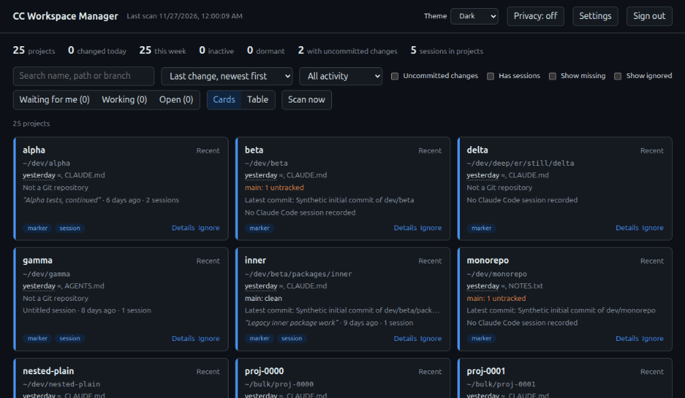
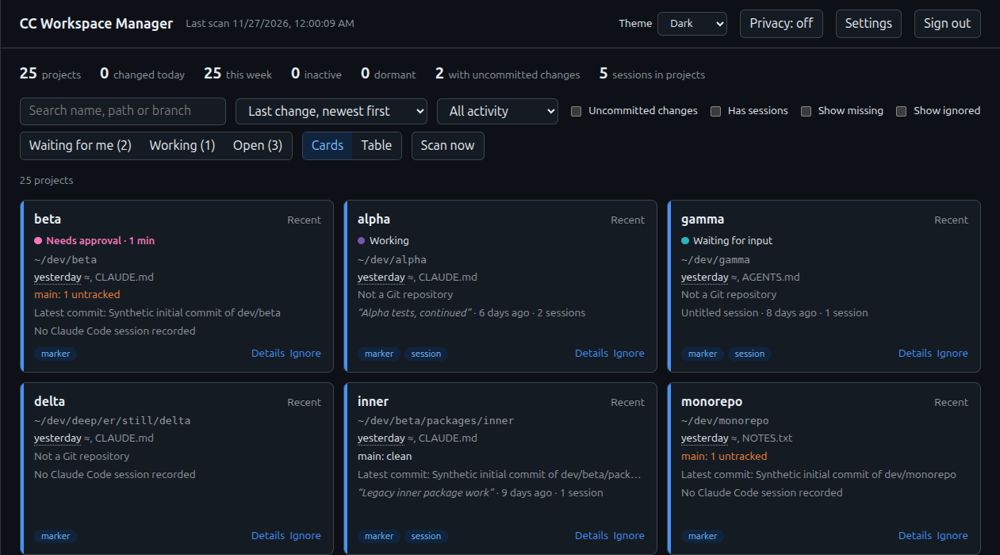
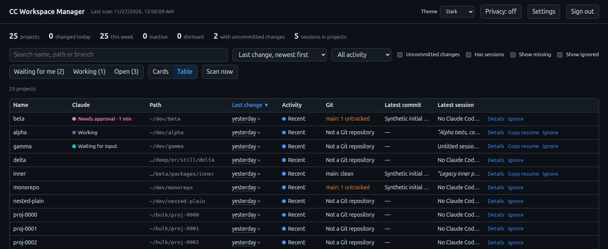
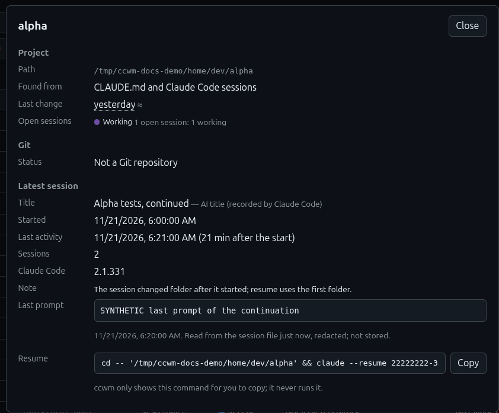

# CC Workspace Manager (`ccwm`)

A local dashboard that finds your Claude Code projects, shows where you left off, and tells you which sessions need you.

CC Workspace Manager is an **independent, unofficial** open-source project. Claude and Claude Code are trademarks of Anthropic, PBC. This project is not affiliated with or endorsed by Anthropic.



*Synthetic test data (`ccwm-synth`), not real projects.*

## Why this exists

If you use Claude Code across many projects, it gets hard to remember where each one stands, which session to resume, and which terminal is waiting for an approval. ccwm finds your projects on its own, from your Claude Code sessions and `CLAUDE.md` files, and shows them in one place with their Git state and, if you turn it on, what each open session is doing right now. It runs entirely on your machine, only reads your projects, and confines itself with Landlock and seccomp.

## Features

- **Finds projects automatically** from Claude Code sessions and `CLAUDE.md` files. Nothing to register.
- **Sorts by real activity**: the latest meaningful file change, watched live with inotify. Gitignored files and `.git/` don't count.
- **Git status at a glance**: branch, ahead/behind, uncommitted changes, latest commit. Read with hardened Git commands that never contact a remote.
- **Live session states** (opt-in, through Claude Code hooks): **Needs approval**, **Working**, **Waiting for input**. Projects with an open session come first.
- **Resume where you left off**: the latest session's title and last prompt, plus a `claude --resume` command to copy. ccwm never runs it.
- **Privacy mode**, enforced by the server: it hides paths, user names, remote URLs, session titles, prompts and resume commands, for screen sharing.
- **Sandboxed and local**: read-only on your projects, loopback only, no telemetry. Landlock and a seccomp filter keep the daemon to what it needs.

| Cards | Table | Details |
|---|---|---|
|  |  |  |

## Quick start

Linux x86_64 only for now (one static binary). Download the release and its checksum file, verify, install, open:

```bash
curl -fLO https://github.com/aman-2709/cc-workspace-manager/releases/download/v0.2.0/ccwm-0.2.0-x86_64-unknown-linux-musl.tar.gz
curl -fLO https://github.com/aman-2709/cc-workspace-manager/releases/download/v0.2.0/SHA256SUMS
sha256sum -c SHA256SUMS
tar -xzf ccwm-0.2.0-x86_64-unknown-linux-musl.tar.gz
cd ccwm-0.2.0-x86_64-unknown-linux-musl && scripts/install.sh
ccwm open
```

`install.sh` puts `ccwm` in `~/.local/bin` and starts it as a systemd user service. It needs no root. To turn on the live session states, see the [user guide](docs/user-guide.md#6-turn-on-the-live-session-indicator).

> **Status: v0.2.0.** Tested on Ubuntu 24.04 (kernel 7.0, systemd 255, Git 2.43) with Claude Code 2.1.332. See the [CHANGELOG](CHANGELOG.md) for what has not been run yet.

## Privacy and security

ccwm reads your projects and Claude Code's session files and never modifies either. It sends nothing anywhere: the only network traffic is loopback HTTP to your own browser, and only connections from your own Linux user are served. Sign-in uses single-use links. Prompts are not stored unless you opt in. [SECURITY.md](SECURITY.md) has the threat model and the residual risks, and [data retention](docs/data-retention.md) lists what is stored and how to delete it.

## Documentation

- [User guide](docs/user-guide.md): install, run, sign in, the session indicator, everyday use, update, uninstall.
- [How it works](docs/how-it-works.md): the architecture, a session step by step, the session states, and what ccwm reads, stores and never does.
- [Configuration](docs/configuration.md): every setting and its default.
- [Session hooks](docs/session-hooks.md): how the live session states work and what Claude Code does not report.
- [Troubleshooting](docs/troubleshooting.md)
- [Contributing](CONTRIBUTING.md)
- More: [discovery](docs/discovery.md), [service](docs/service.md), [benchmarks](docs/benchmarks.md), [specification](REQUIREMENTS.md), [architecture](ARCHITECTURE.md).

## License

MIT, see [LICENSE](LICENSE). Release archives include the licenses of all bundled dependencies (`THIRD_PARTY_LICENSES`).
