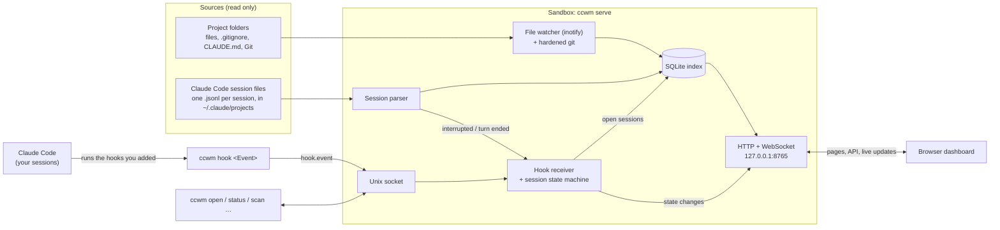
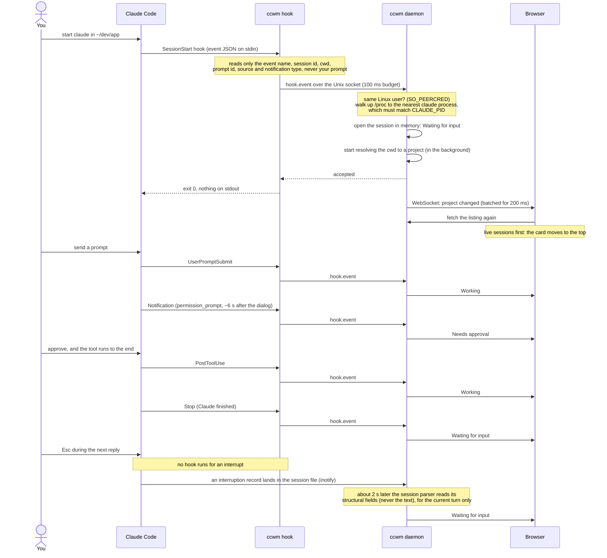
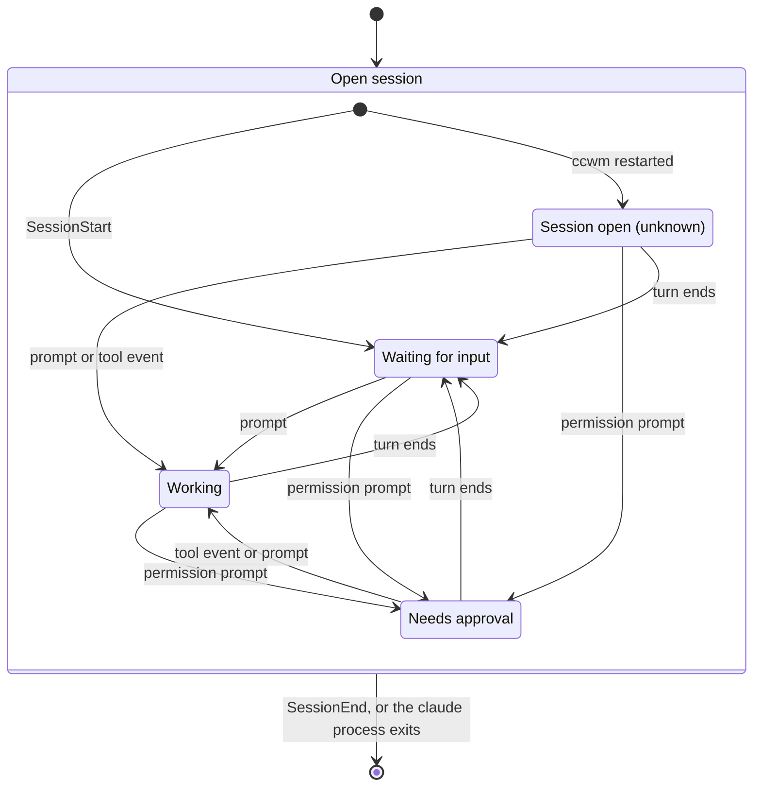

# How ccwm works

A plain-language tour for users and new contributors. It is not the specification:
[REQUIREMENTS.md](../REQUIREMENTS.md) is, and [ARCHITECTURE.md](../ARCHITECTURE.md) has the depth (module map,
[data flow](../ARCHITECTURE.md#3-data-flow), [sandbox policy](../ARCHITECTURE.md#9-sandbox-landlock-policy),
[the indicator's state machine](../ARCHITECTURE.md#state-machine)).

## The big picture

ccwm is one daemon (`ccwm serve`) that runs as your user. It reads three sources, keeps an index in SQLite,
and serves a dashboard to your browser on `127.0.0.1`. The `ccwm` commands talk to it over a Unix socket.

Everything inside the box runs confined: Landlock lets the daemon read your projects and Claude Code's
session folder but write only its own directories, and lets it accept TCP connections on its port but open
none; a seccomp filter forbids new sockets once it is listening. Its `git` children inherit both. `ccwm hook`
and the other commands run outside, as you, like any command you type.

## A session, step by step

What happens when you start `claude` in a project, with ccwm's hooks in your Claude Code settings:

Each hook is a guarded one-liner (`command -v '<ccwm>' … && '<ccwm>' hook <Event> >/dev/null; exit 0`), so
it does nothing when ccwm is missing, never prints, and never fails or blocks Claude Code. Details and limits:
[session-hooks.md](session-hooks.md).

## The states of a session

| Label | Events |
|---|---|
| prompt | `UserPromptSubmit` |
| permission prompt | `Notification` with `permission_prompt` (about 6 s after the dialog appears) |
| tool event | `PostToolUse`, `PostToolUseFailure`, `PostToolBatch` |
| turn ends | `Stop`, `StopFailure`, `Notification` with `idle_prompt`, or an interrupt or turn end recorded in the session file |
| ccwm restarted | a session whose process is still alive is restored without its state; a first `SessionStart` with source `compact` also opens it here |

The rules behind the arrows:

- **Any event opens** a session ccwm does not know yet (for example, hooks added mid-session): it starts in
  the state that event leads to. `SessionEnd` never opens one.
- **A tool event while waiting changes nothing**: a turn that ended stays ended until the next prompt.
- **An event from an older turn** (its prompt id differs from the current one) changes nothing.
- **Unknown** means the process is alive but the activity is not known: after a ccwm restart, until the
  session's next event. ccwm never guesses a state or uses timeouts.
- **Closed** means not tracked, no dot: `SessionEnd` from the session's own process, or its process is gone
  (checked at each event and every 5 s).
- **Claude Code reports no approval.** After you approve, the state stays "Needs approval" until the tool
  finishes, and the minutes keep counting.

## What ccwm reads

- **Your project folders:** directory entries and file times (inotify), `.gitignore` files, and `CLAUDE.md`
  (its SHA-256 recognises a moved project). Git state comes from allowlisted, hardened `git` commands that run
  no repository-defined helpers and contact no remote.
- **Claude Code's session files:** an allowlist of fields, such as the session id, working folder,
  timestamps, AI title, Git branch, Claude Code version, and the structural markers of an interrupt or a turn's
  end. Files are read incrementally. Tool results, Claude's replies and attachments are never read. The last
  prompt is read only when you open a project's details, and it is redacted.
- **Hook events:** the event name, session id, working folder, prompt id, `SessionStart`'s source and the
  notification type. The prompt, Claude's reply and every tool field are skipped unread by `ccwm hook`.
- **`/proc`** of the hook's parent processes (`status`, `stat`, `cmdline`) to find the Claude Code process.

## What ccwm stores

One SQLite file, `~/.local/share/ccwm/ccwm.db` (mode 0600): an **index**, not copies of your work. Projects and
their latest activity (with recent file events: 200 per project by default), Git summaries, session summaries (ids, times, AI titles), the open sessions of the
indicator (session id, process identity, first working folder; deleted when the session closes), hashed
browser tokens. The current *state* of a session lives only in memory, and so do the last 256 hook events.
The full list, and how to delete each: [data-retention.md](data-retention.md).

## What ccwm never does

- **Writes to your projects** or to Claude Code's directory, or edits Claude Code's settings. You add the
  hooks yourself.
- **Uses the network** beyond loopback. No telemetry, no update check. Git never fetches.
- **Stores prompt text**, unless you turn on Settings → "Store prompt text" (off by default).
- **Runs your resume command** or controls Claude Code: it never answers a dialog, sends input or signals a
  process.
- **Serves another Linux user**: every TCP and socket connection's peer user is checked first.

## How updates reach the browser

The browser signs in with a single-use link from `ccwm open` and opens one WebSocket, authenticated with its
token. When something changes (a file, a Git status, a session, a hook state), the daemon collects changes for
200 ms, then sends one message per changed project to every open dashboard; in privacy mode, the server has
already removed paths, titles and prompts. The page then fetches the listing again, so the order (including
"live sessions first") always comes from the server. A dashboard that falls behind gets `resync` and reloads.
